# Tonwerk Synth

Die beiden Browser-Synthesizer aus Tonwerk (YuE UI) als Plugins für Logic Pro: **Tonwerk Analog** und **Tonwerk FM**, jeder mit Delay und Hall und eigenen Werksklängen. Dazu kommen **Tonwerk DX** mit sechs Operatoren für den klassischen FM-Klang der Achtziger, der Wavetable-Synthesizer **Tonwerk Wavetable** für Dubstep-Bässe, der Granular-Synthesizer **Tonwerk Granular** für Klangwolken, **Tonwerk Physical**, der gezupfte, gestrichene, geblasene und angeschlagene Instrumente aus ihrer Physik nachrechnet, **Tonwerk Additiv**, der Klänge aus bis zu 64 einzelnen Obertönen zusammensetzt, **Tonwerk PD** mit Phasenverzerrung, der digitalen Synthese der Achtziger, der Sampler **Tonwerk Sampler** für eigene Samples, Loops und Vocal-Chops, **Tonwerk Bass**, ein Acid-Bass mit Slide und Accent, **Tonwerk Neuro**, ein monophoner Bass für Reese- und Neuro-Sounds aus Drum and Bass und Dubstep, **Tonwerk Expander**, ein achtstimmiger Analog-Synth nach Art der Expander-Module der Siebziger mit stufenlosem 12-dB-Multimode-Filter, die Drum-Machine **Tonwerk Groovebox** mit Step-Sequencer, die Effekte **Chrome Glitch** für zerstückelte Gesangsspuren, **Tonwerk Distortion**, ein klassischer Gitarren-Verzerrer, **Tonwerk Robovox**, der eine Stimme wie einen Roboter singen lässt, **Tonwerk Vocoder**, der klassische Vocoder, bei dem die Stimme einen Synth spricht, den du mit Akkorden spielst, **Tonwerk Wobble**, Filter und Volume mit selbst gezeichneten LFO-Kurven im Tempo für Dubstep-Wobbles, **Tonwerk Tape**, eine leiernde, rauschende Bandmaschine für Lo-Fi, **Tonwerk Delay**, ein Ping-Pong-Delay im Songtempo mit Filtern im Feedback und Ducking, **Tonwerk Chorus**, Chorus, Ensemble, Flanger und Phaser in einem, **Tonwerk Glue**, ein Bus-Kompressor mit Sidechain und Pumpen im Songtempo, und **Tonwerk Shimmer**, ein Hall, dessen Fahne mit jedem Umlauf um ein Intervall nach oben steigt, **Tonwerk Filter**, ein Multimode-Filter mit Envelope Follower und LFO im Songtempo, **Tonwerk Stutter**, ein Beat Repeat, der Stücke im Songtempo wiederholt, **Tonwerk Multiband**, ein Drei-Band-Kompressor, abwärts und aufwärts, **Tonwerk Zone**, ein Kompressor für einen einstellbaren Frequenzbereich (dynamischer EQ, De-Esser), dessen Frequenz ein LFO wandern lassen kann, **Tonwerk Scope**, ein Oszilloskop mit Welle, Takten, Goniometer und Stimmgerät, die MIDI-Effekte **Tonwerk Arp**, ein Arpeggiator und Step-Sequencer vor jedem Synth, und **Tonwerk LFO**, der per MIDI-Controller jeden Regler eines Tonwerk-Instruments bewegt (siehe unten). Klänge, die in Tonwerk auf der Instrumente-Seite gespeichert sind, lassen sich übernehmen und klingen hier wie dort.

Logic lädt nur Audio Units, deshalb wird das Plugin als **Audio Unit** gebaut, dazu als VST3 (für andere Hosts) und als eigenständige App zum Ausprobieren ohne Logic.

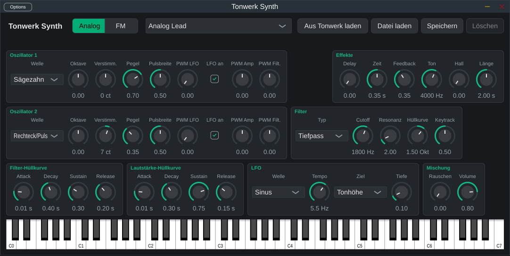
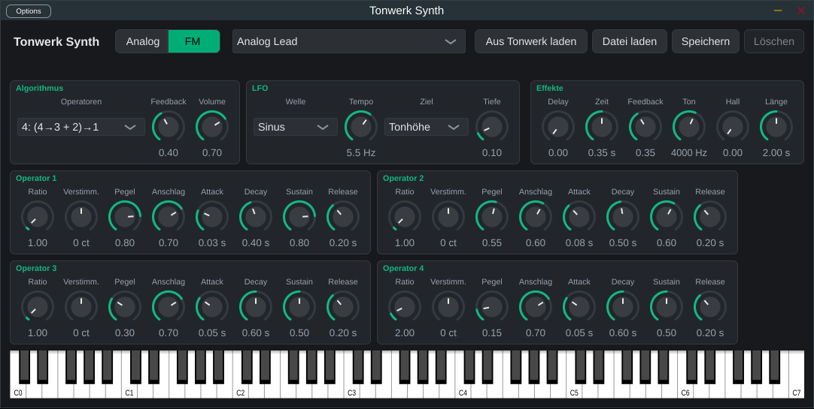

## Zwei Plugins statt einem

Bis 0.3.0 waren beide Engines ein Plugin, **Tonwerk Synth**, mit einem Umschalter oben. Jetzt ist jede Engine ein eigenes Instrument: **Tonwerk Analog** (`aumu TwAn Bvlp`) und **Tonwerk FM** (`aumu TwFm Bvlp`). Jedes hat nur seine eigenen Regler (Logic zeigt bei der Automation also keine fremden mehr) und seine eigenen Werksklänge (siehe [Werksklänge](#werksklänge)).

Die aus Tonwerk oder Dateien übernommenen Klänge teilen sich beide Plugins (dieselbe `presets.json`); jedes zeigt im Menü nur die seiner Engine. Lädst du in Tonwerk Analog eine Datei mit FM-Klängen, landen sie im Menü von Tonwerk FM.

**Alte Projekte:** Tonwerk Synth bleibt installiert und lädt seine Projekte wie bisher, mit beiden Engines und den acht alten Werksklängen auf denselben Programmnummern (die neuen hängen dahinter). Es hat ebenfalls die neue Oberfläche. Für neue Spuren nimmst du Tonwerk Analog oder Tonwerk FM. Eine alte Spur ziehst du um, indem du in Tonwerk Synth **Speichern** drückst und die Datei im neuen Plugin mit **Datei laden** öffnest.

**Oberfläche:** alle Tonwerk-Plugins sehen jetzt aus wie Tonwerk Wavetable: fast schwarz, Gelb, Cyan und Rot im Neon-Look, Paneele mit abgeschnittener Ecke, Bildschirme mit Scanlines. Jede Hüllkurve zeigt ihre Form, Tonwerk FM zeichnet den gewählten Algorithmus (Träger gelb, Modulatoren cyan, die Rückkopplung an Operator 4) und schreibt über jede Operator-Hüllkurve, was der Operator gerade tut („TRÄGER“, „MOD → 1“). Werte stehen als ganze Zahlen mit Einheit da: Zeiten in ms, Pegel und Mengen in %, die Filter-Hüllkurve in Halbtönen (HT), langsame LFO-Raten mit einer Nachkommastelle.

## Was drin ist

**Analog**: zwei Oszillatoren (Sinus, Dreieck, Sägezahn, Rechteck/Puls) mit Oktave, Verstimmung und Pegel, Rauschen, Filter (Tiefpass, Hochpass, Bandpass) mit Resonanz, Keytracking und eigener Hüllkurve, Lautstärke-Hüllkurve, LFO auf Tonhöhe, Filter oder Lautstärke, frei oder im Songtempo. Der Puls hat eine Pulsbreite, die der LFO und beide Hüllkurven bewegen können (PWM).

**Wavefolder und Sample & Hold** gibt es nur im Plugin, nicht in Tonwerk. Der Wavefolder sitzt zwischen Oszillatoren und Filter. **Menge** treibt die Mischung bis zum Achtfachen und faltet alles über dem Vollpegel zurück, statt es abzuschneiden. **Symmetrie** verschiebt das Signal vor dem Falten, das bringt geradzahlige Obertöne. Mit **Hüllkurve** öffnet und schließt die Filter-Hüllkurve den Wavefolder. Sample & Hold nimmt in jedem Schritt einen neuen Zufallswert und hält ihn bis zum nächsten. **Filter** verschiebt damit den Cutoff um bis zu zwei Oktaven nach oben oder unten, **Tonhöhe** den Ton um bis zu eine Oktave. Das Tempo ist frei oder im Songtempo, und jede Note würfelt ihre eigene Folge. Beide stehen auf 0, solange du sie nicht aufdrehst, und Klänge aus Tonwerk laden mit beiden aus.

**FM**: vier Sinus-Operatoren in acht Algorithmen wie bei den 4-Operator-FM-Synths der Achtziger, Feedback auf Operator 4, eine Hüllkurve pro Operator, Anschlagsdynamik pro Operator, LFO auf Tonhöhe, Modulationsindex oder Lautstärke, frei oder im Songtempo.

**Effekte**: Delay mit Tiefpass in der Rückkopplung und Hall, beide als Send. Das Delay läuft frei oder im Songtempo.

**Tempo-Sync**: Mit **Sync** folgen LFO, Sample & Hold und Delay dem Tempo von Logic. Statt Hz oder Sekunden wählst du einen Notenwert von 4/1 bis 1/32, auch punktiert und triolisch. Ohne Host-Tempo (in der App) gelten 120 BPM. Der LFO beginnt wie in Tonwerk mit jeder Note neu. Er läuft also im Tempo, aber nicht auf den Schlag genau.

**Oszilloskop**: unten rechts neben der Tastatur, in beiden Plugins. Es zeigt die Wellenform dessen, was das Plugin gerade spielt, und steht bei einem gehaltenen Ton still.

16 Stimmen, Pitchbend ±2 Halbtöne, Sustain-Pedal. Jeder Regler ist ein Parameter, den Logic automatisieren kann und mit dem Projekt speichert. Jeder Drehregler lernt per Rechtsklick einen MIDI-Controller, etwa von [Tonwerk LFO](#tonwerk-lfo-midi-effekt-und-midi-lernen). Eine Tastatur unten im Fenster spielt das Plugin auch ohne MIDI-Keyboard an.

## Chrome Glitch (Effekt)

Ein Audio-Effekt aus demselben Repository, für eine Gesangsspur, deren „Sprach-Chrome“ versagt: Silben stottern („bo-bo-body“), die Stimme setzt kurz aus, wird digital zerbröselt und springt in der Tonhöhe. Er liegt in Logic unter **Audio-FX → Audio Units → b-velop → Chrome Glitch** und wird mit Tonwerk Synth zusammen gebaut, installiert und veröffentlicht.

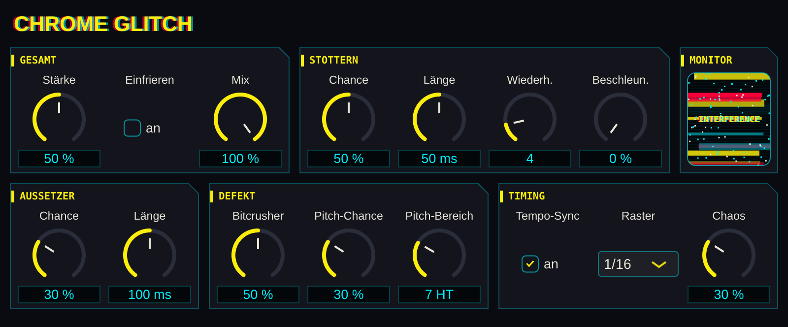

Oben rechts sitzt ein kleiner **Monitor**: Solange die Stimme sauber ist, zeigt er „CHROME OK“. Bei jedem Glitch flimmert er mit zerrissenen Balken und Rauschen und zeigt „INTERFERENCE“ (Stottern), „NO SIGNAL“ (Aussetzer) oder „FROZEN“ (Einfrieren). Die Texte im Monitor sind bewusst englisch, wie die Anzeigen im Spiel. Auch Glitches, die kürzer als ein Bild sind, lassen ihn aufflackern.

Der Effekt arbeitet ohne Latenz auf dem, was gerade hereinkommt. An jedem Schritt des Rasters (im Songtempo) oder zu zufälligen Momenten (40–250 ms auseinander) würfelt er, ob etwas passiert:

- **Stottern**: Die letzten 10–200 ms (Standard 50 ms) werden mehrmals wiederholt. **Beschleunigen** macht jede Wiederholung kürzer, so wird die Silbe immer schneller. Ab der zweiten Wiederholung kann die Tonhöhe springen (**Pitch-Chance**, **Pitch-Bereich** bis ±24 Halbtöne).
- **Aussetzer**: Die Stimme fällt 20–300 ms ganz weg.
- **Bitcrusher**: Bei jedem Glitch voll (bis 4 Bit und 16-faches Downsampling), dazwischen nur leicht, mit der Stärke wachsend.
- **Einfrieren**: Hält die letzte Silbe in einer Schleife fest, solange es an ist. Für das letzte Wort, das hängen bleibt.
- **Tempo-Sync** und **Raster** (1/8, 1/16, 1/32) legen die Glitches aufs Raster. **Chaos** streut zusätzlich Glitches zwischen die Rasterpunkte und lässt die Stotterlänge schwanken, damit es nicht wie ein sauberer Stutter-Effekt klingt.
- **Glitch-Stärke** ist das Makro für die Automation: Auf 0 geht die Stimme unverändert durch, nach oben werden alle Chancen und der Crusher stärker. Für den letzten Chorus also die Stärke über die vier Zeilen hochziehen und am Ende **Einfrieren** einschalten. Die absolute Stille danach entsteht am einfachsten mit einem Schnitt in der Region.

Alle Übergänge werden über 1,5 ms überblendet, es knackt also nur, wo es soll.

**Seed** (0–999) macht die Glitches wiederholbar: Während Logic spielt, wird an jedem Schlag neu gewürfelt, aus dem Seed und der Nummer des Schlags. Ein Glitch gehört damit zu seiner Stelle im Song. Mit demselben Seed klingt der Chorus gleich, egal ob die Wiedergabe dort startet, am Anfang oder ob der ganze Song gebounct wird (ab dem ersten vollen Schlag nach dem Start; ein Stotterer braucht etwa 200 ms Vorlauf, weil er wiederholt, was davor lief). Passt eine Stelle nicht, gibt ein anderer Seed eine andere, wieder feste Folge. Der Seed lässt sich automatisieren, etwa ein Wert für den Chorus und ein anderer für die Bridge. Ohne laufenden Transport bleibt es zufällig.

**Presets** (Logics Programme, oben rechts im Menü und mit den Pfeilen): 13 Einstellungen in vier Gruppen, von **Dezent** (Leichtes Flackern, Wackelkontakt, Funkloch) über **Rhythmisch** (Achtel-Stotter, Sechzehntel-Roll, Stotter-Rampe, Zerhacker) und **Zerstört** (Kernschmelze, Cyberpsychose, Systemabsturz) bis **Klangeffekte** (Roboterstimme, Tonhöhen-Sprünge, Geisterecho mit 50 % Mix). Ein Preset setzt alle Regler, die es nicht nennt, auf ihren Standard zurück; Einfrieren und Seed bleiben also aus bzw. auf 0. Im Test bringt jedes auf einer Stimme in vier Takten Glitches, wird nicht lauter als die Stimme und höchstens 3 dB leiser (Aussetzer nehmen etwas weg).

**Getestet und ungetestet:** Unter Linux gebaut und getestet (Durchreichen bei Stärke 0, Stotterperiode, klickfreie Aussetzer und Tonhöhensprünge, Raster im Sync, Einfrieren, Crusher, Seed und Songposition, Zustand, Presets). `auval` für den Effekt läuft in der GitHub Action. In Logic ist er noch nicht gehört, die Presets nur auf einer künstlichen Stimme aus dem Test.

## Tonwerk Distortion (Effekt)

Der dritte Baustein aus diesem Repository: die Schaltung eines klassischen Verzerrer-Pedals, Stufe für Stufe nachgerechnet. Er liegt in Logic unter **Audio-FX → Audio Units → b-velop → Tonwerk Distortion** und wird mit den anderen beiden gebaut, installiert und veröffentlicht.

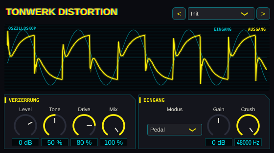

Oben zeigt ein Oszilloskop den Ausgang (gelb) über dem Eingang (cyan); so siehst du, wie Dist die Welle eckig macht. Die Regler sind die des Pedals, in derselben Reihenfolge:

- **Level**: die Lautstärke danach, −30 bis +12 dB. Bei 0 dB liegt eine voll verzerrte Note bei Tone in der Mitte um −6 dBFS.
- **Tone**: 0 % dunkel, 100 % hell. In der Mitte entsteht die typische Delle um 500 Hz (etwa 8 dB unter Bässen und Höhen), die das Pedal nach „Wand“ klingen lässt.
- **Dist**: 0 bis 100 %, wie das 100-kΩ-Poti im Pedal (Verstärkung der Op-Amp-Stufe 1- bis 22-fach). Auch auf 0 % zerrt das Pedal schon etwas, das macht der Transistor-Booster davor.
- **Eingang** gibt es am Pedal nicht: −24 bis +24 dB vor der Schaltung. Gerechnet wird mit 1,0 im Host = 1 V an der Eingangsbuchse, also etwa einer kräftig angeschlagenen Gitarre. Eine leise aufgenommene Gitarre oder ein Synth verzerrt mit mehr Eingang so, wie man es vom Pedal kennt.
- **Mix** gibt es am Pedal auch nicht: 0 % ist das trockene Signal, 100 % (Voreinstellung) nur die Verzerrung. Dazwischen liegt die Verzerrung unter dem Original, wie bei paralleler Verzerrung auf einem Bus: Anschlag und Bass bleiben, der Dreck kommt dazu. Das trockene Signal läuft durch dieselbe Überabtastung wie das verzerrte, damit beide genau gleich verzögert sind und sich nicht kammfiltern (im Test höchstens 0,2 dB Abweichung von 60 Hz bis 15 kHz).
- **Modus**: *Pedal* ist die Schaltung unten. Dazu kommen Kurven für elektronische Musik, jede mit Drive bis zu ihrer eigenen Höchstverstärkung und Tone als ±6-dB-Kippfilter um 700 Hz: *Röhre* (weich, geradzahlige Obertöne), *Clipper* (hartes Abschneiden für Kick und Drumbus), *Falter* (Sinus-Wavefolder, mehr Drive gibt mehr Falten) und *Gleichrichter* (Oktav-Fuzz). *Bitcrusher* rechnet wie ein alter Sampler: **Drive** nimmt die Bits von 16 (0 %) über etwa 6 (50 %) bis 2 (100 %) weg, leise Stellen werden zu Körnern und verstummen; **Crush** setzt die Samplerate von 48000 Hz (aus) bis 500 Hz herunter, die Spiegelfrequenzen klingeln dann metallisch mit. Der Bitcrusher macht nicht lauter, sein Pegel folgt dem Eingang. Ein Moduswechsel blendet über 20 ms über.

Was nachgebildet ist: Transistor-Booster (35 dB, Hochpass 33 Hz, weich in die Versorgung), Op-Amp-Stufe mit Dist-Poti, 72-Hz-Bassbeschnitt über C8 und 100 pF gegen das Zischeln, Rails eines 9-V-Single-Supply-Op-Amps (asymmetrisch, das gibt geradzahlige Obertöne), dann der Tiefpass 7,2 kHz und die zwei 1N4148 gegen Masse, aus der Shockley-Gleichung als Tabelle. Das ist das harte Clipping um ±0,6 V, das diesen Verzerrer von weicheren Overdrive-Pedalen unterscheidet. Danach die Tone-Blende aus Tiefpass 234 Hz und Hochpass 1063 Hz. Die Bauteilwerte stammen aus einer veröffentlichten Analyse der Originalschaltung. Weggelassen ist die Slew-Rate des Op-Amps: Der 7,2-kHz-Tiefpass verdeckt sie, und digital kostet sie mehr Aliasing, als sie bringt.

**CPU:** Die verzerrenden Stufen laufen vierfach überabgetastet, die Clipper zusätzlich mit Antiderivative-Antialiasing; was zurückfaltet, bleibt selbst bei einer 2,5-kHz-Note mit voller Verzerrung mehr als 60 dB unter dem Ton. Tone und Level laufen auf der normalen Rate. Stereo rechnet das Plugin im Test etwa 50-mal schneller als Echtzeit (rund 2 % eines Kerns), auf einer Mono-Spur nur einen Kanal, also die Hälfte. Die Überabtastung bringt eine Latenz von wenigen Samples, die das Plugin Logic meldet.

**Presets** (oben rechts im Menü und mit den Pfeilen): 32 Einstellungen, nach der Quelle sortiert. **Gitarre**: Leicht angezerrt, Crunch, Rock-Rhythmus, Blues-Solo, Solo-Lead, Metal, Fuzz-Wand, Crunch-Blend (halb trocken). **Bass**: Bass-Knurren, Bass-Fuzz (Tone dunkel, sonst bleibt vom Bass wenig übrig), Röhren-Bass, Falter-Bass, Gleichrichter-Bass, Bit-Bass, Parallel-Bass. **Synths**: Synth-Wärme, Acid-Biss, Lo-Fi-Lead, Röhren-Wärme, West-Coast-Falter, Oktav-Fuzz, 8-Bit-Konsole. **Drums**: Drum-Dreck, Zertrümmert, Kick-Clipper, Hart geclippt, Sampler-Grain (12 Bit, 26 kHz), Lo-Fi-Beat, Parallel-Drums. **Gesang**: Megafon, Schrei, Funkgerät. Jedes Preset ist so eingepegelt, dass es etwa so laut ist wie die Spur ohne Effekt, wenn sie mit Spitzen um −6 dBFS aufgenommen ist (im Test höchstens 2 dB daneben, gemessen nach EBU R128). Ein- und Ausschalten springt dann kaum in der Lautstärke. Ist deine Spur deutlich leiser oder lauter, passt du den Eingang an.

**Getestet und ungetestet:** Unter Linux gebaut und getestet (Diodenkennlinie, Tone-Delle, Obertöne mit Dist, Pegel, Aliasing, Stille nach dem Ton, Mono und Stereo, Zustand, Anzeige in ganzen Zahlen, Pegel der Presets; Bitcrusher: Stufen, Spiegelfrequenzen, Pegel; Mix: trocken unverzerrt, halb und halb ohne Kammfilter) und die Oberfläche dort angesehen. Bitcrusher und Mix sind in Logic noch nicht gehört. Die Presets sind auf künstlichen Testsignalen (gezupfte Saiten, Sägezahn, Drumloop, Vokale) eingestellt, nicht auf echten Aufnahmen. `auval` läuft in der GitHub Action. In Logic ist er noch nicht gehört, und ob er wie das Pedal in deinem Kopf klingt, entscheiden die Ohren.

## Tonwerk Wavetable (Instrument)

Ein Wavetable-Synthesizer für Dubstep-Bässe (Wobble, Growl, Reese, Riddim), Screeches, Laser und breite Leads. Alles ist eigener Code, auch die Wavetables: Sie werden beim Laden aus Formeln berechnet, nichts ist aus einem anderen Synth kopiert. Er liegt in Logic unter **Instrument → AU-Instrumente → b-velop → Tonwerk Wavetable** und wird mit den anderen Plugins gebaut, installiert und veröffentlicht.

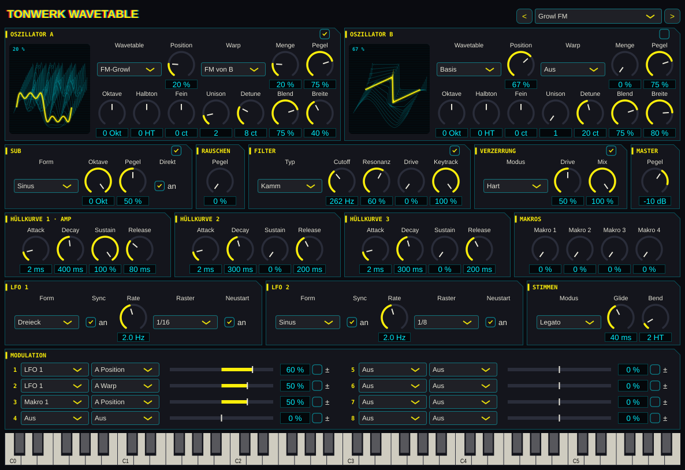

- **Zwei Wavetable-Oszillatoren (A und B)** mit je 64 Frames. **Position** fährt durch die Frames, die Anzeige links zeigt die Tabelle als gestapelte Frames und folgt beim Spielen der modulierten Position. Die Tabellen: *Basis* (Sinus → Dreieck → Säge → Rechteck), *Sync*, *PWM*, *Vokal* (Formanten a-e-i-o-u, der „Yoi“-Growl), *FM-Growl*, *Falter*, *Harmonisch*, *Kamm*, *Bitcrush*, *Rauh*.
- **Warp** verbiegt die Phase vor dem Lesen: *Sync*, *Bend*, *PWM* und *FM* (A von B, B von A). Für FM muss der andere Oszillator nicht hörbar sein, er läuft als Modulator auch ausgeschaltet mit.
- **Unison** bis 8 Stimmen pro Oszillator mit **Detune** (Cent zwischen den äußeren Stimmen), **Blend** (wie laut die äußeren Stimmen sind) und **Breite** im Stereobild. Der Pegel bleibt beim Hinzufügen von Stimmen gleich.
- **Sub** (Sinus, Dreieck, Säge, Rechteck, 0 bis −3 Oktaven) und **Rauschen**. Sub *Direkt* führt den Sub am Filter vorbei, damit das Fundament sauber bleibt, während der Filter wobbelt.
- **Filter**: Tiefpass 12 und 24 dB, Hochpass, Bandpass, Kerbfilter und **Kamm** (auf die Cutoff-Frequenz gestimmt, mit Keytracking 100 % auf die Note: metallische Growls). **Drive** sättigt vor dem Filter.
- **Drei Hüllkurven** (1 ist die Lautstärke) und **zwei LFOs** (Sinus, Dreieck, Säge ab/auf, Rechteck, Zufall). Mit **Sync** läuft ein LFO im Raster des Songtempos, von 4/1 bis 1/32 mit punktierten und Triolen. Mit **Neustart** beginnt er bei jeder Note von vorn (der klassische Wobble beim Spielen); ohne läuft er durch und rastet, solange Logic spielt, auf die Songposition ein, sodass der Wobble immer auf dem Beat liegt.
- **Modulation**: acht Zeilen aus Quelle, Ziel und Menge (−100 bis 100 %). Quellen: LFOs, Hüllkurven, Anschlag, Modrad, Aftertouch, Tonhöhe und **vier Makros** (gut zum Automatisieren in Logic). Ziele: Position, Warp, Tonhöhe (100 % = 24 Halbtöne), Pegel und Detune beider Oszillatoren, Sub, Rauschen, Cutoff (100 % = 10 Oktaven), Resonanz, Filter-Drive, Lautstärke. **±** lässt die Quelle um die Mitte schwingen statt nur nach oben, etwa für Vibrato.
- **Stimmen**: Poly (8 Stimmen), Mono oder Legato, **Glide** (in Mono immer, in Legato nur bei überlappend gespielten Noten), Pitchbend-Bereich.
- **Verzerrung** nach den Stimmen (Weich, Hart, Falten, Röhre), zweifach überabgetastet, mit Drive und Mix, dann **Master**.

**Presets** (Logics Programme, oben rechts im Menü und mit den Pfeilen): 33 Klänge von Wobble, Growl und Neuro über Leads und Flächen bis Riser und Downlifter, die Liste steht unter [Werksklänge](#werksklänge). Bei den Bässen öffnet **Makro 1** den Filter oder treibt den Growl weiter, das ist der Regler für Automation im Drop. Die Bässe sind auf Legato gestellt und sind gleich laut, mit Spitzen zwischen etwa −10 und −4 dBFS, Platz für einen Kompressor in Logic.

**CPU:** Die Modulation rechnet alle 32 Samples, Positionen, Pegel und Filterkoeffizienten gleiten dazwischen, damit nichts stuft. Jede Wavetable liegt in einer Kopie pro Oktave vor, die nur die Obertöne unter Nyquist enthält; eine Säge auf C7 hat deshalb kein Aliasing (im Test über 100 dB darunter). Acht Akkordstimmen *Supersaw* (7 + 5 Unison) mit Verzerrung rechnet der Test etwa 13-mal schneller als Echtzeit.

**Getestet und ungetestet:** Unter Linux gebaut und getestet (Tabellen, Aliasing, Unison-Pegel und Stereobreite, Filter, Hüllkurven, Glide, Matrix, Wobble im Takt, LFO auf der Songposition, alle Warp- und Filterarten, alle Presets, CPU, Zustand, Anzeige mit Einheiten). `auval` läuft in der GitHub Action. In Logic ist er noch nicht gehört; ob die Presets nach Dubstep klingen, entscheiden deine Ohren.

## Tonwerk DX (Instrument)

FM mit sechs Operatoren und 32 Algorithmen nach dem Vorbild der klassischen 6-Operator-Synths, für E-Pianos, Glocken, Blech und Bässe aus den Achtzigern. Tonwerk FM bleibt bei vier Operatoren, damit seine Klänge eins zu eins zu Tonwerk im Browser passen; Tonwerk DX ist ein eigenes Instrument (`aumu TwDx Bvlp`) unter **Instrument → AU-Instrumente → b-velop → Tonwerk DX**.

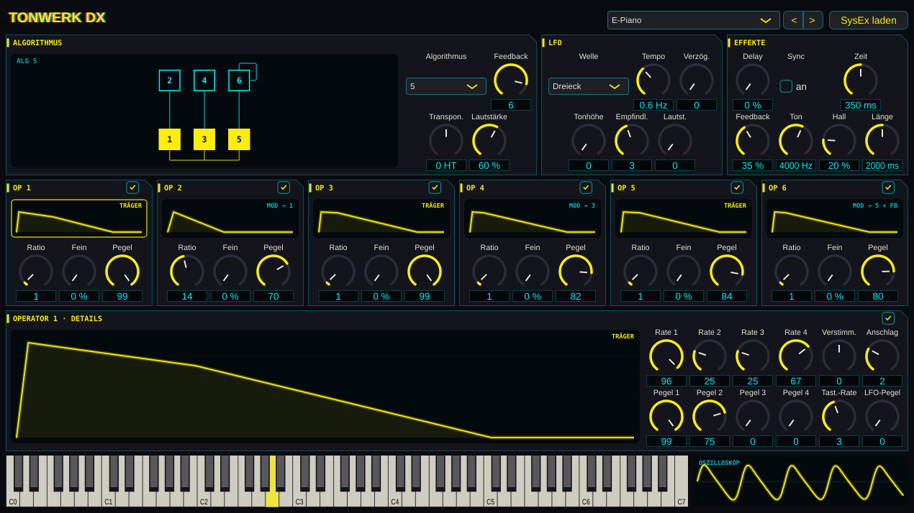

- **Algorithmus** (1 bis 32) als Diagramm gezeichnet, wie es auf solchen Geräten aufgedruckt ist: Träger gelb, Modulatoren cyan, die Rückkopplungsschleife am Operator mit **Feedback** (0 bis 7). Dazu **Transponieren** in Halbtönen und **Lautstärke**.
- **Sechs Operatoren**, oben jeweils klein mit Hüllkurve, **Ratio** (0,5 und 1 bis 31), **Fein** (plus 0 bis 99 % der Ratio), **Pegel** (0 bis 99, ein Schritt etwa 0,75 dB) und einem Schalter. Über jeder Hüllkurve steht, was der Operator im gewählten Algorithmus tut („TRÄGER“, „MOD → 1“). Ein Klick auf eine Hüllkurve öffnet den Operator unten im Detail.
- **Hüllkurven mit vier Raten und Pegeln**: vier Raten und vier Pegel. Pegel 1 bis 3 werden nacheinander angefahren, auf Pegel 3 bleibt die Note, solange die Taste gedrückt ist, Rate 4 führt nach dem Loslassen zu Pegel 4. Die Kurven laufen in Pegelschritten, also in Dezibel, wie beim Original. Dazu je Operator **Verstimmung** (−7 bis 7), **Anschlag** (0 bis 7, wie viel ein leiser Anschlag wegnimmt), **Tastatur-Rate** (hohe Töne verklingen schneller) und **LFO-Pegel** (wie stark das Tremolo diesen Operator trifft).
- **LFO** mit Dreieck, Sägezahn ab und auf, Rechteck, Sinus und S&H, **Tempo** wie bei den Originalen (35 ist ein Vibrato von etwa 5,6 Hz, 63 etwa 10 Hz, 99 etwa 49 Hz), **Verzögerung** (blendet nach dem Anschlag ein), **Tonhöhe** mit **Empfindlichkeit** (bis eine Oktave) und **Lautstärke**.
- **Effekte**: Delay (frei oder im Songtempo) und Hall wie in den anderen Tonwerk-Synths. 16 Stimmen, Pitchbend ±2 Halbtöne.

**Werksklänge** (eigene, keine Kopien aus Werks-ROMs): eine volle Bank mit 32 Klängen, von E-Piano, Bässen und Glocken über Blech, Holzbläser und Streicher bis Chor und Koto, die Liste steht unter [Werksklänge](#werksklänge). Mit **<** und **>** blätterst du durch das Menü.

**SysEx laden:** SysEx-Bänke klassischer 6-Operator-Synths, die du hast (`.syx` mit 32 Klängen im üblichen 4096-Byte-Format, auch ohne SysEx-Rahmen, oder ein einzelner Klang), lädt **SysEx laden**. Die Datei wird nach `~/Library/Application Support/Tonwerk DX/SysEx` kopiert und steht danach in jeder Instanz als eigene Gruppe im Menü. Was das Plugin nicht hat, fällt weg: die Tonhöhen-Hüllkurve, die Pegelskalierung über die Tastatur und Operatoren mit fester Frequenz (die bekommen die Ratio, die ihrer Frequenz am mittleren C am nächsten kommt). Klänge, die stark davon leben, klingen deshalb anders als am Original.

**CPU:** Hüllkurven und LFO rechnen alle 32 Samples, die Pegel gleiten dazwischen; der Sinus kommt aus einer Tabelle. 16 Stimmen *Blech* mit Delay und Hall rechnet der Test etwa 16-mal schneller als Echtzeit.

**Getestet und ungetestet:** Unter Linux gebaut und getestet (alle 32 Algorithmen, Hüllkurvenzeiten, Pegelschritte, Ratios, Anschlag, LFO und sein Tempo gegen Messungen an den Originalen, SysEx-Bänke und Einzelklänge, jeder Werksklang klingt und übersteuert auch im Akkord nicht, Zustand, CPU) und die Oberfläche als Bild angesehen. `auval` läuft in der GitHub Action. In Logic ist er noch nicht gehört; wie nah die Werksklänge an den Klassikern sind, entscheiden die Ohren.

## Tonwerk Granular (Instrument)

Ein Granular-Synthesizer: Er schneidet aus einem Klang viele kurze Körner (5 ms bis 1 s) und spielt sie überlappend, verschoben, umgedreht und im Stereobild verteilt wieder ab. Daraus werden Flächen, Wolken, Texturen und eingefrorene Momente. Er liegt unter **Instrument → AU-Instrumente → b-velop → Tonwerk Granular** (`aumu TwGr Bvlp`) und wird mit den anderen Plugins gebaut, installiert und veröffentlicht.

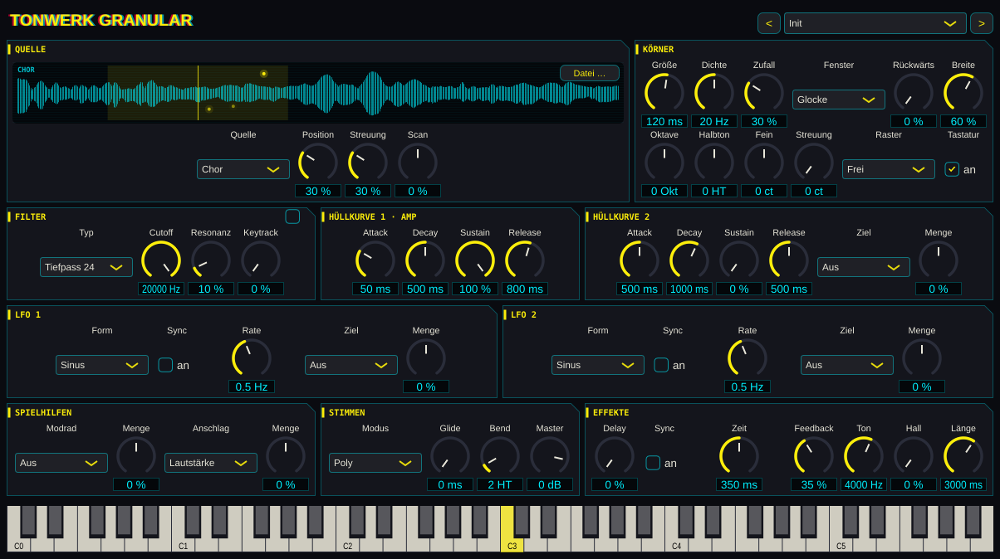

- **Quelle**: neun eigene Klänge, beim Laden aus Formeln berechnet, nichts aufgenommen oder kopiert: *Chor* (gesungenes a-e-i-o-u), *Glas* (angeschlagen), *Streicher*, *Zupfen* (Karplus-Strong), *Orgel*, *Wind*, *Metall* (FM), *Sinus* und *Rhythmus* (zwei Takte Kick, Hats und Stabs). Dazu **Eigene Datei**: **Datei …** oder eine Audiodatei auf die Anzeige ziehen (WAV, AIFF, FLAC, MP3 und was macOS sonst liest; die ersten 30 Sekunden, zu Mono gemischt). Der Pfad wird im Projekt gespeichert und beim Öffnen neu gelesen, die Datei selbst nicht; wer sie verschiebt, lädt sie neu. Alle Quellen sind auf C4 gestimmt, C4 spielt eine Datei so, wie sie ist.
- **Anzeige**: die Quelle als Wellenform, gelb der Bereich, aus dem die Körner kommen, und die Körner der neuesten Note als Funken, die beim Spielen wandern.
- **Position** (wo in der Quelle), **Streuung** (wie weit darum herum, 100 % ist überall) und **Scan** (wie schnell die Position beim Halten weiterläuft, 100 % ist das Tempo der Quelle, negativ rückwärts, 0 friert ein).
- **Körner**: **Größe** (5 bis 1000 ms), **Dichte** (1 bis 200 Körner pro Sekunde), **Zufall** (wie unregelmäßig sie kommen), **Fenster** (*Glocke* weich, *Flach* mit kurzen Blenden, *Schlag* mit hartem Anfang), **Rückwärts** (Anteil umgedrehter Körner) und **Breite** im Stereobild. Der Pegel bleibt gleich, ob zwei Körner gleichzeitig klingen oder vierzig.
- **Tonhöhe**: Oktave, Halbton, Fein, **Streuung** in Cent (bis zwei Oktaven) mit **Raster** *Frei*, *Oktaven* oder *Quinten* (Quinten und Oktaven geben den schimmernden Shimmer-Klang), **Tastatur** aus spielt jede Taste in der Tonhöhe der Quelle.
- **Filter** (Tiefpass 12 und 24 dB, Hochpass, Bandpass) mit Resonanz und Keytracking; ein Bandpass mit hoher Resonanz und Keytracking 100 % macht aus *Wind* einen gestimmten Klang.
- **Hüllkurve 1** (Lautstärke), **Hüllkurve 2**, **zwei LFOs** (frei oder im Songtempo, dann auf der Songposition eingerastet), **Modrad** und **Anschlag**, jede mit einem **Ziel** (Position, Streuung, Korngröße, Dichte, Tonhöhe, Cutoff, Resonanz, Breite, Lautstärke) und einer **Menge** von −100 bis 100 %. Die LFOs schwingen um die Einstellung herum. Beim Anschlag nimmt eine positive Menge bei leisem Spiel weg (Standard: Lautstärke 50 %).
- **Stimmen**: Poly (8 Stimmen) oder Mono mit **Glide**, Pitchbend-Bereich, **Master**. Danach **Delay** und **Hall** wie in den anderen Tonwerk-Synths, hier in Stereo.

**Presets**: 26 eigene Klänge, die Liste steht unter [Werksklänge](#werksklänge). Hörproben aller Klänge mit ihrer Testphrase liegen im Projektordner unter `synth/hoerproben/Tonwerk Granular`.

**CPU:** Jede Stimme spielt höchstens 40 Körner gleichzeitig; die Modulation rechnet alle 32 Samples. Wird ein Korn schneller als die Quelle gelesen, nimmt es eine vorher gefilterte Kopie mit halber, viertel, ... Rate, damit hoch gespielte Körner nicht aliasen. Acht Stimmen mit je 40 Körnern, Filter und Hall rechnet der Test etwa 6- bis 9-mal schneller als Echtzeit; die Werksklänge brauchen viel weniger Körner.

**Getestet und ungetestet:** Unter Linux gebaut und getestet (Quellen und ihr Pegel, Kopien ohne Aliasing, Tonhöhe und Oktave, Tastatur aus, Oktav-Raster, gleicher Pegel bei wenigen und vielen Körnern, Position, Streuung und Scan, Hüllkurve, Vibrato, alle Quellen, Fenster und Filter ohne Ausreißer, eigene Datei samt Speichern und Laden, alle Presets und ihre Lautheit, CPU, Zustand, Anzeige mit Einheiten) und die Oberfläche als Bild angesehen. `auval` läuft in der GitHub Action. In Logic ist er noch nicht gehört, Laden per Dateidialog und Ziehen auf die Anzeige nur auf Linux gebaut, nicht am Mac ausprobiert.

## Tonwerk Physical (Instrument)

Physical Modeling: Statt Wellenformen abzuspielen, rechnet das Plugin nach, wie ein Instrument schwingt. Ein **Erreger** (Zupfen, Schlagen, Streichen, Blasen) bringt einen **Resonator** (Saite, Rohr, Stab, Glocke, Fell, Schale) zum Klingen, danach färbt ein **Korpus** den Klang. Weil der Klang aus dem Zusammenspiel entsteht, klingt jeder Anschlag ein wenig anders, und Bogen und Atem halten den Ton, solange die Taste gedrückt ist. Er liegt unter **Instrument → AU-Instrumente → b-velop → Tonwerk Physical** (`aumu TwPh Bvlp`) und wird mit den anderen Plugins gebaut, installiert und veröffentlicht.

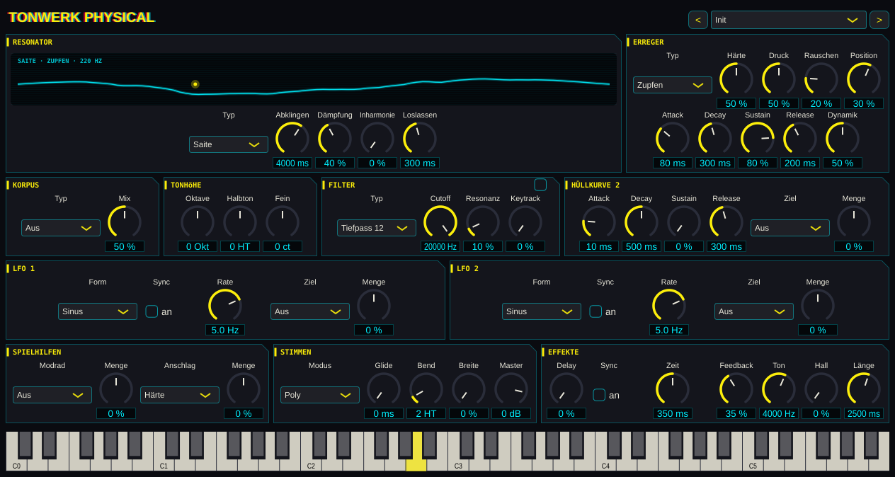

- **Anzeige**: Saite und Rohr als die Welle, die gerade auf ihnen läuft, gelb die Stelle, an der gezupft, geschlagen oder gestrichen wird; Stab, Glocke, Fell und Schale als ihre Resonanzen, je ein Balken bei ihrem Verhältnis zum Grundton, so hoch, wie sie noch klingen.
- **Erreger**: **Zupfen** (ein kurzer Stoß über eine Schwingungsperiode, wie beim Karplus-Strong-Verfahren), **Schlagen** (Hammer oder Schlägel, je härter, desto kürzer und heller), **Streichen** (ein Bogen mit Haft- und Gleitreibung, die Saite schwingt von selbst, solange die Taste gehalten wird) und **Blasen** (am geschlossenen Rohr ein Rohrblatt, das selbst schwingt; sonst ein Luftstrom). Dazu **Härte**, **Druck** (Bogendruck oder Atem), **Rauschen** (Anteil von Kratzen und Luft) und **Position** (wo, 50 % ist die Mitte: eine Saite in der Mitte gezupft verliert ihre geraden Obertöne, am Rand wird sie dünn und hell). Eine eigene Hüllkurve führt Bogen und Atem.
- **Resonator**: **Saite**, **Rohr geschlossen** (nur ungerade Obertöne, der hohle Klang der Klarinette), **Rohr offen** (alle Obertöne, wie eine Flöte), **Stab** (Obertöne beim 4- und 10-fachen, wie ein gestimmter Marimbastab), **Glocke** (mit dem Summton eine Oktave unter dem Schlagton und der kleinen Terz), **Fell** (die unharmonischen Töne einer Trommel) und **Schale** (Klangschale, je zwei eng benachbarte Töne, die schweben). **Abklingen** (wie lange ein Ton klingt, bis 20 s), **Dämpfung** (wie viel schneller die hohen Obertöne verklingen), **Inharmonie** (bei der Saite die Steifheit, die ihre Obertöne nach oben streckt wie bei einem Klavier; bei den anderen streckt sie die Resonanzen) und **Loslassen** (wie schnell der Ton nach dem Loslassen gedämpft wird).
- **Korpus**: *Gitarre*, *Geige*, *Kiste* oder *Resonanzboden*, mit **Mix**.
- **Tonhöhe**, **Filter** (Tiefpass 12 und 24 dB, Hochpass, Bandpass) mit Resonanz und Keytracking, **Hüllkurve 2**, **zwei LFOs** (frei oder im Songtempo), **Modrad** und **Anschlag**, jede mit einem **Ziel** (Tonhöhe, Druck, Härte, Position, Abklingen, Dämpfung, Cutoff, Resonanz, Lautstärke) und einer **Menge**. **Dynamik** sagt, wie viel leiser ein leiser Anschlag ist (bis 20 dB).
- **Stimmen**: Poly (12 Stimmen) oder Mono mit **Glide**, Pitchbend-Bereich, **Breite** (tiefe Töne links, hohe rechts, wie an einem Flügel), **Master**. Danach **Delay** und **Hall** wie in den anderen Tonwerk-Synths. Dieselbe Taste noch einmal regt die klingende Saite neu an, wie bei einem echten Instrument.

**Presets**: 35 eigene Klänge, die Liste steht unter [Werksklänge](#werksklänge). Hörproben aller Klänge mit ihrer Testphrase liegen im Projektordner unter `synth/hoerproben/Tonwerk Physical`.

**CPU:** Saite und Rohre sind Verzögerungsleitungen (eine Schleife pro Stimme), Stab, Glocke, Fell und Schale höchstens 16 Resonatoren pro Stimme; die Modulation rechnet alle 32 Samples. Zwölf Stimmen gestrichener Saiten oder Schalen mit Filter, Korpus und Hall rechnet der Test etwa 17- bis 20-mal schneller als Echtzeit.

**Getestet und ungetestet:** Unter Linux gebaut und getestet (Stimmung über die ganze Tastatur, gestrichene Saite und Rohrblatt schwingen von selbst und hören beim Loslassen auf, ungerade Obertöne im geschlossenen Rohr, fehlende gerade Obertöne bei Anschlag in der Mitte, Abklingzeit, gestreckte Obertöne bei Inharmonie, Obertöne von Stab und Glocke, Härte, Vibrato, jeder Erreger auf jedem Resonator auch an den Extremen ohne Ausreißer, Stimmenklau ohne Knacken, Korpus, alle Presets und ihre Lautheit, CPU, Zustand, Anzeige mit Einheiten) und die Oberfläche als Bild angesehen. `auval` läuft in der GitHub Action. In Logic ist er noch nicht gehört; ob Geige und Klarinette nach Geige und Klarinette klingen, entscheiden die Ohren.

## Tonwerk Additiv (Instrument)

Additive Synthese: Jeder Ton besteht aus bis zu 64 Sinusschwingungen, den Obertönen, und jeder hat seine eigene Lautstärke, seine eigene Stelle im Spektrum und auf Wunsch seine eigene Hüllkurve. Statt einen fertigen Klang wegzufiltern, baut das Plugin ihn Oberton für Oberton auf. Das klingt sauber und glasig, eignet sich besonders für Glocken, Orgeln, Chöre und Flächen, die sich langsam verändern, und weil alles Formen der Obertonpegel sind, kann nichts aliasen. Er liegt unter **Instrument → AU-Instrumente → b-velop → Tonwerk Additiv** (`aumu TwAd Bvlp`) und wird mit den anderen Plugins gebaut, installiert und veröffentlicht.

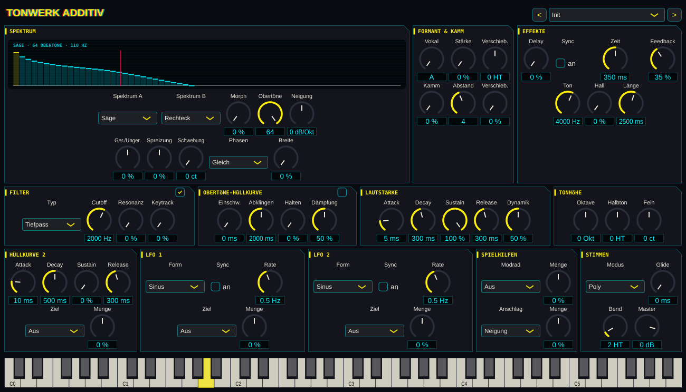

- **Anzeige**: ein Balken pro Oberton, gelb der Grundton, so hoch, wie er gerade klingt (48 dB vom lautesten bis zum Boden). Beim Spielen bewegen sich die Balken mit Hüllkurven und LFOs; ohne Ton zeigen sie das Spektrum, wie die Regler es einstellen. Mit Filter markiert eine rote Linie den Cutoff.
- **Spektrum**: **Spektrum A** und **B** (*Sinus*, *Säge*, *Rechteck*, *Dreieck*, *Puls*, *Orgel* mit Zugriegeln, *Hohl* wie eine Klarinette, *Hell*, *Oktaven*, *Glas* mit den Obertönen 1, 4, 9, 16 …, *Primzahlen*, *Zufall*), alle gleich laut, und **Morph** blendet von A nach B, Oberton für Oberton. **Obertöne** (1 bis 64, stufenlos moduliert, damit ein LFO sie auf- und zuzählen kann), **Neigung** (dB pro Oktave: heller oder dunkler, ohne lauter zu werden), **Gerade/Ungerade** (+100 % nur ungerade, hohl wie ein Rechteck; −100 % nur gerade), **Spreizung** (schiebt die Obertöne von ihren ganzzahligen Plätzen nach oben wie bei einer steifen Saite oder Glocke, oder nach unten), **Schwebung** (jeder Oberton bis zu 50 Cent verstimmt, jeder anders, sodass sie gegeneinander schweben), **Phasen** (*Gleich*: alle starten zusammen, der Anschlag ist knackig; *Zufall*: weicher, Akkorde klingen breiter) und **Breite** (ungerade Obertöne nach links, gerade nach rechts, der Grundton bleibt in der Mitte).
- **Formant & Kamm**: **Vokal** (A, E, I, O, U, stufenlos dazwischen) legt die Formanten einer Singstimme über die Obertöne, fest in Hertz, egal wie hoch der Ton ist; **Stärke** und **Verschiebung** (±12 Halbtöne, kleinerer oder größerer Rachen). Der **Kamm** schneidet Kerben in das Spektrum, alle **Abstand** Obertöne; mit **Verschiebung** auf einem LFO wandern sie durch den Klang wie bei einem Phaser.
- **Filter**: *Tiefpass* und *Hochpass* mit 24 dB pro Oktave, *Bandpass* und *Kerbe*, mit **Resonanz** (bis etwa 15 dB) und **Keytracking**. Es rechnet auf den Pegeln der Obertöne, kostet deshalb nichts und kann nicht übersteuern.
- **Obertöne-Hüllkurve**: jedem Oberton seine eigene Hüllkurve. **Einschwingen** (die hohen Obertöne kommen später, der Grundton sofort, wie bei Blech und Streichern), **Abklingen** (wie lange der Grundton zum Fallen braucht), **Halten** (wohin sie fallen) und **Dämpfung** (wie viel schneller die hohen fallen: bei 100 % der zehnte zehnmal so schnell wie der Grundton, wie bei einer gezupften Saite oder einer Glocke).
- **Lautstärke** (ADSR und **Dynamik**, bis 20 dB leiser bei leisem Anschlag), **Tonhöhe**, **Hüllkurve 2**, **zwei LFOs** (frei oder im Songtempo), **Modrad** und **Anschlag**, jede mit einem **Ziel** (Tonhöhe, Morph, Neigung, Gerade/Ungerade, Spreizung, Obertöne, Kamm, Cutoff, Resonanz, Vokal, Lautstärke) und einer **Menge**. Der Anschlag macht leise Töne zunächst dunkler (Ziel Neigung).
- **Stimmen**: Poly (16 Stimmen) oder Mono mit **Glide**, Pitchbend-Bereich, **Master**. Danach **Delay** und **Hall** wie in den anderen Tonwerk-Synths.

**Presets**: 35 eigene Klänge, die Liste steht unter [Werksklänge](#werksklänge). Hörproben aller Klänge mit ihrer Testphrase liegen im Projektordner unter `synth/hoerproben/Tonwerk Additiv` (und als `synth/hoerproben-additiv.zip`).

**CPU:** Jeder Oberton ist ein Zeiger, der sich pro Sample um einen festen Winkel dreht (vier Multiplikationen, keine Sinusfunktion), acht Obertöne laufen nebeneinander in einem Vektorbefehl. Gerechnet werden nur Obertöne, die klingen und unter der halben Abtastrate liegen; Spektrum, Formanten, Kamm und Filter stellen alle 32 Samples die Pegel neu ein, dazwischen gleiten sie. 16 Stimmen mit je 64 Obertönen und Hall rechnet der Test unter Linux etwa 13-mal schneller als Echtzeit, mit wanderndem Spreizen, Filter, Formanten und Obertöne-Hüllkurven etwa 8-mal.

**Getestet und ungetestet:** Unter Linux gebaut und getestet (Stimmung jedes Spektrums über die Tastatur, Säge mit 1/k, Rechteck ohne gerade Obertöne, alle Spektren gleich laut, Morph, Obertonzahl, kein Aliasing bei hohen Tönen, Neigung in dB pro Oktave, Gerade/Ungerade, Spreizung, Formanten fest in Hertz, Kammkerben und ihre Verschiebung, Filtersteilheit, Abklingen und Einschwingen der einzelnen Obertöne, Vibrato, Stereobreite, alle Spektren und Ziele an den Extremen ohne Ausreißer, Stimmenklau ohne Knacken, alle Presets und ihre Lautheit, CPU, Zustand, Anzeige mit Einheiten) und die Oberfläche als Bild angesehen. `auval` läuft in der GitHub Action. In Logic ist er noch nicht gehört, und die Hörproben sind nur gemessen, nicht angehört.

## Tonwerk PD (Instrument)

Phase Distortion, wie sie digitale Synthesizer der Achtziger nutzten: Eine Kosinuswelle wird mit verbogener Phase gelesen. Wo die Phase schnell läuft, fällt die Welle steil ab, wo sie stehen bleibt, hält die Welle, und so wird aus dem reinen Sinus je nach Biegung (**DCW**) eine Säge, ein Rechteck, ein Puls oder ein resonanter Sweep. Einen Filter braucht es dafür nicht: Die DCW-Hüllkurve öffnet und schließt den Klang so, wie es sonst eine Filterhüllkurve tut. Das klingt digital und trotzdem warm und kostet sehr wenig Rechenzeit. Er liegt unter **Instrument → AU-Instrumente → b-velop → Tonwerk PD** (`aumu TwPd Bvlp`) und wird mit den anderen Plugins gebaut, installiert und veröffentlicht. Die Klänge sind eigene, keine Kopien aus Werksspeichern.

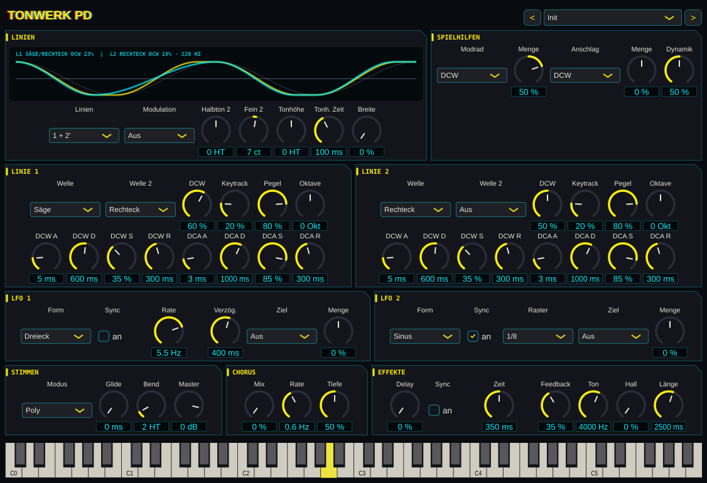

- **Anzeige**: die Welle jeder Linie so, wie sie gerade gebogen ist (Linie 1 cyan, Linie 2 gelb), zwei Perioden lang, damit man bei zwei abwechselnden Wellen beide sieht; darunter blass der unverbogene Kosinus.
- **Linien**: zwei Linien mit eigener Welle, DCW und DCA (Lautstärke). **1** oder **2** spielt eine Linie, **1 + 1'** die erste Linie doppelt (die Kopie mit der Verstimmung von Linie 2, für Schwebung), **1 + 2'** beide. **Modulation**: *Ring* multipliziert Linie 2 mit Linie 1 (Glocken, Metall), *Rauschen* liest Linie 2 mit zufällig wandernder Phase (ein Rauschband um ihre Tonhöhe, für Atem und Wind). Dazu die **Verstimmung** von Linie 2 (Halbton und Fein), eine **Tonhöhen-Hüllkurve** (Start bis ±24 Halbtöne, Zeit bis zum Ton) und **Breite** (Linie 1 links, Linie 2 rechts).
- **Linie 1 und 2**: **Welle** (*Säge*, *Rechteck*, *Puls*, *Doppelsinus*, *Säge-Puls* und drei Resonanzen mit *Säge*-, *Dreieck*- und *Trapez*-Fenster, bei denen ein Kosinus mit bis zum 16-fachen der Tonhöhe unter dem Fenster läuft, der Klang eines resonanten Filters), **Welle 2** (abwechselnd mit der ersten, Periode um Periode, das bringt die Oktave darunter dazu), **DCW** (wie weit die Hüllkurve biegt), **Keytrack** (hohe Töne bekommen weniger Biegung, damit sie nicht schrill werden), **Pegel**, **Oktave**, dazu je eine Hüllkurve für **DCW** und **DCA** (Attack, Decay, Sustain, Release).
- **Zwei LFOs** (frei oder im Songtempo, LFO 1 mit **Verzögerung** für ein spät einsetzendes Vibrato), **Modrad** und **Anschlag**, jede mit einem **Ziel** (Tonhöhe, DCW, DCW 1, DCW 2, Tonhöhe 2, Lautstärke, Balance zwischen den Linien) und einer **Menge**. Das Modrad öffnet am Anfang den Klang (DCW), ein leiser Anschlag biegt weniger. **Dynamik** sagt, wie viel leiser ein leiser Anschlag ist.
- **Stimmen**: Poly (16 Stimmen), Mono oder Legato mit **Glide**, Pitchbend-Bereich, **Master**. Danach ein **Chorus** (Mix, Rate, Tiefe; ohne ihn hat man solche Synths selten gehört), **Delay** und **Hall** wie in den anderen Tonwerk-Synths.

**Presets**: 40 eigene Klänge, die Liste steht unter [Werksklänge](#werksklänge). Hörproben aller Klänge mit ihrer Testphrase liegen im Projektordner unter `synth/hoerproben/Tonwerk PD` (auch als `synth/hoerproben-pd.zip`).

**CPU:** Pro Linie und Sample ein Kosinus aus einer Tabelle; Hüllkurven pro Sample, Modulation alle 32 Samples. Damit hohe Töne bei voller Biegung nicht verzerren, fällt eine Flanke nie in weniger als zwei Samples, und die Sprünge des Doppelsinus werden geglättet (was zurückfaltet, liegt bei C7 30 bis 50 dB unter den Obertönen). 16 Stimmen mit beiden Linien, Ringmodulation, Chorus und Hall rechnet der Test etwa 8- bis 9-mal schneller als Echtzeit, der größte Teil davon ist der Hall.

**Getestet und ungetestet:** Unter Linux gebaut und getestet (ohne Biegung ein reiner Kosinus außer bei den Resonanzen, jede Welle auf der Tonhöhe über die Tastatur, mehr DCW gibt mehr Obertöne, volle Säge mit allen und volles Rechteck nur mit ungeraden Obertönen, der Resonanzgipfel wandert bis zum 16-fachen, die DCW-Hüllkurve schließt den Klang, abwechselnde Wellen bringen die Unteroktave, 1 + 1' mit Verstimmung, Ringmodulation mit Summe und Differenz, Rauschmodulation, wenig Rückfaltung bei hohen Tönen, alle Wellen, Linien und Modulationen auch an den Extremen ohne Ausreißer, Stimmenklau ohne Knacken, Tonhöhen-Hüllkurve, Chorus, alle Presets und ihre Lautheit, CPU, Zustand, Anzeige mit Einheiten) und die Oberfläche als Bild angesehen. `auval` läuft in der GitHub Action. In Logic ist er noch nicht gehört; wie die Klänge dort klingen, entscheiden die Ohren.

## Tonwerk Sampler (Instrument)

Ein Sampler für eigene Aufnahmen: chromatisch über die Tastatur gespielt, mit Loop, oder in Slices geschnitten, eine Taste pro Stück, wie bei einem Beat-Sampler. Er liegt unter **Instrument → AU-Instrumente → b-velop → Tonwerk Sampler** (`aumu TwSm Bvlp`) und wird mit den anderen Plugins gebaut, installiert und veröffentlicht.

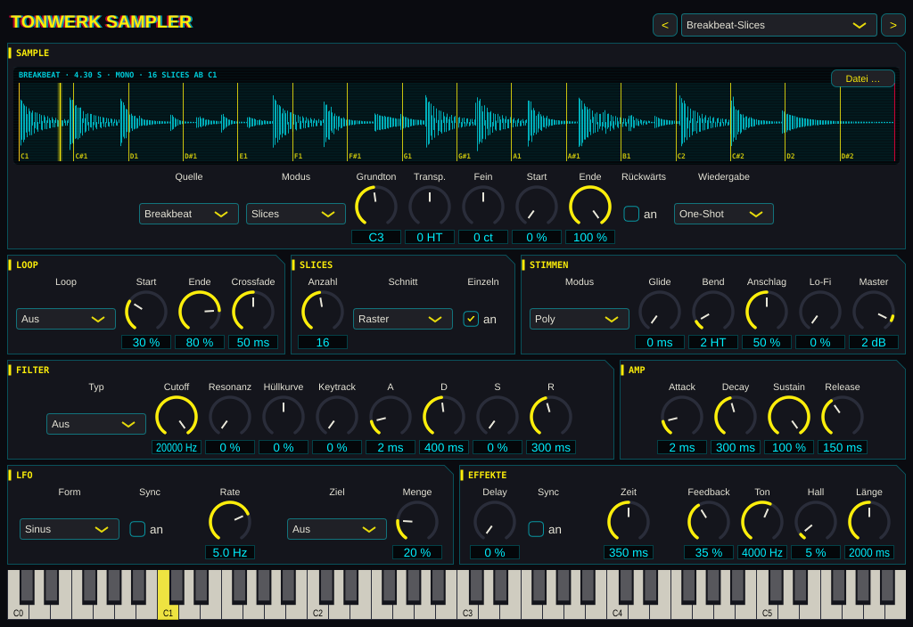

- **Quelle**: neun eingebaute Klänge, alle aus Formeln berechnet, nichts aufgenommen oder kopiert: *Vokal Ah* (gesungenes „a“ auf C3 mit Vibrato), *Vokal-Chops* (acht gesungene Silben auf einer Moll-Pentatonik, zum Schneiden), *Breakbeat* (zwei Takte bei 120 BPM), *E-Piano*, *Streicher* (Stereo), *Glocke*, *Sub-Kick* (auf C1), *Chor* (Stereo, „u“) und *Gitarre* (Nylon). Dazu **Eigene Datei**: Mit **Datei …** oder per Ziehen auf die Anzeige eine WAV-, AIFF-, FLAC-, MP3-, OGG-, M4A- oder CAF-Datei laden (die ersten 60 Sekunden, Mono oder Stereo, ihre eigene Abtastrate). Das Projekt merkt sich den Pfad und lädt die Datei beim Öffnen neu; die Datei selbst steckt nicht im Projekt, sie muss also dort liegen bleiben.
- **Anzeige**: die Wellenform, der gespielte Bereich hell, der Loop gelb, Slices als Linien mit der Taste, die sie spielt, und eine Linie für jede klingende Stimme dort, wo sie gerade liest.
- **Sample**: **Modus** *Klassisch* (die Taste bestimmt die Tonhöhe, **Grundton** ist die Taste, auf der das Sample unverändert klingt, Logic-Namen: C3 = 60) oder *Slices*. **Transponieren** ±24 Halbtöne, **Fein** ±100 Cent. **Start** und **Ende** schneiden den gespielten Bereich zu. **Rückwärts** spielt ihn vom Ende her. **Wiedergabe** *Gate* (die Taste loslassen startet das Release) oder *One-Shot* (spielt immer bis zum Ende, für Drums und Chops).
- **Loop** (nur Klassisch): *Aus*, *Vorwärts* oder *Pingpong*, **Start** und **Ende** in Prozent des Samples, **Crossfade** bis 1000 ms: Beim Vorwärts-Loop blendet das Ende des Loops in das über, was vor seinem Anfang liegt, sodass die Naht auch dann nicht knackt, wenn die Enden nicht zusammenpassen. Der Loop läuft auch im Release weiter.
- **Slices**: **Anzahl** 2 bis 32, **Schnitt** *Raster* (gleich lange Stücke) oder *Transienten* (an den stärksten Einsätzen im Bereich, nicht näher als 30 ms beieinander). Die erste Slice liegt auf **C1**, die nächste auf C#1 und so weiter, wie bei Logics Quick Sampler. Slices klingen in ihrer eigenen Tonhöhe (plus Transponieren). **Einzeln** (an): Eine neue Slice schneidet die vorige ab, wie eine Mute-Gruppe; aus: Sie klingen übereinander.
- **Filter**: *Aus*, *Tiefpass 12*, *Tiefpass 24*, *Hochpass*, *Bandpass*, **Cutoff**, **Resonanz**, **Hüllkurve** (±100 % für bis zu sechs Oktaven), **Keytracking**, mit eigener Hüllkurve (A, D, S, R). **Amp**: Attack, Decay, Sustain, Release. **Anschlag**: wie stark die Lautstärke dem Anschlag folgt.
- **LFO** (frei oder im Songtempo) auf *Tonhöhe* (100 % = eine Oktave, Vibrato um 2 %), *Filter* (±4 Oktaven), *Lautstärke* oder *Panorama*.
- **Stimmen**: Poly (16 Stimmen), Mono oder Legato (die zweite Taste gleitet hin, ohne das Sample neu zu starten) mit **Glide**, Pitchbend-Bereich, **Lo-Fi** (Abtastrate bis auf ein Achtel und Bittiefe von 16 bis 6 Bit herunter, ohne Filter davor, so wie die alten 12-Bit-Sampler klingen), **Master**. Danach **Delay** und **Hall** wie in den anderen Tonwerk-Synths.

**Presets**: 21 eigene Klänge, die Liste steht unter [Werksklänge](#werksklänge). Die Slice-Presets (*Vokal-Chops*, *Breakbeat-Slices*, *Break rückwärts*, *Funk-Chops*) spielt man ab C1. Hörproben aller Klänge mit ihrer Testphrase liegen im Projektordner unter `synth/hoerproben/Tonwerk Sampler` (auch als `synth/hoerproben-sampler.zip`).

**CPU:** Das Sample wird mit vier Punkten (Hermite) gelesen. Damit hoch gespielte Töne nicht zurückfalten, liegt jedes Sample zusätzlich in halber, viertel, … Abtastrate vor, jeweils vorher tiefpassgefiltert, und eine Stimme liest die Kopie, bei der sie höchstens 1,5 Samples pro Schritt springt (eine Säge drei Oktaven und zwei Halbtöne höher: was zurückfaltet, liegt etwa 40 dB unter dem Grundton). Tonhöhe, Filter und LFO alle 32 Samples, Hüllkurven pro Sample. 16 Stereo-Stimmen mit Filter, LFO, Lo-Fi, Delay und Hall rechnet der Test etwa 14-mal schneller als Echtzeit.

**Getestet und ungetestet:** Unter Linux gebaut und getestet (eingebaute Klänge, Tonhöhe vom Grundton bei Dateien mit 44,1, 48 und 96 kHz, Transponieren und Fein, wenig Rückfaltung bei hohen Tönen, Ende ohne Loop, Vorwärts- und Pingpong-Loop, Crossfade gegen Sprünge an der Naht, Rückwärts, Slices im Raster mit ihrer Tonhöhe und One-Shot, Schnitt an Transienten beim Breakbeat und bei den Silben, Einzeln, Legato mit Glide ohne neuen Einsatz, Filter, alle Presets und ihre Lautheit, CPU, Zustand mit Dateipfad, Anzeige mit Einheiten, Oberfläche als Bild). `auval` läuft in der GitHub Action. In Logic ist er noch nicht gehört, und das Laden einer Datei per Ziehen ist nur auf dem Mac möglich und dort noch nicht ausprobiert.

## Tonwerk Bass (Instrument)

Ein Acid-Bass, wie er seit den Achtzigern im Acid House blubbert: eine Stimme, Säge oder Rechteck, ein resonanter Tiefpass, der mit seiner Hüllkurve quietscht, dazu **Slide** und **Accent**. Er liegt unter **Instrument → AU-Instrumente → b-velop → Tonwerk Bass** (`aumu TwBs Bvlp`) und wird mit den anderen Plugins gebaut, installiert und veröffentlicht. Nichts ist kopiert; der Klang ist nachempfunden, keine Schaltung nachgebaut.

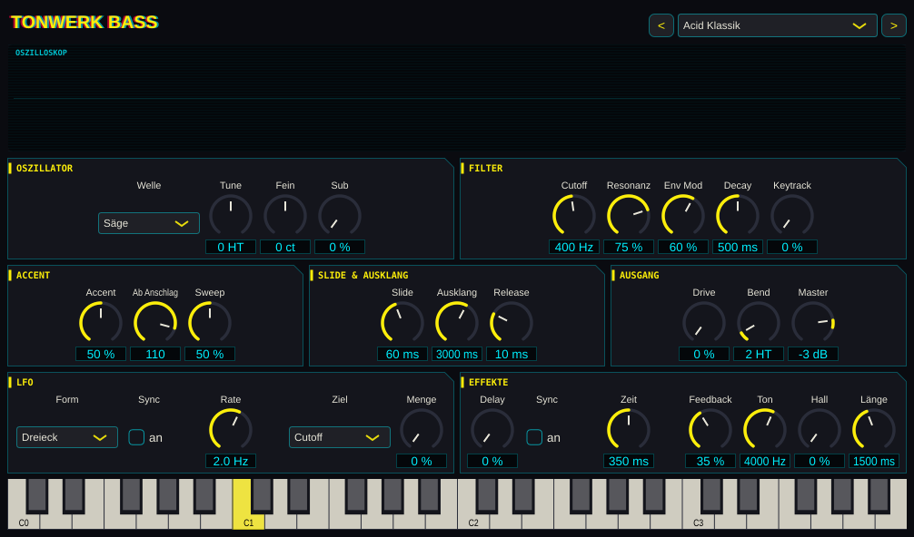

- **Spielen**: Er ist monophon. Eine Taste, die gedrückt wird, während eine andere noch gehalten ist, **gleitet** zu ihrer Tonhöhe, ohne die Hüllkurven neu zu starten, so wie die Slides klassischer Acid-Bässe (in Logic: Noten überlappen lassen). Lässt du die zweite Taste los, gleitet er zurück zur ersten, wenn die noch gehalten ist. Ein Anschlag ab **Ab Anschlag** (Vorgabe 110) ist ein **Accent**: lauter, der Filter öffnet weiter und schließt schneller (Decay dann fest 200 ms). Die Anzeige oben zeigt die Welle, die gespielte Note (Logics Namen, C3 = 60) und ob sie gerade Accent oder Slide hat.
- **Oszillator**: **Welle** Säge oder Rechteck, **Tune** ±12 Halbtöne, **Fein** ±100 Cent, **Sub** ein Rechteck eine Oktave tiefer (für Clubanlagen hilft er).
- **Filter**: ein Tiefpass mit 24 dB pro Oktave und Rückkopplung, die bei voller **Resonanz** fast pfeift, ohne zu explodieren. **Cutoff** 30 bis 8000 Hz, **Env Mod** (100 % öffnet ihn mit jeder neuen Note fünf Oktaven weiter), **Decay** 30 bis 3000 ms (wie schnell er wieder schließt), **Keytrack** (100 % folgt der Cutoff den Tasten).
- **Accent**: **Accent** (wie viel lauter und heller ein Accent ist), **Ab Anschlag** 1 bis 127, **Sweep**: wie sehr sich Accents hintereinander aufschaukeln. Mit viel Sweep klettert der Filter bei jeder weiteren Accent-Note höher, der typische „Wow“-Effekt einer Acid-Linie; bei 0 % beginnt jede neu.
- **Slide & Ausklang**: **Slide** 5 bis 1000 ms (klassisch fest etwa 60 ms), **Ausklang** 50 ms bis 10 s (so lange klingt eine gehaltene Note aus), **Release** nach dem Loslassen.
- **Ausgang**: **Drive** (ein Verzerrer hinter dem Filter, wie das Pedal, durch das die meisten Acid-Platten liefen), **Bend** (Pitchbend-Bereich), **Master**.
- **LFO** (frei oder im Songtempo) auf **Cutoff** (bis vier Oktaven auf), **Tonhöhe** (Vibrato bis ±2 Halbtöne) oder **Lautstärke** (bei 100 % ganz zu, mit Rechteck im Tempo ein Gate). Danach **Delay** und **Hall** wie in den anderen Tonwerk-Synths.

Eine Linie mit Slides und Accents schreibt man in Logic als Noten (überlappend für Slide, laut für Accent) oder lässt sie von **Tonwerk Arp** spielen: Sein Preset *Acid-Linie* bindet Schritte (Slide) und betont einige (Accent). Der Arp spielt unbetonte Schritte mit 65 % des Anschlags; damit seine Accents ankommen, die Taste kräftig anschlagen, beim Arp **Anschlag** auf *Fest* 127 stellen oder **Ab Anschlag** hier auf etwa 90 senken.

**Presets**: 19 eigene Klänge, die Liste steht unter [Werksklänge](#werksklänge). Sie sind etwas leiser abgestimmt als die anderen Synths (−15 statt −12 LUFS), weil ein Accent bis zu 6 dB lauter ist als die unbetonten Noten, nach denen gemessen wird. Hörproben aller Klänge mit einer Acid-Linie (zwei Takte mit Accents und Slides, 125 BPM) liegen im Projektordner unter `synth/hoerproben/Tonwerk Bass` (auch als `synth/hoerproben-bass.zip`).

**CPU:** eine Stimme, Filter und Hüllkurven pro Sample; eine Acid-Linie mit Drive, Sub, LFO, Delay und Hall rechnet der Test etwa 30-mal schneller als Echtzeit.

**Getestet und ungetestet:** Unter Linux gebaut und getestet (Tonhöhe, Tune und Fein, Slide nur bei gehaltener Taste und ohne neuen Einsatz, zurück zur gehaltenen Taste, Accent lauter und heller mit kürzerem Sweep, Schwelle, Sweep schaukelt sich bei Accents hintereinander auf, Filterhüllkurve, volle Resonanz mit Drive und Sub bleibt begrenzt, Release, alle Presets mit Accents unter Vollaussteuerung und ihre Lautheit, CPU, Zustand, Anzeige mit Einheiten) und die Oberfläche als Bild angesehen. `auval` läuft in der GitHub Action. In Logic ist er noch nicht gehört; wie er dort klingt, entscheiden die Ohren.

## Tonwerk Neuro (Instrument)

Ein monophoner Bass für Reese- und Neuro-Sounds, wie man sie aus Drum and Bass und Dubstep kennt: zwei leicht gegeneinander verstimmte Sägezähne (die **Reese**, ihr Schweben macht das langsame Rollen), ein FM-Paar mit Rückkopplung für den Dreck, ein sauberer Sinus-Sub darunter, dann Drive und ein Filter, die ein LFO im Songtempo bewegt (der **Wobble**). Er liegt unter **Instrument → AU-Instrumente → b-velop → Tonwerk Neuro** (`aumu TwNr Bvlp`) und wird mit den anderen Plugins gebaut, installiert und veröffentlicht.

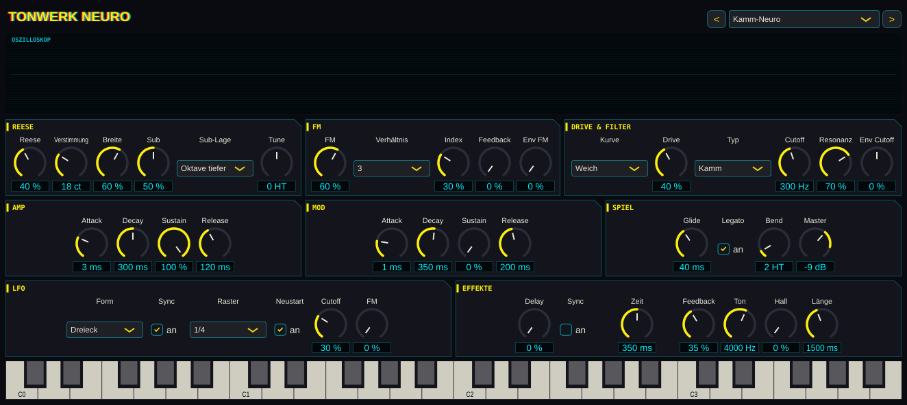

- **Spielen**: monophon. Eine Taste, die gedrückt wird, während eine andere gehalten ist, **gleitet** in der **Glide**-Zeit dorthin; mit **Legato** laufen die Hüllkurven dabei weiter. Lässt du sie los, gleitet er zurück zur noch gehaltenen. Die Anzeige oben zeigt die Welle, die Note (C3 = 60) und wo der Filter gerade steht.
- **Reese**: **Reese** (Lautstärke der beiden Sägezähne), **Verstimmung** 0 bis 60 Cent (je mehr, desto schneller schwebt es), **Breite** (wie weit die beiden links und rechts auseinander liegen; 0 % ist mono), **Sub** ein Sinus, eine Oktave tiefer oder auf dem Grundton (**Sub-Lage**); er läuft an Drive und Filter vorbei und bleibt rund. **Tune** ±24 Halbtöne.
- **FM**: ein Sinus, den ein zweiter moduliert. **FM** (Lautstärke), **Verhältnis** (Modulator zu Träger, 0.25 bis 7), **Index** (wie stark, bis 8 wie in Tonwerk FM), **Feedback** (der Modulator auf sich selbst, macht ihn rauer), **Env FM** (wie weit die Mod-Hüllkurve den Index mit jeder Note aufreißt: der „Biss“).
- **Drive & Filter**: **Kurve** Weich, Hart, Falter oder Röhre, **Drive** bis 30 dB in die Kurve, ausgeglichen, sodass es dichter statt lauter wird. **Typ** Tiefpass (24 dB, Ladder), Bandpass, Notch oder Kamm (die Zähne folgen der Taste), **Cutoff** 20 bis 18000 Hz, **Resonanz**, **Env Cutoff** (±6 Oktaven durch die Mod-Hüllkurve).
- **Amp** und **Mod**: zwei ADSR-Hüllkurven, die erste für die Lautstärke, die zweite für Filter und FM-Index.
- **LFO**: sechs Formen, frei (**Rate**) oder im Songtempo (**Raster** von 4 Takten bis 1/32, auch triolisch und punktiert). **Neustart**: mit jeder neuen Note beginnt er unten, sonst läuft er auf den Takten des Songs. **Cutoff** bewegt den Filter bis 5 Oktaven nach oben, **FM** den Index. Danach **Delay** und **Hall** wie in den anderen Tonwerk-Synths.

**Hardware-Blatt**: Der Knopf **Hardware-Blatt** oben rechts speichert den gerade eingestellten Klang (Werksklang oder eigener Patch) als Bild für ein echtes Expander-Modul dieser Bauart mit Zwei-Stimmen-Steuerung (zwei VCOs mit Sync, Filter mit Notch-Regler LP–HP und BP-Schalter, Mixer Säge–aus–Puls, zwei ADS-Hüllkurven, LFO; Assign UNI/SPLIT/DUO, Pan, Portamento). Jeder Regler ist auf seine Stellung gedreht und als Uhrzeit beschriftet (ganz links 7 Uhr, Mitte 12, ganz rechts 5 Uhr), die Schalter stehen richtig, und darunter steht, was am Modul nicht 1:1 geht (Säge und Puls zugleich, Vibrato und PWM zugleich, Release länger als der Decay, mehr als zwei Stimmen, Delay und Hall …). Die Skalen der Hardware sind nicht beschriftet und deshalb geschätzt (Cutoff 20 Hz bis 20 kHz, Hüllkurven 1 ms bis 5 bzw. 10 s, LFO 0,05 bis 20 Hz, alle logarithmisch, in `expander/src/HardwarePanel.h`): ein Startpunkt, die VCO-Stimmung und die Feinheiten macht das Ohr. Ungetestet an einem echten Modul.

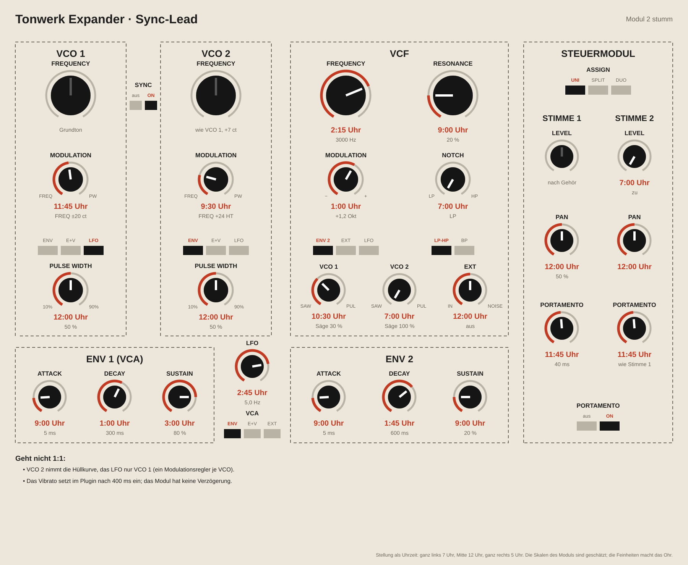

**Presets**: 15 eigene Klänge, auf −12 LUFS eingepegelt, die Liste steht unter [Werksklänge](#werksklänge).

**CPU:** eine Stimme, Filter alle 16 Samples neu berechnet; ein Riff mit FM, Wobble, Delay und Hall rechnet der Test etwa 50-mal schneller als Echtzeit.

**Getestet und ungetestet:** Unter Linux gebaut und getestet (Tonhöhe, Tune, Sub eine Oktave tiefer, Schweben der Reese, Stereobreite, FM-Index und Mod-Hüllkurve machen heller, LFO im Tempo: ein Achtel bei 140 BPM wobbelt alle 214 ms und beginnt mit der Note unten, freier LFO, Glide und zurück zur gehaltenen Taste, alle Filter und Kurven bei voller Resonanz begrenzt, Release, alle Presets unter Vollaussteuerung und ihre Lautheit, CPU, Zustand, Anzeige mit Einheiten) und die Oberfläche als Bild angesehen. `auval` läuft in der GitHub Action. In Logic ist er noch nicht gehört.

## Tonwerk Expander (Instrument)

Ein achtstimmiger Synth nach Art der klassischen Expander-Module der Siebziger: pro Stimme zwei Oszillatoren in einen 12-dB-Filter, dessen Modus stufenlos vom Tiefpass über den Notch zum Hochpass wandert, dazu ein Bandpass-Schalter. Jede Stimme ist ein eigenes kleines Modul, ein wenig anders gestimmt und gefiltert als die anderen (**Drift**), das macht Akkorde breit und lebendig. Nachempfunden, nichts kopiert. Er liegt unter **Instrument → AU-Instrumente → b-velop → Tonwerk Expander** (`aumu TwEx Bvlp`) und wird mit den anderen Plugins gebaut, installiert und veröffentlicht.

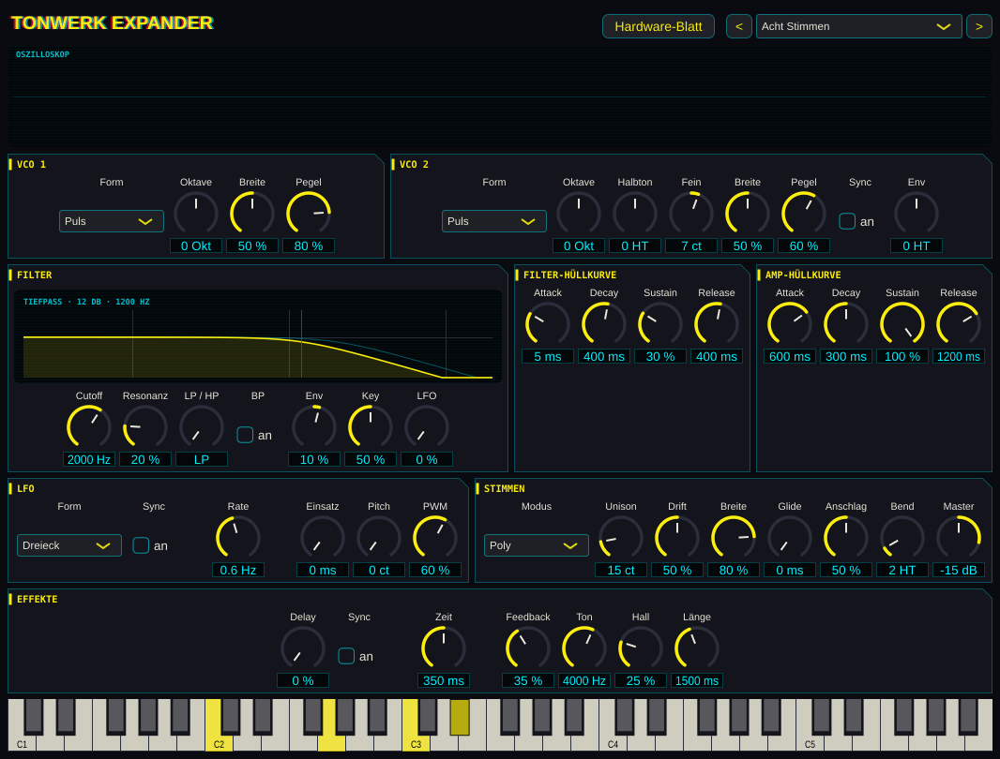

- **VCO 1** und **VCO 2**: **Form** Säge, Puls oder beides, **Oktave** ±2, **Breite** (Pulsbreite 5 bis 95 %), **Pegel**. VCO 2 dazu **Halbton** ±12 und **Fein** ±50 Cent. **Sync** startet VCO 2 mit jeder Schwingung von VCO 1 neu; **Env** zieht VCO 2 mit der Filter-Hüllkurve bis ±48 Halbtöne, das ist der klassische Sync-Sweep. Alle Sprünge der Wellen sind geglättet (polyBLEP an der genauen Stelle, auch beim Sync), damit hohe Töne nicht kratzen.
- **Filter**: **Cutoff** 20 bis 18000 Hz, **Resonanz** bis kurz vor dem Pfeifen, **LP / HP** (0 Tiefpass, Mitte Notch, ganz rechts Hochpass, dazwischen stufenlos), **BP** schaltet auf Bandpass, **Env** (±6 Oktaven durch die Filter-Hüllkurve), **Key** (wie weit der Cutoff der Taste folgt), **LFO** (±3 Oktaven). Die Anzeige zeigt die Kurve, wie die Regler sie stellen, und wohin die Hüllkurve der neuesten Stimme sie gerade bewegt. Volle Resonanz auf einem lauten Akkord wird wärmer statt lauter.
- **Filter-Hüllkurve** und **Amp-Hüllkurve**: zwei ADSR.
- **LFO**: sechs Formen, frei (**Rate**) oder im Songtempo (**Raster**), **Einsatz** blendet ihn nach jeder Taste ein (Vibrato erst auf langen Tönen), **Pitch** (Vibrato bis 1200 Cent), **PWM** (bewegt die Pulsbreite beider VCOs). Das Modulationsrad gibt bis zu 50 Cent Vibrato dazu.
- **Stimmen**: **Modus** Poly (acht Stimmen, jede Taste nimmt das nächste Modul und seinen Platz im Stereobild), Mono (Legato, zurück zur gehaltenen Taste) oder Unison (alle acht auf einer Taste, **Unison** verstimmt sie bis 100 Cent auseinander, so laut wie eine Stimme). **Drift**, **Breite** (Stereo), **Glide**, **Anschlag** (wie stark leise Tasten leiser und dunkler werden), **Bend**, **Master**. Danach **Delay** und **Hall** wie in den anderen Tonwerk-Synths; das Haltepedal hält die Töne.

**Presets**: 15 eigene Klänge, auf −12 LUFS eingepegelt, die Liste steht unter [Werksklänge](#werksklänge).

**CPU:** Hüllkurven und Oszillatoren pro Sample, Tonhöhe, Filterfrequenz und Pulsbreite alle 16 Samples mit Rampen dazwischen; acht Stimmen mit Sync, PWM, Delay und Hall rechnet der Test etwa 25- bis 30-mal schneller als Echtzeit.

**Getestet und ungetestet:** Unter Linux gebaut und getestet (Tonhöhe, Oktave, Halbton und Fein, Pulsbreite 50, 25 und 10 % auf ein halbes Prozent genau ohne Gleichanteil, Sync wiederholt sich exakt mit der Periode von VCO 1, Rückfaltungen bei C7 unter −50 dB für Säge, Puls und Sync, Tiefpass, Notch, Hochpass und Bandpass an Obertönen nachgemessen, Resonanz, alle Modi bei voller Resonanz begrenzt, Filter-Hüllkurve, Anschlag, acht Stimmen und Stimmenklau, Mono, Unison so laut wie eine Stimme, Drift zwischen den Stimmen, Glide, LFO-Einsatz, alle Presets und ihre Lautheit, CPU, Zustand, Anzeige mit Einheiten, Reglerstellungen des Hardware-Blatts) und die Oberfläche und die Hardware-Blätter aller Werksklänge als Bild angesehen. `auval` läuft in der GitHub Action. In Logic ist er noch nicht gehört.

## Tonwerk Groovebox (Instrument)

Eine Drum-Machine mit acht Instrumenten und eingebautem Step-Sequencer. Alle Klänge werden berechnet, nicht abgespielt, so wie die klassischen analogen Drumcomputer sie gebaut haben: die Bassdrum ein Sinus, dessen Tonhöhe beim Schlag von oben herunterfällt, die Snare ein gestimmter Kessel unter gefiltertem Rauschen, das Clap drei schnelle Hände und ein Nachhall aus Rauschen, die Toms fallende Sinustöne mit etwas Fell, Hi-Hats und Becken sechs Rechteckschwingungen in schief zueinander stehenden Frequenzen, die durch Bandpass und Hochpass nach Metall klingen. Samples gibt es keine, jeder Regler wirkt deshalb stufenlos auf den Klang. Sie liegt unter **Instrument → AU-Instrumente → b-velop → Tonwerk Groovebox** (`aumu TwGb Bvlp`) und wird mit den anderen Plugins gebaut, installiert und veröffentlicht.

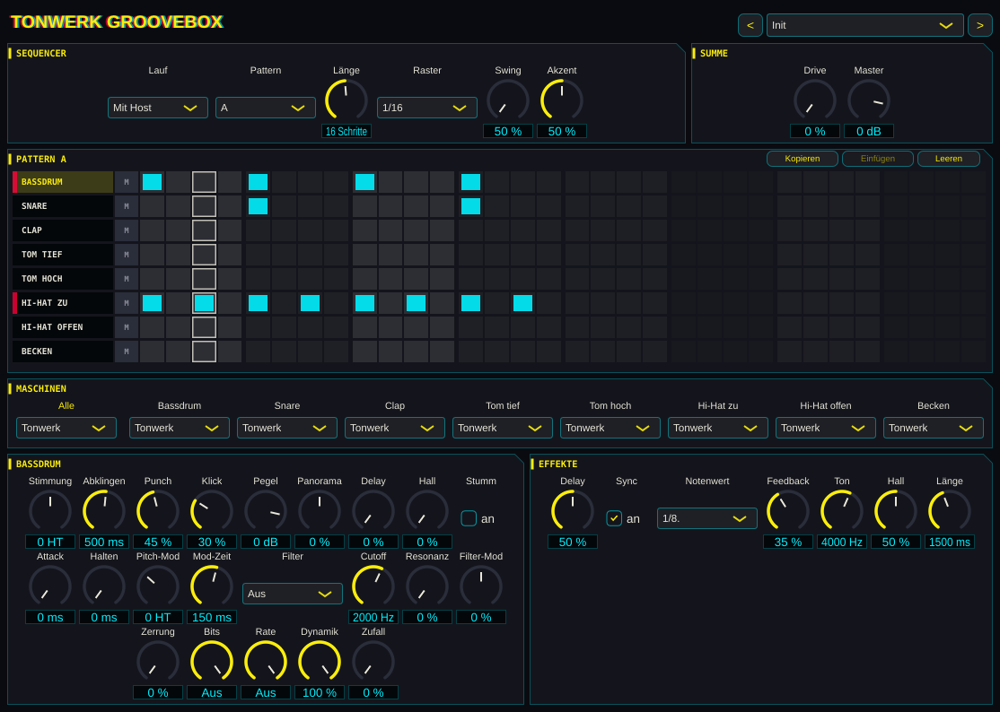

- **Pattern**: Eine Zeile pro Instrument mit bis zu 32 Schritten. Ein Klick setzt einen Schritt, ein zweiter macht ihn zum **Akzent** (gelb), ein dritter löscht ihn; Ziehen über die Zeile setzt alle überfahrenen Schritte genauso. Ein Klick auf den Namen spielt das Instrument an und zeigt unten seine Regler, **M** schaltet es stumm. Der gerade spielende Schritt ist umrandet, Schritte hinter der Länge sind abgedunkelt. **Kopieren**, **Einfügen** und **Leeren** wirken auf das gezeigte Pattern.
- **Maschinen**: Unter dem Pattern wählst du für jedes Instrument, nach welchem Drumcomputer es klingt, mit **Alle** für alle acht auf einmal (stehen sie verschieden, zeigt es *Gemischt*). Die Namen lehnen sich an die Klassiker an, ohne deren Namen zu tragen. Alle Klänge bleiben berechnet, die Regler wirken auf jeder Maschine gleich, und jede Maschine ist so laut wie Tonwerk (im Test auf 1 dB abgeglichen), Umschalten lässt den Mix also stehen:
  - *Tonwerk*: der Klang der Groovebox wie bisher; alte Projekte laden darauf.
  - *Boom 88*: der analoge Boom. Tiefe Bassdrum (47 Hz), die sich kaum biegt und keinen Schlägel hat, Snare aus zwei klingenden Tönen unter hellem Rauschen, Clap aus vier Händen, Toms wie reine Sinustöne, Hi-Hats aus sechs Rechtecken.
  - *Punch 99*: die House-Maschine. Bassdrum, die schnell von weit oben fällt, mit hartem Schlägel und Zerrung, knappe Snare mit viel Rauschen, Hi-Hats und Becken aus 6-Bit-Samples.
  - *Mini 66*: die kleine Schwester. Kurze, dünne Bassdrum, helle Snare fast nur aus Rauschen, hohe Toms, hellere und engere Hi-Hats.
  - *Neon 77*: der erste reine Sample-Drumcomputer. Sauber, hell und etwas dünn, aus 8 Bit bei 25 kHz, die Hi-Hats aus 6 Bit.
  - *Kompakt 78*: die Rhythmusbox der späten Siebziger. Weicher Puls ohne Schlägel, hohle Snare, Toms wie Bongos, Hi-Hats als Zischen aus gefiltertem Rauschen.
  - *Studio 80*: das gesampelte Studio-Set der frühen Achtziger. Bassdrum mit großem Schlägel, fette Snare mit langem Teppich, Clap aus fünf Händen, Toms mit Stock, Hi-Hats fast nur Rauschen, alles aus 8 Bit bei 28 kHz.
  - *Street 81*: die Hip-Hop-Kiste. Hart und kurz, eine Bassdrum, die klopft, fette Snare, tiefe Toms, 8 Bit bei 24 kHz.
  - *Sechseck*: die sechseckigen Pads der elektronischen Drums. Alles fällt: die Bassdrum, der Ton der Snare und die Toms um eine Oktave und mehr, der Klang der Fills der Achtziger.

  Ein Kit lädt Klang und Patterns, die gewählten Maschinen bleiben, so spielt jedes Kit auf jeder Maschine. Die Bits und die Rate der Sample-Maschinen kommen zu **Bits** und **Rate** des Instruments hinzu; es zählt jeweils das gröbere. Hörproben (derselbe Groove zwei Takte bei 120 BPM auf jeder Maschine) liegen im Projektordner unter `synth/hoerproben/Tonwerk Groovebox Maschinen`.
- **Sequencer**: **Lauf** *Mit Host* (spielt, solange Logic spielt, auf dessen Takte: wer mitten im Takt startet oder einen Cycle laufen lässt, hört die Schritte trotzdem an ihrer Stelle), *Frei* (läuft ohne Transport, für die App oder zum Jammen) oder *Aus* (nur MIDI). **Pattern** A bis H, acht pro Projekt, umschaltbar auch per Automation. **Länge** 1 bis 32 Schritte, **Raster** 1/16, 1/8, 1/16-Triolen oder 1/32, **Swing** (50 % gerade, 67 % triolisch, 75 % punktiert) und **Akzent** (wie viel leiser ein normaler Schritt als ein Akzent ist, bis 6 dB). **Würfeln** (0 bis 100 %) lässt den Zufall das Pattern verändern, wie die Randomness der DrumBrute Impact: gesetzte Schritte fallen aus (bei 100 % die Hälfte), leere Schritte einer Spur, die überhaupt spielt, kommen hinzu (bei 100 % ein Viertel), Akzente kommen und gehen (drei von zehn). Der Regler im Sequencer gilt für alle Instrumente, jedes Instrument hat unter **Formung** sein eigenes **Würfeln**, beide zählen zusammen. Jeder Takt würfelt neu, aber an derselben Stelle im Song immer gleich: ein Bounce, ein Cycle oder ein Start mitten im Song spielt dieselben Würfe.
- **Instrumente**: Jedes hat **Stimmung** (±24 Halbtöne), **Abklingen** (bis −60 dB), zwei Klangregler, **Pegel**, **Panorama** und je einen Send auf **Delay** und **Hall**. Die Klangregler: Bassdrum *Punch* (wie hoch der Schlag beginnt) und *Klick* (Schlägel und Übersteuerung), Snare *Ton* und *Snappy* (Teppich gegen Kessel), Clap *Schärfe* und *Streuung* (wie weit die Hände auseinander liegen), Toms *Sweep* und *Fell*, Hi-Hats und Becken *Ton* und *Rauschen* (Rauschen statt Metall). Die geschlossene Hi-Hat würgt die offene ab, wie bei einem echten Paar.
- **Formung**: Darunter hat jedes Instrument dieselben Regler, die seinen Klang weiter verbiegen; in ihrer Grundstellung ändern sie nichts, alte Projekte und Kits klingen deshalb wie vorher.
  - **Attack** (0 bis 100 ms) blendet den Schlag ein, **Halten** (0 bis 2000 ms) hält ihn voll, bevor er abklingt: eine Gated Snare, eine lange Bassdrum, die steht und dann abreißt. Beim Clap hält der Nachhall nach den Händen, bei Snare und Toms der Teppich und der Grundton, nicht der Kessel.
  - **Pitch-Mod** (−24 bis +48 Halbtöne) biegt das ganze Instrument beim Schlag hoch oder runter und fällt in **Mod-Zeit** (5 bis 2000 ms, bis −60 dB) zurück: Simmons-Toms, ein Zap auf der Bassdrum, eine Hi-Hat, die nach unten rutscht.
  - **Filter** *Tiefpass*, *Hochpass* oder *Bandpass* mit **Cutoff** (20 Hz bis 20 kHz) und **Resonanz**; **Filter-Mod** (±100 %, sechs Oktaven) lässt dieselbe Mod-Hüllkurve den Cutoff mitnehmen, nach oben oder unten.
  - **Zerrung** sättigt das Instrument allein (leise Teile bis 10 dB hoch, Spitzen nicht lauter), **Bits** (16 bis 2, oben *Aus*) und **Rate** (48 kHz bis 500 Hz, oben *Aus*) machen es grob wie ein alter Sampler.
  - **Dynamik**: wie stark die Anschlagstärke (MIDI oder Akzent) den Pegel bestimmt; bei 0 % ist jeder Schlag so laut wie der lauteste. **Zufall**: jeder Schlag ein wenig anders, bis einen Halbton in der Tonhöhe und 3 dB im Pegel, damit gleichmäßige Hi-Hats lebendig werden. **Würfeln**: der Zufall im Pattern dieses Instruments (siehe Sequencer), zusätzlich zum globalen Regler. Die Würfel fangen bei jedem Start von vorn an, ein Bounce klingt also jedes Mal gleich.
- **MIDI**: Jedes Instrument spielt auch auf seiner Note nach General MIDI, mit Anschlagsdynamik: Bassdrum C1 (36), Snare D1 (38), Clap D#1 (39), Tom tief F1 (41), Tom hoch C2 (48), Hi-Hat zu F#1 (42), Hi-Hat offen A#1 (46), Becken C#2 (49), dazu die verwandten Noten (35, 40, 43, 45, 47, 50, 44, 51, 57 …). So lassen sich Patterns auch in Logics Drum-Editor oder Step Sequencer schreiben, mit dem eingebauten Sequencer auf *Aus*.
- **Summe**: **Drive** sättigt die Summe (leise Teile kommen bis 7 dB hoch, Spitzen werden rund), **Master**. Danach **Delay** und **Hall** wie in den anderen Tonwerk-Instrumenten; was hineingeht, bestimmen die Sends der Instrumente. Der Schalter oben rechts im Panel **Effekte** schaltet beide mit einem Klick ab (automatisierbar als *Effekte* An/Aus): was sie hinzufügen, blendet in 20 ms aus, die Instrumente bleiben trocken und unverändert. Solange er aus ist, sind die Sends zu, beim Wiedereinschalten kommen also keine alten Echos oder Hallfahnen zurück; der Hall rechnet nach seinem Ausklingen nicht mehr mit. Ein Kit lässt den Schalter, wie er ist.

**Kits**: 26 eigene Kits mit je einem oder zwei Patterns (A ist der Groove, B eine Variation oder ein Fill), die Liste steht unter [Werksklänge](#werksklänge). Ein Kit lädt Klang und Patterns, die Einstellung von **Lauf**, die Maschinen und der Effekte-Schalter bleiben. Hörproben aller Kits (zwei Takte Pattern A bei 120 BPM) liegen im Projektordner unter `synth/hoerproben/Tonwerk Groovebox`.

**CPU:** Jedes Instrument hat zwei Stimmen, damit ein neuer Schlag den alten kurz ausklingen lässt statt zu knacken; stumme Stimmen kosten nichts. Alle acht Instrumente auf jedem 1/32-Schritt mit Delay, Hall und Drive rechnet der Test etwa 12-mal schneller als Echtzeit, mit voller Formung auf allen acht (Mod-Hüllkurve auf Tonhöhe und Filter, Zerrung, Bits, Rate, Zufall) etwa 9-mal, auf Studio 80 kostet dasselbe rund ein Viertel mehr. Formung in Grundstellung kostet nichts, eine Maschine ohne Samples (Boom 88, Mini 66, Kompakt 78, Sechseck) so viel wie Tonwerk.

**Getestet und ungetestet:** Unter Linux gebaut und getestet (Tonhöhe der Bassdrum und ihr Punch, Abklingzeit, Snappy, Helligkeit und Länge der Hi-Hats, die Hände des Claps, Anschlag, Abwürgen der offenen Hi-Hat, erneuter Schlag ohne Knacken, Attack und Halten, Pitch-Mod und Mod-Zeit, Tiefpass, Hochpass, Filter-Mod und Resonanz, Zerrung, Bits, Rate, Dynamik und Zufall, alte Projekte ohne die Formungsregler, Lautstärke jeder Maschine gegen Tonwerk, Tonhöhe und Fall der Bassdrum von Boom 88 und Punch 99, Schlägel von Studio 80 gegen Kompakt 78, Fall der Toms von Sechseck, Rauschen der Hi-Hats von Kompakt 78, Bits der Sample-Maschinen, Kits behalten die Maschinen, alte Projekte laden auf Tonwerk, Raster und Swing auf das Sample genau, Start mitten im Takt und Stopp mit dem Host, freier Lauf, Länge, Pattern-Wahl und Stummschalten, Akzent, MIDI-Noten, Sends und Panorama, Würfeln (Anteile, global plus pro Instrument, gleich bei Start mitten im Song), Effekte-Schalter (Ausblenden in 20 ms ohne Sprung, keine alten Echos nach dem Wiedereinschalten), Zustand mit allen Patterns, alle Kits und ihre Lautheit, CPU, Anzeige mit Einheiten) und die Oberfläche als Bild angesehen. `auval` läuft in der GitHub Action. In Logic ist sie noch nicht gehört, und ob Logic das Projekt nach einer Änderung im Pattern als geändert markiert, ist nur dort zu sehen.

## Tonwerk Robovox (Effekt)

Die Roboterstimme aus KI-Songs: Die Stimme wird von einem Synth gesungen. Der Klang in deinem Beispiel („Day Off in Night City“) ist ein Vocoder, dessen Träger nicht auf der Tonhöhe der Sängerin liegt, sondern ein tiefer, völlig gerader Ton ist (dort D und G ganz unten, die Basslinie), der ohne Gleiten von Ton zu Ton springt; die Formanten der Stimme liegen über seinem dichten Kamm aus Obertönen. Deshalb hat ihn die Stem-Trennung als Bass erkannt. Ein normaler Vocoder trifft das nicht, wenn der Träger von Hand auf der Höhe der Stimme gespielt wird oder zu wenige Bänder hat. Hier macht das Plugin den Träger selbst: aus der Tonhöhe der Stimme, auf eine Tonleiter gerastet und um Oktaven nach unten gesetzt, oder aus MIDI-Noten.

In Logic gibt es ihn auf zwei Wegen:

- **Quelle Stimme** (der Träger folgt dem Gesang): als Effekt auf der Gesangsspur, **Audio-FX → Audio Units → b-velop → Tonwerk Robovox**.
- **Quelle MIDI** (der Träger spielt deine Noten): Logic gibt einem Effekt im Audio-FX-Slot keine MIDI-Noten. Dafür eine Software-Instrument-Spur nehmen (die mit den Noten oder eine neue, auf die du die Noten legst), im **Instrument**-Slot **AU MIDI-gesteuerte Effekte → b-velop → Tonwerk Robovox** wählen und im Plugin-Fenster oben rechts unter **Sidechain** die Gesangsspur einstellen. Den Ausgang der Gesangsspur auf **Kein Ausgang** stellen, sonst klingt die Stimme doppelt.

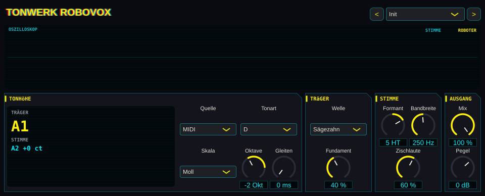

- **Tonhöhe**: **Quelle** Stimme oder MIDI (ohne gehaltene Note bleibt der letzte Ton liegen, vor der ersten folgt der Träger der Stimme). **Tonart** und **Skala** (Chromatisch, Dur, Moll, Pentatonik) rasten die gesungenen Töne ein, wie eine Tonhöhenkorrektur mit 0 ms. **Oktave** −4 bis +1 setzt den Träger unter die Stimme (nur bei Quelle Stimme): −2 für eine Männerstimme, −3 für eine Frauenstimme ergibt die Lage des Beispiels. **Gleiten** 0 bis 500 ms; bei 0 springt der Ton hart. Die Anzeige links zeigt den Ton des Trägers groß (Logics Namen, C3 = Note 60) und darunter, was gesungen wird, mit der Abweichung in Cent.
- **Träger**: **Welle** Sägezahn, Rechteck (hohler) oder Puls (dünner). **Fundament** 0 bis 100 % hält die untersten Obertöne des Trägers unter der Stimme oben, wie im Beispiel, wo der Bass immer mitklingt.
- **Stimme**: **Formant** −12 bis +12 HT verschiebt die Klangfarbe ohne die Tonhöhe (minus: größer, dunkler, plus: kleiner). **Bandbreite** 80 bis 800 Hz: wie fein die Klangfarbe der Stimme abgenommen wird; schmal folgt den Vokalen genauer, breit klingt verwaschener. **Zischlaute** 0 bis 100 %: wie viel Rauschen bei S, T, Sch den Träger ersetzt, damit Konsonanten verständlich bleiben.
- **Ausgang**: **Mix** (100 % nur der Roboter) und **Pegel** −24 bis +12 dB.

Wie es rechnet: Die Tonhöhe kommt aus YIN auf einer auf etwa 12 kHz heruntergerechneten Kopie (60 Hz bis 1 kHz, alle 5 ms), der Ton muss zweimal hintereinander erkannt werden und hat eine kleine Hysterese, damit er an einer Grenze nicht flattert. Der Vocoder arbeitet mit kurzen Spektren (21 ms, Hann, 75 % Überlappung): Das Spektrum des Trägers wird flach gemacht und bekommt die Hüllkurve der Stimme. Das ist feiner als eine Filterbank mit 16 oder 32 Bändern. Die Stimme läuft dabei 11 ms verzögert, damit der Tonwechsel des Trägers mit seiner Silbe kommt. Zusammen ergibt das 32 ms Latenz, die das Plugin Logic meldet. Gerechnet wird mono (eine Stereospur wird summiert, der Roboter geht auf beide Seiten); im Test etwa 50-mal schneller als Echtzeit.

**Presets**: **Tief**: Neonstadt (Sänger), Neonstadt (Sängerin), Dämon, MIDI-Bass. **Roboter**: Klassischer Vocoder, Harte Korrektur, Helm-Roboter, Halb Mensch. **Hell**: Chip-Stimme, Androidin. **Effekte**: Funkgerät, Gleitender Roboter. Jedes ist auf eine Stimme mit Spitzen um −6 dBFS eingepegelt (im Test höchstens 2 dB daneben).

**Getestet und ungetestet:** Unter Linux gebaut und getestet (Tonleiter und Hysterese, Tonhöhenerkennung von 82 bis 880 Hz auf 10 Cent, Obertonkamm des Trägers, harter Tonwechsel, MIDI, Pegel, Stille, Latenz des trockenen Wegs, Formant, 44,1 und 96 kHz, Zustand, Oberfläche, Presets) und mit einer Sprachsynthese-Stimme angehört, deren Spektrum dem des Beispiels ähnelt. `auval` läuft in der GitHub Action. In Logic und mit einer echten Gesangsaufnahme ist er noch nicht gehört.

## Tonwerk Vocoder (Effekt)

Der klassische Vocoder der Siebziger und Achtziger: Deine Stimme steuert einen Synth, den du auf der Tastatur spielst, auch mit Akkorden. Die Stimme bestimmt, was gesagt wird, die Noten, was gesungen wird. Tonwerk Robovox macht seinen Träger selbst aus der Stimme oder einer Basslinie; der Vocoder hier ist das Gegenstück zum Spielen, mit einem eigenen achtstimmigen Synth als Träger.

In Logic wie Robovox mit MIDI: eine Software-Instrument-Spur, im **Instrument**-Slot **AU MIDI-gesteuerte Effekte → b-velop → Tonwerk Vocoder**, im Plugin-Fenster oben rechts unter **Sidechain** die Gesangsspur einstellen und den Ausgang der Gesangsspur auf **Kein Ausgang**. Dann spielen die Noten der Instrument-Spur den Träger. Ohne gedrückte Taste ist der Vocoder still (`aumf TwVc Bvlp`).

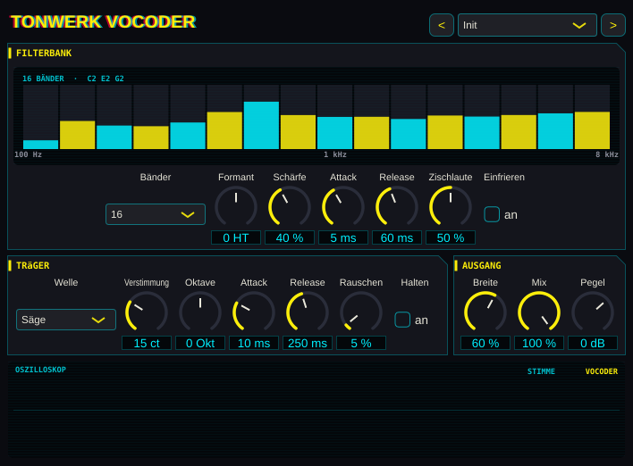

- **Filterbank**: **Bänder** 8, 12, 16, 24 oder 32 zwischen 100 Hz und 8 kHz (wenige klingen nach Blechroboter, viele sind verständlicher). **Formant** −12 bis +12 HT setzt die Bänder des Trägers höher oder tiefer als die der Stimme (minus: Monster, plus: Zwerg). **Schärfe**: breite, ineinander laufende oder schmale Bänder. **Attack** und **Release**: wie schnell jedes Band der Stimme folgt; lang verwischt die Wörter zu einer Fläche. **Zischlaute**: wie viel von S, T, Sch (über 5 kHz) an der Filterbank vorbei durchgeht, damit Konsonanten verständlich bleiben. **Einfrieren** hält die Bänder, wie sie gerade sind: ein Vokal bleibt stehen, solange die Noten klingen. Die Anzeige zeigt die Bänder als Balken und die gespielten Noten (Logics Namen, C3 = 60).
- **Träger**: **Welle** Säge (der klassische Klang), Rechteck (hohler), Puls (dünner) oder Super-Säge (drei verstimmte Sägen je Note: ein Chor). **Verstimmung** der Super-Säge 0 bis 50 Cent, **Oktave** −2 bis +2, **Attack** und **Release** der Noten, **Rauschen** (mischt Rauschen in den Träger, für Konsonanten und Flüstern), **Halten** (der Akkord klingt weiter, wenn du loslässt, bis du einen neuen spielst). Pitchbend ±2 Halbtöne.
- **Ausgang**: **Breite** verteilt die Bänder abwechselnd nach links und rechts (bei 0 % Mono), **Mix** (100 % nur der Vocoder), **Pegel** −24 bis +12 dB.

Wie es rechnet: Die Stimme läuft durch die Bänder (je zwei Bandpässe hintereinander für steile Flanken), ein Hüllkurvenfolger pro Band misst ihren Pegel. Der Träger läuft durch dieselben Bänder; jedes wird zuerst auf gleichen Pegel gebracht und bekommt dann den Pegel der Stimme in diesem Band. Dadurch klingt eine einzelne Note so laut wie ein Akkord, und auch die schwachen oberen Obertöne einer Säge tragen die Stimme. Ohne Latenz. 32 Bänder unter acht Super-Säge-Stimmen rechnet der Test etwa 35-mal schneller als Echtzeit.

**Presets**: **Klassisch**: Studio 1978, Electro-Funk, Sprechender Synth, Weiche Stimme. **Chor**: Roboterchor, Engelschor, Tiefer Chor. **Roboter**: Blechstimme, Androide, Funkspruch. **Effekte**: Monster, Zwerg, Flüstern, Atmende Fläche. Jedes ist auf eine Stimme mit Spitzen um −6 dBFS und einen gehaltenen Akkord eingepegelt (im Test höchstens 2 dB daneben). Hörproben mit einer Sprachsynthese-Stimme unter einem C-Dur-Akkord liegen im Projektordner unter `synth/hoerproben/Tonwerk Vocoder` (auch als `synth/hoerproben-vocoder.zip`), dazu die Stimme trocken.

**Getestet und ungetestet:** Unter Linux gebaut und getestet (Obertöne des Trägers da, wo die Stimme Energie hat, Stille ohne Noten, die Bänder folgen dem Spektrum der Stimme, Formant verschiebt es, Pegel bei einer Note und bei Akkorden mit allen Bandzahlen, Release, Einfrieren, Release der Noten, Halten bis zum nächsten Akkord, Zischlaute, Breite, CPU, alle Presets, Zustand, Oberfläche als Bild). `auval` läuft in der GitHub Action. In Logic und mit einer echten Stimme ist er noch nicht gehört.

## Tonwerk Wobble (Effekt)

Der Wobble-Bass des Dubstep auf jeder Spur: ein Filter und ein Volume-Shaper, die jeweils von einem LFO bewegt werden, dessen Kurve du selbst zeichnest. Beide laufen im Tempo von Logic mit und stehen auf der Songposition, ein Wobble sitzt also auf dem Beat, egal wo die Wiedergabe startet oder loopt; bei angehaltenem Transport laufen sie im Tempo weiter. In Logic: **Audio-FX → Audio Units → b-velop → Tonwerk Wobble**, am liebsten auf einem gehaltenen Bass (Tonwerk Wavetable, Tonwerk Analog).

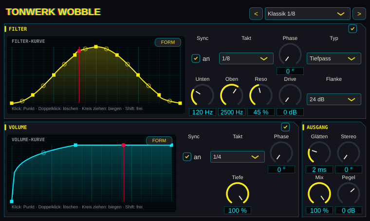

- **Kurven zeichnen**: Klick setzt einen Punkt (rastet auf Sechzehntel des Zyklus, mit Shift frei), Ziehen verschiebt ihn, Doppelklick oder Rechtsklick löscht ihn. Der Kreis in der Mitte eines Abschnitts biegt ihn nach oben oder unten, Doppelklick darauf macht ihn wieder gerade. Zwei Punkte übereinander ergeben eine Stufe (für Gates). **FORM** bietet Grundformen (Sinus, Dreieck, Säge ab, Säge auf, Rechteck, Pumpen, Anstieg, Treppe, Gerade) und dreht die Kurve um (oben/unten), spiegelt sie (rückwärts), verdoppelt sie (zweimal pro Zyklus) oder übernimmt die der anderen Spur. Die rote Linie zeigt, wo der LFO gerade ist.
- **Filter** (Schalter oben rechts): **Sync** an spielt eine Kurve pro **Takt**-Wert (4/1 bis 1/64, punktiert und Triolen), aus läuft sie mit **Rate** in Hz. **Phase** 0 bis 360° verschiebt die Kurve gegen den Beat. **Typ** Tiefpass, Bandpass, Hochpass oder **Vokal**. **Unten** und **Oben** sind die Cutoffs am unteren und oberen Rand der Kurve (dazwischen in Oktaven). **Reso** 0 bis 100 %, **Drive** 0 bis 24 dB (Sättigung vor dem Filter, auf gleichen Pegel bei −6 dBFS), **Flanke** 12 oder 24 dB.
- **Vokal** ist das „Yoi“ und „Wau“ des Dubstep: drei Formantfilter, die mit der Kurve von u (unten) über o, a, e nach i (oben) gleiten. Unten und Oben wirken dabei nicht, Reso macht die Vokale schärfer.
- **Volume** (Schalter oben rechts, aus Werk aus): eigener Takt, Rate und Phase. **Tiefe** 0 bis 100 % sagt, wie weit der untere Rand der Kurve leiser macht. Mit Pumpen klingt es wie ein Sidechain zur Kick, mit Stufen wie ein Trance-Gate.
- **Ausgang**: **Glätten** 0 bis 50 ms nimmt harten Sprüngen das Knacken. **Stereo** 0 bis 180° lässt die rechte Seite vorauslaufen (180° mit dem Volume ist ein Auto-Pan). **Mix** und **Pegel** −24 bis +12 dB.

Wie es rechnet: Die Kurven sind Punkte mit einer Biegung pro Abschnitt (Potenzkurven bis Exponent 8) und werden für den Audio-Thread in Tabellen mit 1024 Werten gezeichnet. Die Filter sind State-Variable-Filter (TPT), die auch bei schnellen Wobbles stabil und gestimmt bleiben; die Koeffizienten folgen alle 8 Samples. Im Test läuft Stereo mit Drive, Filter und Volume etwa 150-mal schneller als Echtzeit.

**Presets**: **Wobble**: Klassik 1/8, Langsam 1/4, Halftime 1/2, Triolen 1/8T, Sechzehntel, Säge-Wobble, Dreckig, Zweiklang 1/16, Wobble-Ritt. **Yoi & Vokal**: Yoi, Wau-Wau, Sprechender Bass. **Pumpen**: Sidechain 1/4, Sidechain 1/8, Pumpender Filter. **Gater**: Trance-Gate, Stotter-Gate, Triolen-Gate, Gate + Wobble. **Bewegung**: Langsamer Sweep, Stereo-Kreisen, Tremolo, Auto-Pan, Hochpass-Riser. Ein Preset bringt seine Kurven mit; jedes ist auf seine Quelle (gehaltener Bass oder Fläche, Spitzen um −6 dBFS, 140 BPM) eingepegelt, im Test höchstens 2 dB daneben.

**Getestet und ungetestet:** Unter Linux gebaut und getestet (Kurven, Stufen und Biegungen, Text im Zustand, Gate-Anteile, LFO auf dem Beat aus der Songposition, freier Lauf bei Stopp und ohne Sync, Stereo-Versatz, Tiefe, Glätten ohne Knacken, Filterfrequenzen und Flanken, Resonanz, Formanten des Vokalfilters, Mix, Presets mit Kurven, Oberfläche, CPU). Die Presets sind als Spektrogramm angesehen, nicht angehört. `auval` läuft in der GitHub Action. In Logic ist es noch nicht gehört.

## Tonwerk Delay (Effekt)

Ein Delay für Rhythmus und Dub: Echos im Songtempo, die zwischen links und rechts springen, im Feedback gefiltert und gesättigt, und auf Wunsch geduckt, sodass sie nur in den Pausen kommen. Auf jeder Spur: **Audio-FX → Audio Units → b-velop → Tonwerk Delay** (`aufx TwDl Bvlp`).

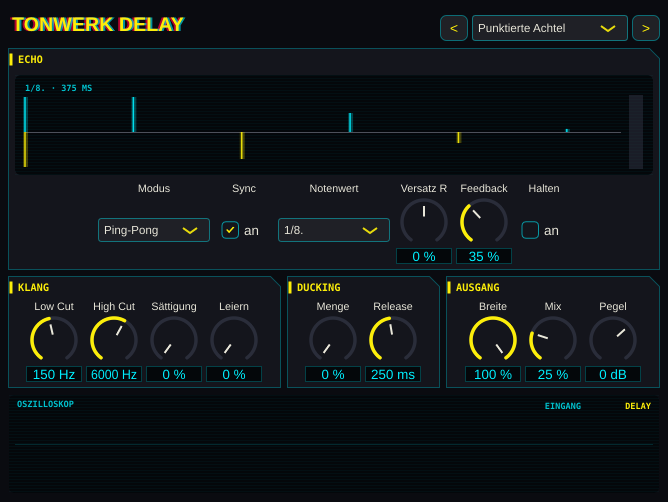

- **Echo**: **Modus** *Stereo* (jede Seite für sich, die rechte um **Versatz R** −50 bis +50 % länger oder kürzer), *Ping-Pong* (das erste Echo links, das nächste rechts und so weiter) oder *Mono*. **Sync** an: **Notenwert** 1/1 bis 1/32 mit punktierten (.) und Triolen (T) im Tempo von Logic; aus: **Zeit** 1 bis 4000 ms. Ändert sich die Zeit, gleitet das Delay in etwa 60 ms hin, wie ein Bandecho, statt zu knacken. **Feedback** 0 bis 100 %. **Halten**: was gerade kreist, läuft endlos weiter, nichts Neues kommt hinein. Die Anzeige zeigt die kommenden Echos (links cyan oben, rechts gelb unten, 40 dB hoch) und rechts, wie stark gerade geduckt wird.
- **Klang** (im Feedback, jedes Echo wird weiter gefiltert): **Low Cut** 20 bis 2000 Hz, **High Cut** 500 Hz bis 20 kHz, **Sättigung** (die Echos werden wärmer und lauter gedrückt; ein wenig ist immer da, deshalb läuft ein Feedback von 100 % weiter, ohne zu explodieren), **Leiern** (die Echos schwanken in der Tonhöhe wie von einem alten Band).
- **Ducking**: **Menge** (wie weit die Echos leiser werden, solange das Signal spielt; ab etwa −12 dBFS ganz, unter −42 dBFS gar nicht) und **Release** (wie schnell sie danach zurückkommen).
- **Ausgang**: **Breite** (0 % legt die Echos in die Mitte), **Mix** (bis 50 % bleibt das trockene Signal voll und die Echos kommen dazu, darüber wird das Trockene leiser), **Pegel** −24 bis +12 dB.

**Presets**: **Rhythmisch**: Punktierte Achtel, Achtel Ping-Pong, Triolen, Slapback, Doppelt. **Dub**: Dub-Echo, Endlos-Dub, Bandecho. **Raum**: Weite Wolke, Gesangs-Delay, Ducking-Fläche. **Effekte**: Telefon-Echo, Flatter-Echo, Leiernde Kassette. Jedes ist auf eine Synth-Linie mit Pausen bei 120 BPM eingepegelt (Spitzen um −6 dBFS, im Test höchstens 2 dB daneben). Hörproben liegen im Projektordner unter `synth/hoerproben/Tonwerk Delay` (auch als `synth/hoerproben-delay.zip`), dazu die Linie trocken.

**CPU:** Zwei Leitungen, gelesen mit kubischer Interpolation, Filter erster Ordnung (je zwei hintereinander); der Test rechnet etwa 140-mal schneller als Echtzeit. Keine Latenz.

**Getestet und ungetestet:** Unter Linux gebaut und getestet (Echo auf das Sample genau frei und im Tempo, Versatz rechts, Feedback je Echo, Ping-Pong wechselt die Seite, Breite, Filter dunkeln jedes Echo weiter ab, Ducking hält die Echos unten und lässt sie danach zurück, volle Rückkopplung mit Sättigung bleibt begrenzt, Halten, CPU, alle Presets, Zustand, Oberfläche als Bild). `auval` läuft in der GitHub Action. In Logic noch nicht gehört.

## Tonwerk Chorus (Effekt)

Chorus, Ensemble, Flanger und Phaser in einem Plugin, alle von einem LFO bewegt, frei oder im Songtempo. Auf jeder Spur: **Audio-FX → Audio Units → b-velop → Tonwerk Chorus** (`aufx TwCh Bvlp`).

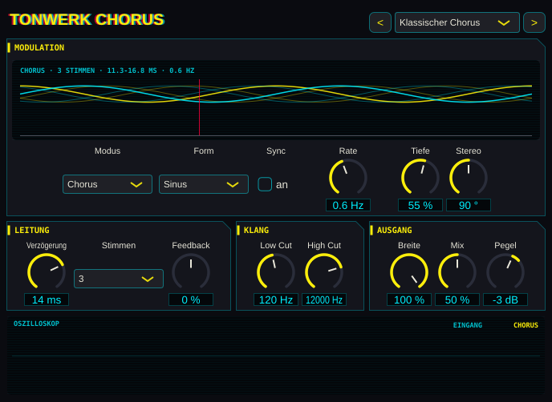

- **Modulation**: **Modus** *Chorus* (1 bis 4 Stimmen je Seite, jede um die Verzögerung herum bewegt, bis zu 5 ms weit), *Ensemble* (drei Leitungen wie in den String-Maschinen der Siebziger, ein langsamer und ein schneller LFO zugleich, ihr typisches Schimmern), *Flanger* (eine Leitung, von der Verzögerung bis fast auf null und zurück, mit Feedback ein tiefer Kamm) oder *Phaser* (4, 6, 8 oder 12 Allpass-Stufen, bis zu zwei Oktaven um die Frequenz herum bewegt). **Form** Sinus oder Dreieck. **Sync** an: **Notenwert** 4 Takte bis 1/16, und während Logic spielt, liegt der LFO auf den Takten (ein Flanger über zwei Takte fängt auf jeder zweiten Eins von vorn an); aus: **Rate** 0.02 bis 10 Hz. **Tiefe** 0 bis 100 %, **Stereo** 0 bis 180° Versatz zwischen dem linken und dem rechten LFO. Die Anzeige zeigt zwei Durchläufe dessen, was der LFO bewegt (Verzögerung in ms, beim Phaser die Frequenz), links cyan, rechts gelb, weitere Chorus-Stimmen blasser, und in Rot, wo der LFO gerade steht.
- **Leitung** (Chorus, Ensemble, Flanger): **Verzögerung** 0.5 bis 30 ms, **Stimmen** (nur Chorus), **Feedback** −95 bis +95 % (beim Flanger der Kamm, negativ hohl und metallisch; beim Chorus mit halber Stärke etwas Farbe). Im Modus Phaser stehen hier **Frequenz** 50 bis 5000 Hz, **Stufen** und **Feedback**.
- **Klang** (nur der Effektanteil): **Low Cut** 20 bis 1000 Hz (der Bass bleibt trocken und damit mittig und druckvoll), **High Cut** 1 bis 20 kHz.
- **Ausgang**: **Breite**, **Mix** (bis 50 % bleibt das trockene Signal voll, ab 50 % der Effekt; bei 50 % sind beide gleich laut, so entstehen beim Flanger und Phaser die tiefsten Kerben), **Pegel** −24 bis +12 dB, Standard −3 dB, weil Trocken und Effekt zusammen etwa 3 dB lauter sind als das Trockene allein.

Ein Wechsel des Modus blendet den Effekt über 10 ms aus und wieder ein, ein Presetwechsel knackt also nicht.

**Presets**: **Chorus**: Klassischer Chorus, Breiter Chorus, Dimension, Vibrato, Achtziger-Chorus. **Ensemble**: String-Ensemble, Sanftes Ensemble, Orgel-Rotor. **Flanger**: Jet-Flanger, Metall-Flanger, Sanfter Flanger, Schneller Flanger. **Phaser**: Klassischer Phaser, Tiefer Phaser, Sync-Phaser, Phaser-Wellen. Jedes ist auf einen gehaltenen Akkord mit gezupften Tönen danach eingepegelt (Spitzen um −6 dBFS, im Test höchstens 2 dB daneben). Hörproben liegen im Projektordner unter `synth/hoerproben/Tonwerk Chorus` (auch als `synth/hoerproben-chorus.zip`), dazu die Quelle trocken.

**CPU:** Der Chorus mit vier Stimmen und das Ensemble rechnen im Test etwa 75-mal schneller als Echtzeit, der Flanger über 200-mal, der Phaser mit 12 Stufen über 300-mal. Keine Latenz.

**Getestet und ungetestet:** Unter Linux gebaut und getestet (Verzögerung auf das Sample genau, Tonhöhenschwankung wie aus Tiefe und Rate berechnet, mehr Stimmen ohne mehr Pegel, Ensemble ohne tiefe Löcher im Pegel, Kerbe und Spitze des Flangers und des Phasers an ihrer berechneten Frequenz, Feedback hebt die Spitze wie berechnet, volles Feedback bleibt begrenzt, Stereo-Versatz und Breite, Sync auf den Takten, Moduswechsel ohne Knacken, CPU, alle Presets, Zustand, Oberfläche als Bild). `auval` läuft in der GitHub Action. In Logic noch nicht gehört.

## Tonwerk Glue (Effekt)

Ein Bus-Kompressor in der Art der Mischpult-Kompressoren, der einen Mix oder eine Drum-Gruppe zusammenklebt, mit Sidechain-Eingang für Ducking unter der Kick und einem Pumpen im Songtempo, das ganz ohne Kick auskommt. Auf jeder Spur oder jedem Bus: **Audio-FX → Audio Units → b-velop → Tonwerk Glue** (`aufx TwGl Bvlp`).

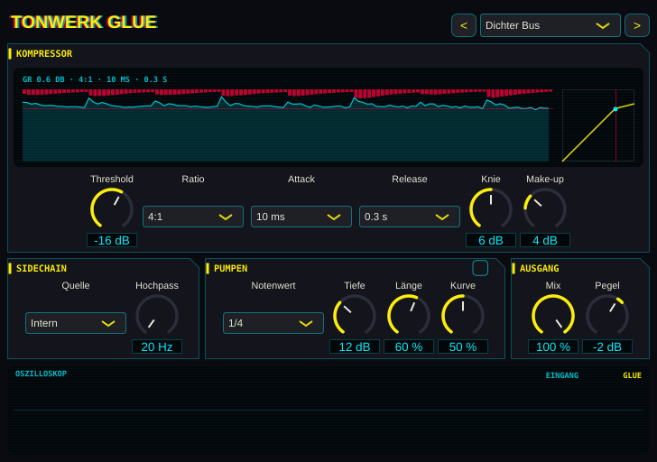

- **Kompressor**: **Threshold** −40 bis 0 dB, **Ratio** 1.5:1, 2:1, 4:1, 10:1 oder 20:1, **Attack** 0.1 bis 30 ms und **Release** 0.1 bis 1.2 s als Schalter wie am Pult, oder **Auto** (kurze Spitzen lässt er sofort los, lange dichte Passagen langsam, so atmet der Mix mit), **Knie** 0 bis 12 dB (weicher Einsatz), **Make-up** −6 bis +24 dB. Beide Seiten bekommen dieselbe Verstärkung, das Stereobild bleibt stehen. Die Anzeige zeigt die letzten vier Sekunden: die Reduktion rot von oben, das Pumpen gelb darunter, den Pegel am Detektor cyan von unten, rechts die Kennlinie mit dem Threshold und dem Punkt, an dem der Pegel gerade liegt.
- **Sidechain**: **Quelle** *Intern* (das Signal selbst) oder *Sidechain* (was Logic im Sidechain-Menü oben im Plugin-Fenster einspeist, zum Beispiel die Kick). Ohne eingespeistes Signal passiert im Modus Sidechain nichts, und die Anzeige meldet *SIDECHAIN FEHLT*. **Hochpass** 20 bis 500 Hz: der Detektor hört erst darüber, so drückt der Bass nicht den ganzen Mix.
- **Pumpen** (mit eigenem Schalter): bei jedem **Notenwert** (1/1 bis 1/16) zieht es den Pegel um die **Tiefe** (0 bis 36 dB) herunter und lässt ihn über die **Länge** (5 bis 100 % des Schritts) zurückkommen, die **Kurve** von gerade (0 %) bis lange unten bleiben und spät steigen (100 %). Während Logic spielt, liegt es auf den Schlägen des Songs. Es wirkt zusätzlich zum Kompressor.
- **Ausgang**: **Mix** (unter 100 % Parallelkompression: das Trockene kommt dazu), **Pegel** −24 bis +12 dB.

**Presets**: **Bus**: Mix-Kleber, Sanfter Bus, Dichter Bus, Mastering-Glue. **Drums**: Drum-Punch, Parallel-Drums, Raum-Quetsche. **Pumpen**: Viertel-Pumpen, Achtel-Pumpen, EDM-Ducking, Sanftes Atmen, Stotter-Pumpen. **Sidechain** (brauchen ein Signal im Sidechain-Menü): Kick-Ducking, Bass unter Kick, Platz für Gesang. Jedes ist auf eine Mix-Schleife bei 120 BPM eingepegelt (Kick, Snare, Bass, Fläche, Spitzen bei −6 dBFS, im Test höchstens 2 dB daneben). Hörproben liegen im Projektordner unter `synth/hoerproben/Tonwerk Glue` (auch als `synth/hoerproben-glue.zip`), dazu die Schleife trocken; die Sidechain-Presets klingen dort ohne Kick wie das Original.

**CPU:** Ein Detektor, ein Gain je Sample; der Test rechnet fast 300-mal schneller als Echtzeit. Keine Latenz.

**Getestet und ungetestet:** Unter Linux gebaut und getestet (Kennlinie bei allen fünf Ratios auf 0.3 dB genau, Knie, Make-up, Attack 10 ms und Release 300 ms gemessen, Auto-Release lässt einen kurzen Schlag in 100 ms und eine lange Passage in über 1.5 s los, der Hochpass hält den Bass aus dem Detektor, Sidechain über den zweiten Eingang des Plugins duckt um über 20 dB, ohne Sidechain bleibt alles unverändert, Pumpen auf den Schlägen mit der gewollten Kurve, Mix, CPU, alle Presets, Zustand, Oberfläche als Bild). `auval` läuft in der GitHub Action. In Logic noch nicht gehört, auch das Sidechain-Menü nicht.

## Tonwerk Shimmer (Effekt)

Ein Hall, dessen Fahne mit jedem Umlauf ein Stück nach oben steigt, eine Oktave oder ein anderes Intervall, bis sie wie ein Chor über dem Signal schwebt; ohne Shimmer ein schlichter, dichter Hall. Sparsam gebaut, damit er auf vielen Spuren laufen kann. Auf jeder Spur oder jedem Bus: **Audio-FX → Audio Units → b-velop → Tonwerk Shimmer** (`aufx TwSh Bvlp`).

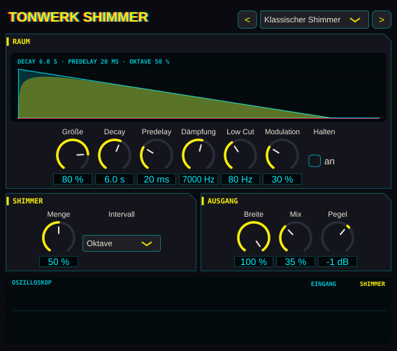

- **Raum**: **Größe** (wie weit die Wände auseinander stehen), **Decay** 0.3 bis 30 s (die Zeit, in der die Fahne um 60 dB fällt), **Predelay** 0 bis 500 ms, **Dämpfung** 1 bis 20 kHz (die Höhen sterben früher; ganz rechts aus), **Low Cut** 20 bis 1000 Hz (die Fahne dröhnt nicht; ganz links aus), **Modulation** (die Fahne wandert leicht, lange Fahnen klingen dann nicht metallisch), **Halten** (die Fahne läuft endlos weiter, nichts Neues kommt hinein, der Shimmer ruht). Die Anzeige zeigt nach dem Predelay den Verlauf der Fahne in dB (cyan) und gelb darin den Anteil, den der Shimmer schon angehoben hat.
- **Shimmer**: **Menge** (wie viel der Fahne bei jedem Umlauf durch den Tonhöhenschieber geht), **Intervall** *Oktave*, *Quinte*, *Quarte*, *Oktave + Quinte*, *Zwei Oktaven* oder *Oktave tiefer*. Der Schieber sitzt in der Rückkopplung, so wird das Angehobene beim nächsten Umlauf noch einmal angehoben; lauter werden kann die Fahne dadurch nicht.
- **Ausgang**: **Breite**, **Mix** (bis 50 % bleibt das trockene Signal voll), **Pegel** −24 bis +12 dB.

**Presets**: **Shimmer**: Klassischer Shimmer, Engelschor, Quinten-Shimmer, Oktave und Quinte, Doppel-Oktave. **Hall** (ohne Shimmer): Großer Hall, Kathedrale, Heller Raum, Dunkle Halle. **Ambient**: Endlose Fläche, Wolke, Sternenstaub. **Effekte**: Unterwelt (eine Oktave nach unten), Gitarren-Shimmer, Kristall. Jedes ist auf einen gehaltenen Akkord mit gezupften Tönen danach eingepegelt (Spitzen um −6 dBFS, im Test höchstens 2 dB daneben). Hörproben liegen im Projektordner unter `synth/hoerproben/Tonwerk Shimmer` (auch als `synth/hoerproben-shimmer.zip`), dazu die Quelle trocken.

**CPU:** Acht Verzögerungsleitungen, zwei Tonhöhenschieber und je Seite vier Allpässe, keine FFT; der Test rechnet fast 70-mal schneller als Echtzeit. Keine Latenz.

**Getestet und ungetestet:** Unter Linux gebaut und getestet (Nachhallzeit bei 1, 3 und 8 s auf 1 % genau, Dämpfung nimmt die Höhen aus der Fahne, Oktave, Quinte und Oktave tiefer erscheinen in der Fahne über 20 dB stärker als ohne Shimmer, lautes Rauschen bei 30 s Decay und vollem Shimmer bleibt begrenzt, Halten hält die Fahne über 4 s, Predelay, die Seiten sind unkorreliert, Breite, CPU, alle Presets, Zustand, Oberfläche als Bild). `auval` läuft in der GitHub Action. In Logic noch nicht gehört.

## Tonwerk Filter (Effekt)

Ein Multimode-Filter, das sich bewegt: Ein **Envelope Follower** liest die Lautstärke der Spur und öffnet das Filter mit jedem Anschlag (Auto-Wah, Funk-Gitarre, Bass-Quaken), ein **LFO** fährt es frei in Hertz oder im Songtempo auf und zu. Anders als Tonwerk Wobble gibt es keine gezeichneten Kurven, dafür acht Filtertypen und die Hüllkurve. Auf jeder Spur oder jedem Bus: **Audio-FX → Audio Units → b-velop → Tonwerk Filter** (`aufx TwFl Bvlp`).

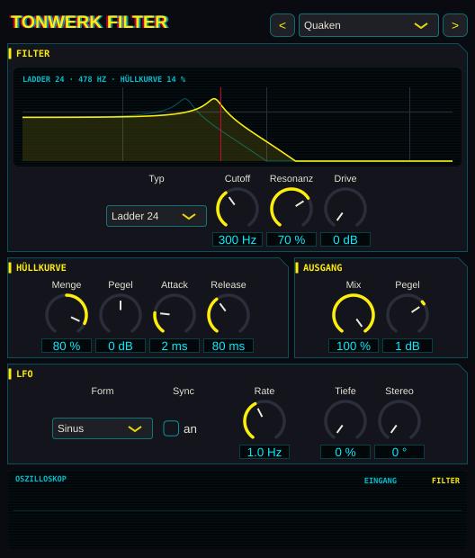

- **Filter**: **Typ** *Tiefpass 12* und *24*, *Ladder 24* (die Transistorkette der klassischen Synths, warm, schwingt ganz rechts von selbst), *Hochpass 12* und *24*, *Bandpass*, *Notch*, *Kamm* (Spitzen auf den Obertönen der Cutoff-Frequenz, metallisch). **Cutoff** 20 bis 20000 Hz, **Resonanz**, **Drive** 0 bis 24 dB (Sättigung vor dem Filter; eine Note bei −6 dBFS bleibt dabei etwa gleich laut). Die Anzeige zeigt den Frequenzgang, wie die Regler ihn setzen (cyan), und wo Hüllkurve und LFO ihn gerade hingeschoben haben (gelb, rote Linie am Cutoff).
- **Hüllkurve**: **Menge** −100 bis +100 % (bei 100 % öffnet ein Signal bei Vollpegel das Filter um sechs Oktaven, negativ schließt es), **Pegel** −24 bis +24 dB (leise Spuren brauchen mehr, um oben anzukommen), **Attack** 1 bis 200 ms, **Release** 10 bis 2000 ms. Beide Seiten folgen der lauteren, damit das Filter links und rechts gleich läuft.
- **LFO**: **Form** *Sinus*, *Dreieck*, *Säge auf*, *Säge ab*, *Rechteck*, *Zufall* (ein neuer Wert pro Durchlauf), **Sync** mit **Takt** von 4/1 bis 1/64 (mit punktierten und Triolen; läuft der Song, sitzt der LFO auf den Takten, egal wo die Wiedergabe beginnt) oder frei mit **Rate** 0.05 bis 20 Hz, **Tiefe** (bei 100 % vier Oktaven nach oben und unten), **Stereo** 0 bis 180° (der rechte LFO läuft voraus, das Filter kreist im Panorama). Sprünge von Rechteck und Zufall gleitet das Filter über 3 ms, damit nichts knackt.
- **Ausgang**: **Mix**, **Pegel** −24 bis +12 dB.

**Presets**: **Auto-Wah**: Funk-Wah, Bass-Hüllkurve, Quaken, Sanftes Öffnen, Umgekehrt (je lauter, desto dunkler). **Rhythmisch** (im Songtempo): Achtel-Pumpe, Sechzehntel-Gate, Zufalls-Treppe, Triolen-Wobble. **Sweeps**: Langsamer Sweep, Hochpass-Riser (über vier Takte), Notch-Phaser, Stereo-Kreisen. **Klangfarbe**: Telefon, Dunkler Ladder, Acid-Kante, Kamm-Metall, Kamm-Flanger. Jedes ist auf eine Basslinie unter einem gehaltenen Akkord bei 120 BPM eingepegelt (Spitzen um −6 dBFS, im Test höchstens 2 dB daneben). `TONWERK_FILTER_WAV_DIR=<Ordner>` schreibt beim Test die Hörproben.

**CPU:** Zwei Filter, ein Follower und ein LFO; die Koeffizienten werden alle 8 Samples neu gerechnet. Stereo rechnet der Test je nach Typ 200- bis 350-mal schneller als Echtzeit. Keine Latenz.

**Getestet und ungetestet:** Unter Linux gebaut und getestet (Flanken aller Typen zwei Oktaven um den Cutoff auf 3 dB genau, Resonanzspitze, die Ladder schwingt von selbst, Kammzähne, Hüllkurve öffnet und schließt, synchronisierter LFO auf dem Schlag, Stereo-Versatz, Rechteck und Zufall ohne Knacken, Mix 0 lässt das Signal unberührt, lautes Rauschen bei voller Resonanz und Drive bleibt begrenzt, CPU, alle Presets, Zustand, Oberfläche als Bild). `auval` läuft in der GitHub Action. In Logic noch nicht gehört.

## Tonwerk Stutter (Effekt)

Ein Beat Repeat im Songtempo: An einer festen Stelle im Takt greift er sich ein kurzes Stück der Spur und wiederholt es, auf Wunsch leiser werdend, höher oder tiefer, rückwärts oder durch ein Filter, das sich schließt. Für Stotter-Fills vor dem Drop, Snare-Rolls aus der eigenen Snare, Glitches auf Vocals und Drums. Anders als Chrome Glitch, das zufällig über die Spur verteilt zerhackt, sitzt Stutter fest auf dem Raster des Songs. Auf jeder Spur oder jedem Bus: **Audio-FX → Audio Units → b-velop → Tonwerk Stutter** (`aufx TwSt Bvlp`).

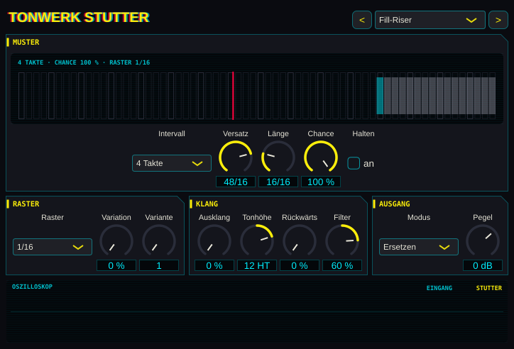

- **Muster**: **Intervall** 1/4, 1/2, 1, 2 oder 4 Takte: so oft wird gewürfelt. **Chance** 0 bis 100 %: wie oft es dann losgeht. **Versatz** 0/16 bis 63/16: wo im Intervall (in Sechzehnteln; 8/16 ist Schlag drei). **Länge** 1/16 bis 64/16: wie lange es wiederholt, das erste, live gespielte Stück mitgezählt. **Halten**: wiederholt ab der nächsten Rasterlinie, solange es an ist, unabhängig vom Würfel; in Logic zu automatisieren (Preset *Von Hand*). Die Anzeige zeigt das Intervall in Sechzehnteln, das erste Stück (cyan), die Wiederholungen (gelb, solange sie klingen) und wo der Song gerade steht.
- **Raster**: **Raster** 1/4 bis 1/64, auch triolisch: so lang ist das wiederholte Stück. **Variation**: wie oft es stattdessen eine oder zwei Stufen kürzer oder eine länger ist. **Variante** 1 bis 99: ein anderer Würfelsatz. Der Würfel hängt an der Stelle im Song: dieselbe Stelle wiederholt sich bei jedem Abspielen und im Bounce gleich.
- **Klang**: **Ausklang** (bei 100 % ist die letzte Wiederholung fast stumm), **Tonhöhe** −24 bis +24 HT (die Wiederholungen gehen stufenweise dorthin; tief klingt wie ein Bandstopp, hoch wie ein Riser), **Rückwärts** (Chance, dass ein Stück rückwärts läuft), **Filter** −100 bis +100 % (negativ schließt ein Tiefpass über die Länge, positiv öffnet ein Hochpass).
- **Ausgang**: **Modus** *Ersetzen* (die Wiederholungen statt der Spur), *Mischen* (über der Spur, wie ein Echo), *Gate* (nur die Wiederholungen, sonst Stille), **Pegel** −24 bis +12 dB. Alle Schnitte blenden über 1,5 ms, damit nichts knackt.

**Presets**: **Beat Repeat**: Sechzehntel auf drei, Achtel-Echo, Triolen-Repeat, Halbtakt-Stotter, Zweitakt-Ende. **Glitch**: Zufalls-Splitter, Rückwärts-Fetzen, Bitsplitter, Chaos. **Fills** (am Ende von zwei oder vier Takten): Snare-Roll, Fill-Riser, Bandstopp, Abtauchen. **Effekte**: Repeat-Gate, Dub-Wiederholung, Von Hand. Auf einem Drumloop liegen alle im Test zwischen −2 und +2 dB des Loops. `TONWERK_STUTTER_WAV_DIR=<Ordner>` schreibt beim Test die Hörproben.

**CPU:** kaum etwas: ein Puffer für das Stück, ein Filter. Der Test rechnet einen Repeat auf jedem Schlag mit Tonhöhe und Filter mehrere hundert Mal schneller als Echtzeit. Keine Latenz.

**Getestet und ungetestet:** Unter Linux gebaut und getestet (ohne Chance bleibt das Signal unberührt, Schlag drei mit drei Wiederholungen auf das Sample genau, danach wieder das Original, Mischen und Gate, rückwärts, Tonhöhe stufenweise, Ausklang, Filter, Würfel um die Chance, gleich bei jedem Lauf und anders mit anderer Variante, Variation, Start mitten im Takt, Halten, keine Knackser, alle Presets auf einem Drumloop, CPU, Zustand, Oberfläche als Bild). `auval` läuft in der GitHub Action. In Logic noch nicht gehört.

## Tonwerk Multiband (Effekt)

Ein Drei-Band-Kompressor: Tiefen, Mitten und Höhen bekommen je einen eigenen Kompressor, der laute Stellen herunterzieht und auf Wunsch leise hochholt (Aufwärtskompression, der dichte Klang aus Dubstep und EDM, der jeden Oberton eines Basses nach vorn holt). Auf jeder Spur oder jedem Bus: **Audio-FX → Audio Units → b-velop → Tonwerk Multiband** (`aufx TwMb Bvlp`).

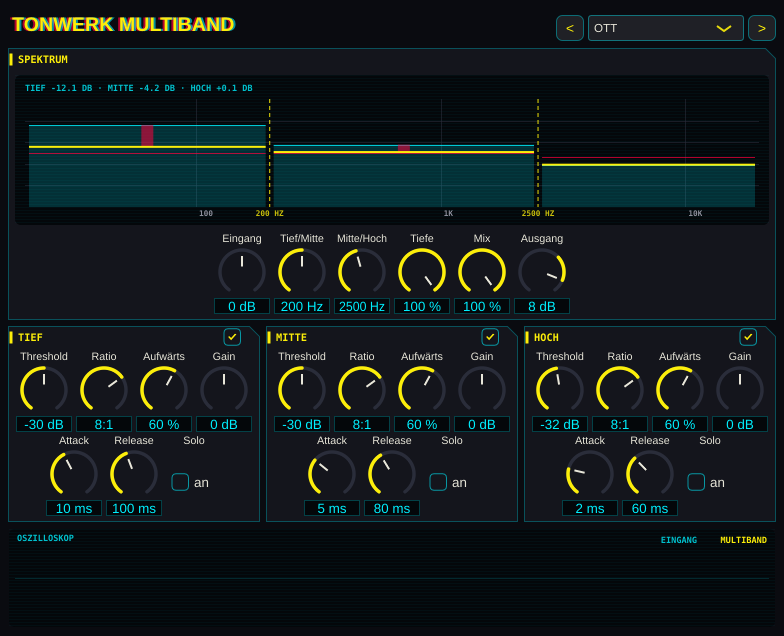

- **Spektrum**: Die Anzeige zeigt die drei Bänder von 20 Hz bis 20 kHz, die Trennfrequenzen als gelbe Linien. In jedem Band steigt der Pegel am Detektor cyan von unten, der Threshold ist rot, und gelb steht, wo das Band nach dem Kompressor landet: unter dem Pegel, wenn es heruntergezogen wird, darüber, wenn es angehoben wird. Darunter **Eingang** −24 bis +24 dB (treibt alle Bänder in den Kompressor), **Tief/Mitte** 40 bis 1000 Hz und **Mitte/Hoch** 1000 bis 12000 Hz (die Trennfrequenzen), **Tiefe** 0 bis 100 % (wie stark alle Bänder zugleich wirken), **Mix** (unter 100 % kommt das Trockene dazu) und **Ausgang** −24 bis +12 dB.
- **Tief, Mitte, Hoch** (je mit Schalter, aus heißt: das Band bleibt unberührt): **Threshold** −60 bis 0 dB, **Ratio** 1:1 bis 20:1 (über dem Threshold), **Aufwärts** 0 bis 100 % (unter dem Threshold: bei 50 % kommt ein Signal 20 dB darunter um 10 dB hoch, bei 100 % bis an den Threshold, höchstens 18 dB; unter −60 dBFS lässt es nach, damit Rauschen und Stille bleiben, was sie sind), **Gain** −24 bis +24 dB, **Attack** 0.5 bis 200 ms, **Release** 10 bis 1000 ms, **Solo** (nur dieses Band hören, auch mehrere zugleich). Beide Seiten bekommen dieselbe Verstärkung, das Stereobild bleibt stehen.

Die Weichen sind Linkwitz-Riley mit 24 dB pro Oktave: ohne Kompression addieren sich die Bänder zu einem geraden Frequenzgang (im Test auf 0.001 dB). Das Trockene läuft durch dieselben Allpässe, damit Mix unter 100 % keine Kammfilter-Löcher an den Trennfrequenzen reißt.

**Presets**: **Mix**: Sanfter Master, Dichter Mix, Tiefen zähmen, Glanz. **Druck**: Volldruck, Halber Druck, Hyper, Paralleldruck. **Drums**: Drum-Bus, Raum aufblasen. **Bass**: Bass-Kontrolle, Growl nach vorn, Sub festnageln. **Gesang**: De-Esser, Stimme nach vorn. Jedes ist mit **Ausgang** auf eine Mix-Schleife bei 120 BPM eingepegelt (Kick, Snare, Hi-Hats, Bass, Fläche, Spitzen bei −6 dBFS, im Test höchstens 2 dB daneben, keine Spitze über Vollpegel). `TONWERK_MULTIBAND_WAV_DIR=<Ordner>` schreibt beim Testen jedes Preset auf diese Schleife als WAV.

**CPU:** Drei Weichen und drei Detektoren pro Sample; der Test rechnet über hundertmal schneller als Echtzeit. Keine Latenz.

**Getestet und ungetestet:** Unter Linux gebaut und getestet (Bänder addieren sich ohne Kompression gerade, Mix 50 % ohne Loch an den Trennfrequenzen, jedes Band verändert nur seinen Bereich, Kennlinie bei 2:1, 4:1 und 10:1 auf 0.2 dB genau, Aufwärtskompression um die Hälfte und höchstens 18 dB, Rauschen unter −60 dBFS bleibt, Tiefe halbiert alles, Attack 10 ms und Release 200 ms gemessen, Solo, CPU, alle Presets, Zustand, Oberfläche als Bild). `auval` läuft in der GitHub Action. In Logic noch nicht gehört.

## Tonwerk Zone (Effekt)

Ein Kompressor für einen Frequenzbereich, den du einstellst: eine Glocke um eine Frequenz oder alles unter oder über ihr. Nur dieser Bereich wird abgehört und, wenn er zu laut wird, heruntergeregelt; der Rest bleibt unberührt (ein dynamischer EQ). Zum Entschärfen von Zischlauten, harten Mitten, dröhnenden Bassnoten oder um mit der Kick im Sidechain nur den Tiefen des Basses Platz zu machen. Auf jeder Spur oder jedem Bus: **Audio-FX → Audio Units → b-velop → Tonwerk Zone** (`aufx TwZn Bvlp`).

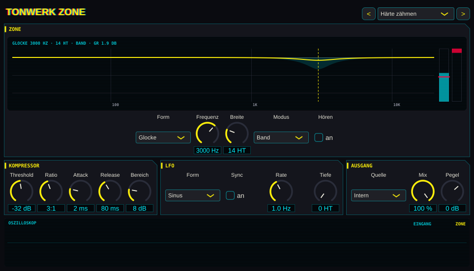

- **Zone**: **Form** *Glocke* (um die Frequenz), *Tiefen* (alles darunter) oder *Höhen* (alles darüber), **Frequenz** 20 bis 20000 Hz, **Breite** 2 bis 48 HT (nur für die Glocke, zwischen ihren −3-dB-Punkten; 12 HT ist eine Oktave), **Modus** *Band* (nur der Bereich wird leiser) oder *Breitband* (das ganze Signal wird leiser, der Bereich sagt nur wann, wie bei klassischen De-Essern), **Hören** (spielt nur, was der Detektor hört, um den Bereich zu finden). Die Anzeige zeigt den Bereich cyan schattiert so tief, wie er höchstens abgesenkt wird, gelb den Frequenzgang gerade jetzt, rechts den Pegel am Detektor gegen den Threshold (rot) und die Absenkung von oben.
- **Kompressor**: **Threshold** −60 bis 0 dB, **Ratio** 1:1 bis 20:1 (mit 6 dB weichem Knie), **Attack** 0.5 bis 200 ms, **Release** 10 bis 1000 ms, **Bereich** 0 bis 36 dB (weiter wird nie abgesenkt).
- **LFO**: bewegt die **Frequenz** (und den Filter des Sidechains mit). **Form** *Sinus*, *Dreieck*, *Säge auf*, *Säge ab*, *Rechteck* oder *Zufall* (ein neuer Wert je Zyklus), **Sync** (an: **Takt** von 4/1 bis 1/64, auch punktiert und triolisch, beim Abspielen an der Songposition ausgerichtet; aus: **Rate** 0.05 bis 20 Hz), **Tiefe** 0 bis 48 HT nach oben und unten (12 HT ist eine Oktave). Bei Tiefe 0 (der Voreinstellung) tut er nichts, ältere Projekte klingen also unverändert. Sprünge von Rechteck und Zufall gleiten über 3 ms. Die Anzeige folgt dem Bereich, die Kopfzeile zeigt *LFO ±… HT*.
- **Ausgang**: **Quelle** *Intern* oder *Sidechain* (was Logic im Sidechain-Menü einspeist, durch denselben Filter gehört; ohne Signal passiert nichts, die Anzeige meldet *SIDECHAIN FEHLT*), **Mix**, **Pegel** −24 bis +12 dB.

Unter dem Threshold kommt das Signal Bit für Bit unverändert heraus: Der Filter teilt es in Tiefen, Band und Höhen, die sich wieder genau zum Signal addieren, und die Absenkung ändert nur, wie sie addiert werden. Deshalb kämmt auch Mix unter 100 % nicht.

**Presets**: **Gesang**: De-Esser, De-Esser breit, Nasal weg. **Mix**: Härte zähmen, Mulm weg, Becken zähmen. **Bass**: Dröhnen bändigen, Sub glätten, Growl-Spitzen. **Sidechain** (brauchen ein Signal im Sidechain-Menü): Kick-Platz im Bass, Platz für Gesang. **Bewegung** (mit LFO im Songtempo): Wandernde Glocke, Kerbe im Takt, Höhen-Pendel. Jedes ist auf eine Mix-Schleife bei 120 BPM eingepegelt (im Test höchstens 2 dB daneben, keine Spitze über Vollpegel). `TONWERK_ZONE_WAV_DIR=<Ordner>` schreibt beim Testen jedes Preset auf diese Schleife als WAV.

**CPU:** Ein Filter pro Seite, einer mehr für den Sidechain; der Test rechnet über fünfhundertmal schneller als Echtzeit. Mit LFO werden die Filterwerte alle 16 Samples neu berechnet, ohne LFO einmal pro Block. Keine Latenz.

**Getestet und ungetestet:** Unter Linux gebaut und getestet (unter dem Threshold bitgenau bei allen drei Formen, Glocke bei 3 kHz senkt nur 3 kHz um die berechneten 17 dB, Breitband alles gleich, der Detektor hört nur den Bereich, Bereich begrenzt die Absenkung, Tiefen- und Höhen-Form, Attack 10 ms und Release 200 ms gemessen, Sidechain senkt die Tiefen des Basses um 15 dB und lässt seine Mitten stehen, auch über den zweiten Eingang des Plugins, Hören, CPU, alle Presets, Zustand, Oberfläche als Bild; der LFO senkt einen 1-kHz-Ton, wenn die Glocke ihn überstreicht, und lässt ihn zwei Oktaven daneben stehen, sitzt im Sync an der Songposition, und bei Tiefe 0 ist das Ergebnis bitgleich mit dem ohne LFO). `auval` läuft in der GitHub Action. In Logic noch nicht gehört, auch das Sidechain-Menü und der LFO nicht.

## Tonwerk Scope (Effekt)

Ein Oszilloskop im Night-City-Look: Es reicht das Audio unverändert durch (Bit für Bit, keine Latenz) und zeigt, was auf der Spur passiert, als Welle, als Takte des Songs oder als Stereobild, und stimmt als Stimmgerät Gitarre, Bass oder einen Synth. Auf jeder Spur oder jedem Bus, am besten als letztes Plugin: **Audio-FX → Audio Units → b-velop → Tonwerk Scope** (`aufx TwSc Bvlp`). Das Fenster lässt sich an der Ecke rechts unten größer ziehen, Logic merkt sich die Größe mit dem Projekt.

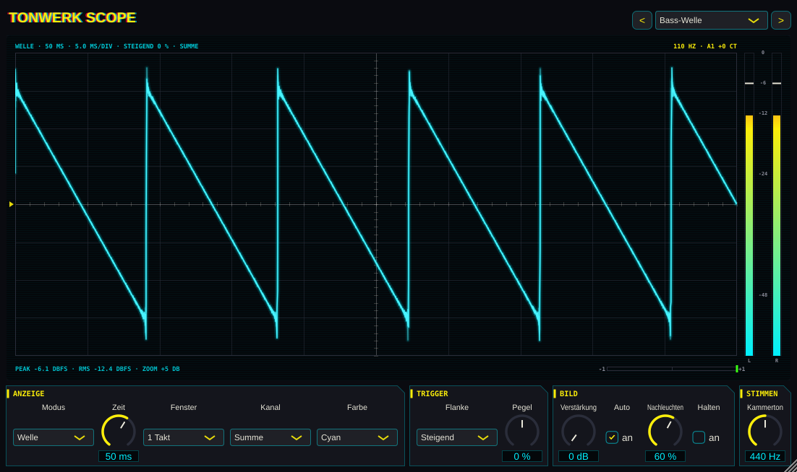

- **Anzeige**: **Modus** *Welle* (ein Ausschnitt von **Zeit** 1 bis 500 ms, getriggert, damit ein gehaltener Ton stillsteht; oben steht die Zeit pro Kästchen), *Takt* (das **Fenster** von 1/4 bis 4 Takten als Hüllkurve, wie Logic eine Region zeigt; jede Stelle im Takt liegt immer an derselben Stelle, so sieht man Pumpen und Ducking auf einen Blick; steht der Song, läuft es im Tempo weiter) *XY* (Goniometer: Mitte nach oben, Seite quer; Mono ist eine senkrechte Linie, je breiter das Bild, desto mehr geht es in die Breite) oder *Stimmgerät* (siehe unten). **Kanal** *Summe*, *Links*, *Rechts*, *Beide* (links in der gewählten Farbe, rechts rot oder cyan darüber) oder *Seite*. **Farbe** Cyan, Gelb, Rot oder Grün.
- **Trigger**: **Flanke** *Steigend*, *Fallend* oder *Frei* (läuft durch), **Pegel** −100 bis +100 % (gelbes Dreieck am linken Rand). Rauschen auf einer langsamen Welle löst nicht aus.
- **Bild**: **Verstärkung** 0 bis 36 dB oder **Auto** (zieht leise Signale bis 36 dB hoch, laute sofort zurück), **Nachleuchten** 0 bis 100 % (die Spur verblasst wie auf einer Bildröhre), **Halten** (friert das Bild ein).
- **Stimmen**: **Kammerton** 430 bis 450 Hz, das A3 nach Logics Zählung (440 Hz ist Standard, manche Orchester stimmen auf 442 oder 443 Hz).
- **Anzeigen**: oben rechts die Tonhöhe mit Notenname wie in Logic (A3 = 440 Hz) und Abweichung in Cent, unten Spitze, RMS und Zoom, rechts die Pegel beider Seiten (RMS als Balken, Spitze als Strich mit Rückfall) und darunter die Korrelation von −1 (gegenphasig, rot) bis +1 (mono).

**Stimmgerät**: Im Modus *Stimmgerät* (oder mit dem Preset gleichen Namens) zeigt der Schirm groß den nächsten Ton mit Oktave, darunter eine Skala von −50 bis +50 Cent mit Nadel, ein grünes Feld für ±3 Cent und ein Stroboskop, dessen Streifen in die Richtung laufen, in die der Ton danebenliegt, und stillstehen, wenn er stimmt. Darunter steht alles noch in Worten: Frequenz, Cent und *ZU TIEF*, *STIMMT* oder *ZU HOCH*. Die Farbe sagt es auch: grün bis 3 Cent, gelb bis 15, rot darüber. Gemessen wird der gewählte **Kanal** (Summe, links, rechts oder Seite), von 30 Hz (die tiefe H-Saite eines fünfsaitigen Basses hat 31 Hz) bis 1,5 kHz, 30-mal pro Sekunde. Eine verklingende Saite bleibt noch kurz gedimmt stehen. Das Plugin auf die Spur der Gitarre oder des Basses legen, oder in der Standalone-App den Eingang des Interfaces wählen.

**Presets**: **Welle**: Bass-Welle, Lead-Detail, Drum-Hüllkurve, Phosphor, Frei laufend. **Takt**: Ein Takt, Vier Takte, Sidechain-Check. **Stereo**: Goniometer, Links und Rechts, Nur Seite. **Stimmen**: Stimmgerät.

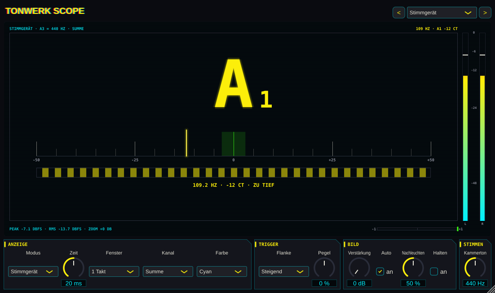

**CPU:** Im Audio-Thread nur zwei Kopien in Ringpuffer; der Test rechnet über tausendmal schneller als Echtzeit. Das Zeichnen läuft 30-mal pro Sekunde im Fenster und nur, solange es offen ist.

**Getestet und ungetestet:** Unter Linux gebaut und getestet (das Audio kommt in jedem Preset bitgenau heraus, Ringpuffer, Trigger steigend, fallend, mit Pegel und mit Rauschen, Tonhöhe von 41 Hz bis 1 kHz auf 1 % genau, Stimmgerät von 31 Hz bis 1,3 kHz bei 44,1, 48 und 96 kHz auf weniger als 1 Cent genau (Sägezahn), Kammerton, Anzeige einer 12 Cent zu tiefen A-Saite, Notennamen, Takte an den Schlägen des Songs, eigener Takt bei stehendem Song, CPU, Zustand mit Fenstergröße, alle vier Modi als Bild). `auval` läuft in der GitHub Action. In Logic noch nicht angesehen, auch das Vergrößern des Fensters und das Stimmgerät an einer echten Gitarre nicht.

## Tonwerk Tape (Effekt)

Eine abgenutzte Bandmaschine als Effekt: Was durchläuft, wird aufgenommen und wieder abgespielt, so wie es ein Kassettendeck oder eine Spulenmaschine tut. Der Tonkopf sättigt, das Band rauscht und verliert ab und zu den Kontakt, der Antrieb läuft nicht ganz gleichmäßig, und beim Abspielen kommen ein Buckel in den Bässen und weniger Höhen dazu. Das Plugin liegt in Logic unter **Audio-FX → Audio Units → b-velop → Tonwerk Tape** und wird mit den anderen Plugins gebaut, installiert und veröffentlicht.

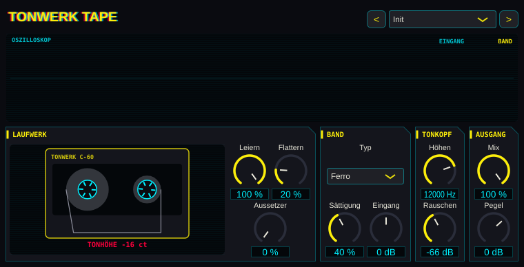

- **Laufwerk**: **Leiern** (Wow) 0 bis 100 %: ein langsames Schwanken der Geschwindigkeit, etwa einmal in zwei Sekunden, mit unregelmäßigem Tempo wie bei einem ausgeleierten Riemen. Bei 100 % schwankt die Tonhöhe um bis zu 1,6 % (etwa 28 Cent). **Flattern** (Flutter) 0 bis 100 %: das schnelle Zittern um 7 und 12 Hz, bis 0,4 %. **Aussetzer** 0 bis 100 %: Das Band hebt kurz vom Kopf ab, der Pegel sinkt für 30 bis 200 ms um 3 bis 18 dB, bei 100 % etwa einmal pro Sekunde. Die Kassette links dreht sich, solange Ton durchläuft, und zeigt darunter, um wie viele Cent das Band gerade verstimmt ist.
- **Band**: **Typ** Spulenband (tiefer Bassbuckel bei 48 Hz, weites Band, sauberste Kennlinie), Chrom (Typ II, straffe Bässe, hell), Ferro (Typ I, voller Buckel bei 85 Hz, unsymmetrischer, sättigt früher) oder Diktiergerät (Band nur von etwa 220 Hz bis 4,5 kHz, harte Kennlinie). **Sättigung** 0 bis 100 %: wie hart der Tonkopf gefahren wird. Die Spitzen werden runder, Leises kommt hoch; die Lautheit bleibt dabei etwa gleich, weil ein Ton bei −12 dBFS bei jeder Einstellung seinen Pegel behält. Die Höhen werden vor der Sättigung um 6 dB angehoben und danach wieder abgesenkt, wie bei der Aufnahme-Entzerrung, deshalb sättigen sie zuerst. **Eingang** −24 bis +24 dB: wie heiß aufgenommen wird.
- **Tonkopf**: **Höhen** 2000 bis 20000 Hz, wo das Band oben aufhört (12 dB pro Oktave). **Rauschen** −90 dB (Aus) bis −30 dB: das Bandrauschen, auf beiden Spuren getrennt.
- **Ausgang**: **Mix** (100 % nur Band; darunter wird der trockene Weg passend verzögert dazugemischt) und **Pegel** −24 bis +12 dB.

Der Abspielkopf liegt 8 ms hinter dem Aufnahmekopf, damit das Leiern nach beiden Seiten Platz hat. Diese Latenz meldet das Plugin Logic. Leiern, Aussetzer und Rauschen starten bei jedem Start der Wiedergabe gleich, ein Bounce klingt also wie das Abspielen davor.

**CPU:** Keine Überabtastung, die Sättigung rechnet mit Antiderivative-Antialiasing. Stereo mit allem auf Anschlag läuft im Test etwa 100-mal schneller als Echtzeit.

**Presets**: **Spulenband**: Studio-Maschine, Mastering-Band, Heißes Band, Parallel-Band (50 % Mix). **Kassette**: Chromkassette, Ferro-Kassette, Walkman, Mixtape 1991. **Lo-Fi**: Lo-Fi Hip-Hop, Chillhop-Keys, Vaporwave. **Kaputt**: Bandsalat, Diktiergerät, Dachbodenfund, Seekrank. Jedes ist auf einen Lo-Fi-Beat mit Spitzen um −6 dBFS eingepegelt (im Test höchstens 2 dB daneben, gemessen nach EBU R128).

**Getestet und ungetestet:** Unter Linux gebaut und getestet (sauberer Durchgang und Latenz, Obertöne mit Sättigung, gerade Obertöne der Kassette, Höhen sättigen zuerst, Stärke von Leiern und Flattern gemessen an einer Sinus-Frequenz, Höhen-Filter, Rauschpegel, Aussetzer, Mix, gleicher Bounce, Mono, 44,1 und 96 kHz, Zustand, Anzeige in ganzen Zahlen, CPU, Oberfläche, Presets). Die Presets sind auf einem künstlichen Beat (E-Piano, Bass, Drums) eingestellt. `auval` läuft in der GitHub Action. In Logic ist es noch nicht gehört.

## Tonwerk Freeze (Effekt)

Friert einen Moment des Klangs ein und macht daraus eine endlose Fläche: einen Akkord, eine Stimme, einen Schlag mit Hall. Auf einer Audio- oder Instrumentenspur unter **Audio-FX → Audio Units → b-velop → Tonwerk Freeze**. **Freeze** einschalten (der Schalter oben im Freeze-Feld oder ein Klick in das Spektrum) nimmt, was gerade klingt, und hält es, bis du wieder ausschaltest. Der Schalter lässt sich in Logic automatisieren, so friert ein Song genau auf einer Zählzeit ein. Das trockene Signal läuft dabei weiter, unverzögert (das Plugin hat keine Latenz), und du spielst über die Fläche.

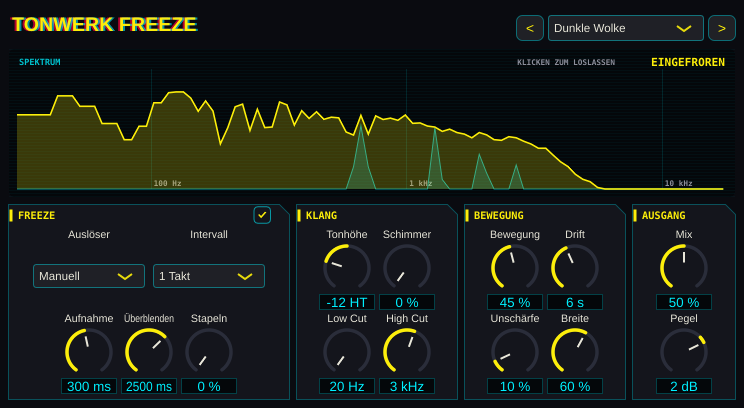

- **Freeze**: **Auslöser** Manuell oder Tempo. Auf Tempo friert es, solange der Schalter an ist und Logic spielt, auf jeder Linie des **Intervalls** (1/4, 1/2, 1 Takt, 2 oder 4 Takte) neu ein, so wandert die Fläche mit der Akkordfolge. **Aufnahme** 20 bis 2000 ms: über wie lange vor dem Einfrieren gemittelt wird; kurz nimmt genau den Moment, lang macht aus einer Melodie einen Akkord. **Überblenden** 10 bis 10000 ms: Ein- und Ausblenden und der Übergang zur nächsten Aufnahme. **Stapeln** 0 bis 100 %: Bei 0 ersetzt eine neue Aufnahme die alte, bei 100 % legt sie sich dazu (gleich laut wie die lautere der beiden), so baut sich die Fläche Schicht um Schicht auf. Aus- und wieder Einschalten, während die alte Fläche noch ausklingt, überblendet oder stapelt ebenso.
- **Klang**: **Tonhöhe** −24 bis +24 HT verschiebt die Fläche, ohne sie zu verlangsamen. **Schimmer** 0 bis 100 % legt eine Kopie eine Oktave darüber. **Low Cut** 20 Hz bis 2 kHz und **High Cut** 1 bis 20 kHz (24 dB pro Oktave; ganz links bzw. rechts aus).
- **Bewegung**: **Bewegung** 0 bis 100 % lässt 32 Bänder über das Spektrum langsam lauter und leiser werden (bis ±12 dB) und ein wenig in der Tonhöhe wandern (bis ±15 Cent), jedes auf seinem eigenen Weg; **Drift** 1 bis 30 s ist, wie lange ein Weg dauert. **Unschärfe** 0 bis 100 %: bei 0 steht der eingefrorene Akkord klar wie Glas, darüber verwischt er, bei 100 % rauscht er wie Paulstretch. **Breite** 0 bis 100 % macht auch aus einer Monospur eine breite Fläche, die mono gehört nicht ausgelöscht wird.
- **Ausgang**: **Mix** 0 bis 100 %: bei 50 % laufen trockenes Signal und Fläche beide voll, darüber tritt das Trockene zurück, solange eingefroren ist (bei 100 % nur die Fläche). **Pegel** −24 bis +12 dB für die Fläche.

Das Spektrum oben zeigt den Eingang in Cyan und die eingefrorene Fläche in Gelb darüber; bei jeder neuen Aufnahme blitzt es kurz.

Wie es rechnet: Das Plugin zerlegt den Eingang laufend in Spektren (85 ms, Hann, 75 % Überlappung) und mittelt die Leistung jeder Frequenz über die Aufnahmezeit, dazu ihre genaue Frequenz aus dem Phasenschritt zwischen zwei Spektren. Beim Einfrieren spielt ein Phasenvocoder dieses Spektrum endlos ab: Jede Spitze im Spektrum dreht ihre Phase mit ihrer eigenen Frequenz weiter, und die Frequenzen um sie behalten ihre Phasenlage zu ihr (Identity Phase Locking nach Laroche und Dolson). Ohne das schwebt ein gehaltener Ton, mit ihm klingt ein eingefrorener Akkord wie der Akkord. Die Tonhöhe verschiebt jede Spitze samt Umgebung. Stereo, beide Seiten in einer FFT; im Test mit allen Optionen an etwa 35-mal schneller als Echtzeit, ohne Freeze kostet nur das Zerlegen.

**Presets**: **Flächen**: Endlose Fläche, Warmes Pad, Dunkle Wolke, Glas. **Schimmer**: Schimmer, Oktave höher, Engelschor. **Bewegt**: Atmend, Langsame Drift, Paulstretch. **Rhythmisch** (Auslöser Tempo): Jeder Takt, Viertel-Stapel, Morph alle 2 Takte. **Klangeffekte**: Nur Freeze, Unterwasser, Geisterstimme. Kein Preset schaltet Freeze selbst ein, sonst würde beim Laden auf einer stillen Spur Stille eingefroren. Jedes ist so eingepegelt, dass die Fläche so laut ist wie das, was eingefroren wurde (im Test höchstens 2 dB daneben). Hörproben jedes Presets (ein Akkord mit Arpeggio, eingefroren, dann eine Melodie darüber; die rhythmischen über einer Akkordfolge) und einer eingefrorenen Stimme liegen im Projektordner unter `synth/hoerproben/Tonwerk Freeze`.

**Getestet und ungetestet:** Unter Linux gebaut und getestet (Tonhöhe, Pegel und Reinheit eines eingefrorenen Sinus, ein Akkord mit allen Tönen, Ein- und Ausblendzeit, unverändertes Trockensignal ohne Freeze, Mix, Tonhöhe, Schimmer, Low und High Cut, Breite mit Korrelation, Bewegung, gleicher Pegel bei jeder Unschärfe, Überblenden und Stapeln, Einfrieren im Tempo-Raster, Monospur, Zustand, Anzeige mit Einheiten, alle Presets mit Pegel, CPU) und die Oberfläche als Bild angesehen. `auval` läuft in der GitHub Action. In Logic ist es noch nicht gehört. Offen ist dort vor allem, ob Logic das Plugin auf einer Spur ohne Region weiterlaufen lässt; das Plugin meldet 30 s Nachklang, eine endlose Fläche hört also nach 30 s Stille auf der Spur womöglich auf. Dann hilft es, die Spur auf Input-Monitoring zu stellen oder eine leere Region darunterzulegen.

## Tonwerk Arp (MIDI-Effekt)

Ein Arpeggiator und Step-Sequencer, der vor einem Synth sitzt: Du hältst Tasten, er spielt daraus Noten im Raster. In Logic im **MIDI-FX**-Slot einer Software-Instrument-Spur, über dem Instrument: **MIDI-FX → Audio Units → b-velop → Tonwerk Arp**. Er funktioniert mit jedem Instrument, mit den Tonwerk-Synths genauso wie mit Logics eigenen. Läuft Logic, sitzt das Raster auf den Takten des Songs (ein Pattern mit 16 Schritten beginnt immer auf der Eins); steht Logic, beginnt das Raster mit der ersten Taste, damit der erste Ton sofort kommt. Alles außer Noten (Modulationsrad, Pitch Bend, Controller) geht unverändert durch.

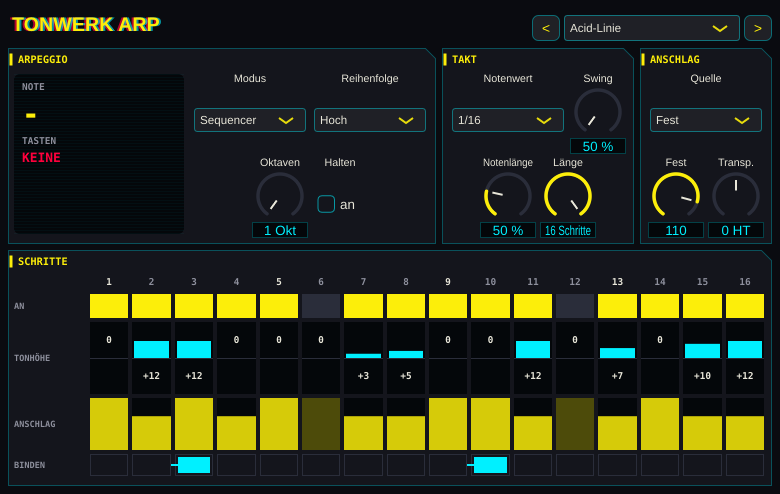

- **Arpeggio**: **Modus** Arpeggiator (die gehaltenen Tasten nacheinander) oder Sequencer (die Schritte spielen die gehaltenen Tasten zusammen: eine Taste wird eine Basslinie auf diesem Ton, ein Akkord ein Akkord-Rhythmus). **Reihenfolge** Hoch, Runter, Hoch-Runter, Runter-Hoch (an den Enden ohne Wiederholung), Gespielt (in der Reihenfolge, in der du sie gedrückt hast) oder Zufall (nie zweimal derselbe Ton hintereinander; bei jedem Start von Logic dieselbe Folge, damit ein Bounce wie die Wiedergabe klingt). **Oktaven** 1 bis 4: der Arpeggiator steigt so viele Oktaven hoch, der Sequencer geht bei jedem Durchlauf eine Oktave höher. **Halten**: die Tasten bleiben liegen, wenn du loslässt; ein neuer Akkord ersetzt sie. Die Anzeige links zeigt die gehaltenen Tasten und die gespielte Note (Logics Namen, C3 = Note 60).
- **Takt**: **Notenwert** 1/1 bis 1/32, Triolen (T) und punktiert (.). **Swing** 50 bis 75 % wie in der Groovebox (50 % gerade, 75 % punktiert). **Notenlänge** 5 bis 200 % eines Schritts; über 100 % beginnt die nächste Note unter der letzten, ein monophoner Synth mit Glide gleitet dann. **Länge** 1 bis 16 Schritte; ungerade Längen verschieben das Pattern gegen den Takt.
- **Anschlag**: **Quelle** Gespielt (wie die Taste angeschlagen wurde) oder Fest (**Fest** 1 bis 127). **Transp.** −24 bis +24 HT für alle Noten.
- **Schritte**: 16 Schritte, jeder mit **An** (aus ist eine Pause; der Arpeggiator bleibt dabei auf seinem Ton stehen), **Tonhöhe** −24 bis +24 HT (ziehen; Doppelklick setzt auf 0), **Anschlag** 0 bis 100 % des Anschlags (ziehen, auch über mehrere Schritte) und **Binden** (der Ton des Schritts davor klingt durch diesen Schritt weiter, wie die Slides eines Acid-Basses). Der laufende Schritt leuchtet, Schritte hinter der Länge sind dunkel. Alle Schritte sind Parameter, Logic kann sie also automatisieren.

**Presets**: **Klassisch**: Hoch und runter, Gebrochener Akkord, Harfe, Runter, Wie gespielt, Zufall. **Trance & Techno**: Trance-Gate, Pluck 1/16, Oktav-Roller, Techno-Stab. **Bass-Sequenzen** (eine Taste halten): Acid-Linie, Offbeat-Bass, Berlin-Schule, Rollender Bass, Dubstep-Triolen. **Rhythmisch**: Swing-Arp, Triolen, Siebener, Legato-Kette, Punktiert.

**Getestet und ungetestet:** Unter Linux gebaut und getestet (alle Reihenfolgen, Oktaven, Raster auf das Sample genau mit Logic und frei, auch über krumme Blockgrößen und Start mitten im Takt, Swing, Pausen, Bindungen, Sequencer mit Akkorden und Oktaven, Halten, Anschlag, Transponieren, lange Notenlängen, Stopp beendet die Noten, All Notes Off, keine hängenden Noten bei zufälligem Spiel, Controller gehen durch, alle Presets) und die Oberfläche als Bild angesehen. `auval` als MIDI-Effekt (`aumi`) läuft in der GitHub Action. In Logic ist er noch nicht gespielt worden; ob er im MIDI-FX-Slot erscheint, zeigt sich dort.

## Tonwerk LFO (MIDI-Effekt) und MIDI-Lernen

Ein LFO, der jeden Regler eines Tonwerk-Instruments bewegen kann. Er sitzt im **MIDI-FX**-Slot über dem Instrument (**MIDI-FX → Audio Units → b-velop → Tonwerk LFO**) und sendet einen MIDI-Controller; das Instrument legt diesen Controller auf den Regler, der ihn gelernt hat. Logic schickt, was aus dem MIDI-FX-Slot kommt, nur an das Instrument der Spur, nie an Audio-Effekte: Für Effekte wie Tonwerk Zone gibt es dort, wo es passt, ein eigenes LFO im Plugin.

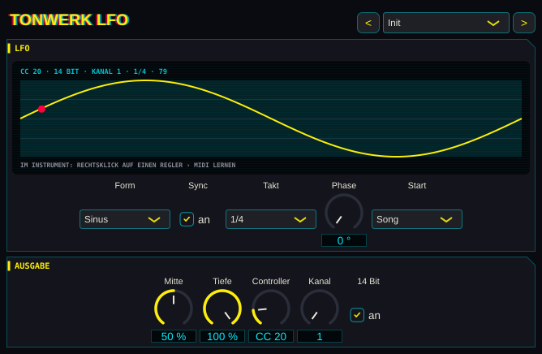

**So geht's:** Tonwerk LFO in den MIDI-FX-Slot setzen, im Instrument mit der rechten Maustaste auf einen Regler klicken und **MIDI lernen** wählen; der Name des Reglers zeigt *CC lernen …*, beim nächsten Controller, der ankommt (also sofort, wenn der LFO läuft), steht dort zum Beispiel *Cutoff · CC20*, und der Regler folgt dem LFO. Über denselben Rechtsklick wird die Zuordnung wieder entfernt. Für einen zweiten Regler einen zweiten Tonwerk LFO darunter setzen und ihm einen anderen **Controller** geben. Die Zuordnung wird mit dem Projekt gespeichert, ein Werksklang lässt sie stehen. Das MIDI-Lernen funktioniert genauso mit Logics eigenem *Modulator* oder einem Hardware-Controller; der Controller geht außerdem weiter an das Instrument (ein Modulationsrad bewegt also sein Vibrato und den gelernten Regler). Es steckt in allen Instrumenten (Tonwerk Analog, FM, Synth, DX, Wavetable, Granular, Physical, Additiv, PD, Sampler, Bass, Neuro, Expander, Groovebox) sowie in Robovox, Vocoder und Arp, und gilt für die Drehregler, nicht für Menüs und Schalter. Logic sieht die Bewegung wie einen gedrehten Regler: Im Automationsmodus *Latch* oder *Touch* schreibt es sie als Automation mit.

- **LFO**: **Form** Sinus, Dreieck, Säge auf, Säge ab, Rechteck oder Zufall (ein neuer Wert je Zyklus), **Sync** (an: **Takt** von 4/1 bis 1/64, auch punktiert und triolisch; aus: **Rate** 0.05 bis 20 Hz), **Phase** 0 bis 360 °, **Start** *Song* (im Sync beim Abspielen an der Songposition, ein Wobble sitzt also auf den Takten) oder *Note* (die erste Taste einer Phrase startet den Zyklus; Tasten, die dazukommen, nicht).
- **Ausgabe**: **Mitte** und **Tiefe** 0 bis 100 % (der Wert schwingt um die Mitte, bei 100 % Tiefe über den ganzen Regelweg), **Controller** CC 0 bis 119, **Kanal** 1 bis 16, **14 Bit** (für CC 0 bis 31: der grobe Teil auf dem Controller, der feine auf Controller + 32, wie es der MIDI-Standard vorsieht; 16384 Stufen statt 128, damit ein langsamer Sweep des Cutoffs nicht stuft. Tonwerk-Instrumente lesen beides, andere Instrumente nehmen den groben Teil). Die Anzeige zeigt einen Zyklus mit seinem Wertebereich und wo der LFO gerade steht. Gesendet wird alle 64 Samples und nur, wenn sich der Wert geändert hat. Alles andere, was hereinkommt, geht unverändert weiter.

**Presets** (ändern nie Controller und Kanal): **Sweeps**: Langsamer Sweep, Atmen, Rampe pro Takt, Frei schwebend. **Rhythmisch**: Wobble 1/8, Wobble Triolen, Gate 1/16, Abfall pro Note, Pumpen 1/4. **Zufall**: Zufall 1/16, Zufall 1/4, Zufall pro Takt.

**Getestet und ungetestet:** Unter Linux gebaut und getestet (14-Bit-Paare über den ganzen Bereich, 7 Bit oberhalb von CC 31, nur bei Änderung, Sync an der Songposition, Start mit Note auf das Sample genau, Durchreichen, Presets, Zustand, Oberfläche als Bild; MIDI-Lernen: nur passende Controller werden gelernt, ein neuer ersetzt den alten, 14 Bit, Speichern und Laden, Werksklang behält die Zuordnung, Name am Regler, Tonwerk LFO bewegt den Cutoff von Tonwerk Bass über den ganzen Regelweg). `auval` läuft in der GitHub Action. In Logic noch nicht ausprobiert, auch nicht, ob Logic den Controller aus dem MIDI-FX-Slot an Tonwerk-Instrumente durchreicht (so sollte es sein) und ob der Rechtsklick dort ankommt.

## Herunterladen

Unter [Releases](https://github.com/Marcel-B/Synth/releases) liegt zu jeder Version ein Zip mit Audio Unit, VST3, App (für Synth und Effekt) und Installationsskript, für Apple Silicon und Intel ab macOS 11. Nach dem Laden im Terminal:

```sh
cd ~/Downloads/Tonwerk-Synth-*-macOS
zsh install.sh
```

Sind im Repository die Secrets für Apple Developer ID hinterlegt (siehe „Signieren mit Developer ID“), ist das Release damit signiert und von Apple notarisiert, und macOS öffnet es nach dem Download ohne Rückfrage. Sonst sind die Plugins nur ad hoc signiert, und macOS versieht alles aus dem Netz mit einer Quarantäne-Markierung, die Logic die Plugins nicht laden lässt. `install.sh` entfernt die Markierung in beiden Fällen (`xattr -dr com.apple.quarantine`), kopiert die Dateien an ihren Platz und prüft die Audio Unit mit `auval`. Wer ein ad hoc signiertes Release lieber von Hand installiert, ruft vorher selbst `xattr -dr com.apple.quarantine` auf den entpackten Ordner auf.

Zum Aktualisieren lädst du das neue Zip und rufst dessen `install.sh` genauso auf. Logic sollte dabei geschlossen sein. Importierte Klänge bleiben erhalten, und gespeicherte Projekte laden ihre Einstellungen weiter.

Ein neues Release entsteht, wenn ein Tag wie `v0.2.0` gepusht wird, oder von Hand unter Actions → Release → „Run workflow“ mit einer Versionsnummer. Die Action `release.yml` baut dann, testet, prüft mit `auval` und hängt das Zip an. Die Versionsnummer des Plugins kommt aus dem Tag, so erkennt Logic eine neue Version.

## Selbst bauen auf dem Mac

Ein volles Xcode ist nicht nötig, die Command Line Tools reichen:

```sh
xcode-select --install          # einmal, falls noch nicht da
brew install cmake              # einmal
git clone https://github.com/Marcel-B/Synth.git && cd Synth
scripts/install-macos.sh
```

Das Skript baut eine Universal-Binary (Apple Silicon und Intel), signiert sie ad hoc, kopiert die Audio Unit nach `~/Library/Audio/Plug-Ins/Components`, das VST3 nach `~/Library/Audio/Plug-Ins/VST3` und die App nach `~/Applications`, und prüft die Audio Unit mit Apples `auval`. Der erste Lauf lädt JUCE herunter und dauert ein paar Minuten.

In Logic: neue Software-Instrument-Spur, im Kanalzug **Instrument → AU-Instrumente → b-velop → Tonwerk Analog** (oder Tonwerk FM). Taucht es nicht auf, im Plug-in-Manager (Logic Pro → Einstellungen → Plug-in-Manager) „Tonwerk“ suchen und **Erneut scannen** wählen.

Entfernen: `scripts/install-macos.sh --uninstall`.

Zwischenstände ohne Release: Jeder Lauf der Action `build.yml` legt die Dateien auch als Artefakt `tonwerk-synth-macos` ab (Actions → Lauf → Artifacts). Für sie gilt dasselbe wie für Releases, die Quarantäne-Markierung muss weg.

### App-Symbole

Jedes Plugin hat ein eigenes Symbol im Stil der Oberflächen: ein dunkles Feld mit abgeschnittener Ecke, darauf ein Zeichen für das, was das Plugin tut, gelb bei Instrumenten, cyan bei Effekten, rot beim MIDI-Effekt, mit rot und cyan verschobenen Rändern. Die Bilder liegen in `icons/` und sind mit `scripts/make-icons.py` gezeichnet (braucht Pillow). Der Build gibt sie der App und unter macOS auch Audio Unit und VST3 (Finder, Dock), unter Windows steckt das Symbol in der `.exe`. Unter Linux kennt eine Programmdatei kein Symbol; dort legt `install.sh` aus dem Release für jede App einen Eintrag im Anwendungsmenü an (`~/.local/share/applications`), mit Symbol.

### Downloadzahlen

GitHub zeigt auf der Release-Seite nicht an, wie oft ein Paket geladen wurde, zählt aber mit. Die Action `release-stats.yml` (Actions → Downloadzahlen) fragt die Zahlen jeden Morgen ab und hängt sie an `downloads.csv` auf dem Zweig [`stats`](https://github.com/Marcel-B/Synth/blob/stats/downloads.csv) an: eine Zeile pro Tag und Paket mit Datum, Release, Datei und der Summe bis dahin. Die Differenz zweier Tage ergibt die Downloads dazwischen. Von Hand starten geht über **Run workflow**; zweimal am selben Tag schreibt sie nichts doppelt. Gezählt werden nur die angehängten Pakete, nicht die automatischen Quellcode-Archive. Den aktuellen Stand gibt es auch direkt:

```sh
scripts/release-stats.sh /tmp/downloads.csv      # braucht gh und jq
```

Besucher und Klone des Repos stehen unter Insights → Traffic, aber nur für die letzten 14 Tage.

## Auf dem iPad (in Arbeit)

Auf dem iPad kommt alles in einer App: **Tonwerk**. Sie bringt jedes Plugin als AUv3 mit, das Logic Pro für iPad, GarageBand und AUM laden, und spielt die Instrumente auch allein: oben das Instrument antippen und aus den Kacheln wählen, darunter seine Oberfläche, unten eine große Tastatur über zwei Oktaven mit **+**/**−** für die Oktave und rechts ein Oszilloskop, dazu ein MIDI-Keyboard über USB oder Bluetooth (Knopf **Bluetooth-MIDI**). **Tasten** klappt die Tastatur weg, dann bekommt ein großes Instrument wie Tonwerk Wavetable den ganzen Bildschirm. Die App merkt sich das gewählte Instrument, den Klang und die Oktave jedes Instruments und spielt im Hintergrund weiter. Als Letztes in der Auswahl steht **Tonwerk Scope**: Es zeigt, was am Mikrofon oder am Audio-Interface ankommt (Knopf **Eingang** wählt Gerät und Kanäle), auch als Stimmgerät, und gibt es nicht auf die Lautsprecher, damit nichts rückkoppelt. Die anderen Effekte, Tonwerk Arp und Tonwerk LFO gibt es nur als AUv3 im Host (in Logic Pro für iPad unter Audio-FX → Audio Units → b-velop), denn sie brauchen einen Klang, den sie bearbeiten, oder jemanden, der hört, was sie senden. Es sind dieselben Quellen wie auf dem Mac, nur ein weiteres Build-Ziel. Die App läuft nur auf dem iPad und nur quer, ab iPadOS 15.

Was auf dem iPad anders ist (`common/Platform.h`):

- **Größe**: Der Host bestimmt, wie groß die Oberfläche ist. Sie wird darin ganz gezeigt, mit ihren Proportionen vergrößert oder verkleinert, und Menüs öffnen sich in ihr.
- **MIDI-Lernen**: Ein Finger, der etwa eine halbe Sekunde ruhig auf einem Regler liegt, öffnet das Menü, das am Mac der Rechtsklick öffnet.
- **Dateien**: Klänge laden und speichern (Tonwerk Analog, FM, Synth), SysEx (Tonwerk DX) und eigene Samples (Tonwerk Granular, Tonwerk Sampler) gehen über die Dateien-App. Ein Sample wird dabei in den Speicher des Plugins kopiert, damit ein Projekt es beim nächsten Öffnen wiederfindet.

Bauen braucht hier das volle Xcode, denn nur darin steckt das iOS-SDK; für den Mac bleibt es bei den Command Line Tools.

```sh
scripts/build-ios.sh simulator                      # für den iOS-Simulator, ohne Signatur
TONWERK_TEAM_ID=ABCDE12345 scripts/build-ios.sh device   # für ein angeschlossenes iPad, mit dem Team des Developer-Kontos
```

Die App liegt danach unter `build-ios/Tonwerk_artefacts/Release/Tonwerk.app`. Auf dem Mac oder unter Linux lässt sie sich mit `-DTONWERK_APP=ON` ebenfalls bauen (`cmake --build build --target Tonwerk`), um sie ohne iPad auszuprobieren.

Die Action `build.yml` baut bei jedem Push die App für den Simulator, prüft, dass sie alle 32 AUv3s enthält, öffnet einige Plugins darin in einem iPad-Simulator und legt Bildschirmfotos als Artefakt `ipad-screenshots` ab.

### Für den Mac aus dem App Store (in Arbeit)

Dieselbe App gibt es auch für den Mac, über den Mac App Store: **Tonwerk** mit allen 32 Plugins als AUv3, die Logic Pro, GarageBand und MainStage unter Audio Units → b-velop finden, und allein gespielt wie auf dem iPad (im Fenster statt im Vollbild). Sie hat dieselbe Bundle-ID wie die iPad-App, App Store Connect führt beide als eine App mit zwei Plattformen. Die Plugins haben dieselben Codes wie die Audio Units aus `install.sh`, ein Logic-Projekt öffnet sich also mit beiden, und auch die Projekte von Logic Pro für iPad.

Was sich gegenüber den Plugins aus `install.sh` ändert:

- **Sandbox**: Der App Store nimmt nur Apps in einer Sandbox. Die Plugins laufen deshalb in einem eigenen Prozess, ihre Einstellungen und Klänge liegen in ihrem Container (`~/Library/Containers/de.bvelop.tonwerk.<plugin>/Data/Library/Application Support`) statt unter `~/Library/Application Support`. Eigene Samples und SysEx werden beim Laden in den Container kopiert, wie auf dem iPad, denn die Erlaubnis für die gewählte Datei endet mit dem Prozess; Menüs öffnen sich in der Oberfläche.
- **Kein VST3, keine einzelnen Apps**: Im App Store gibt es nur die eine App mit den AUv3s. VST3 und die einzelnen Apps bleiben im Release-Zip.
- **Nicht beides zugleich**: Dieselben Plugins aus `install.sh` und aus dem App Store melden sich mit denselben Codes, Logic zeigt sie dann als „nicht verfügbar“. Wer die App aus dem Store nimmt, löscht die Tonwerk-Komponenten unter `~/Library/Audio/Plug-Ins/Components` und lässt den Plug-in-Manager neu scannen. Dasselbe gilt für die iPad-App auf einem Mac mit Apple-Chip.

Gebaut wird sie mit `-G Xcode -DTONWERK_MAC_STORE=ON` (volles Xcode). `build.yml` baut sie bei jedem Push und prüft die Sandbox jeder Erweiterung, die Action **TestFlight** lädt sie zusammen mit der iPad-App hoch (Auswahl **Plattformen**: beide, iPad oder Mac).

### TestFlight

Die Action **TestFlight** (Actions → TestFlight → Run workflow) baut die App, signiert sie für den App Store und lädt sie zu TestFlight hoch; die Version ist die des letzten Tags, die Build-Nummer die Nummer des Laufs. Einmal einzurichten:

1. In App Store Connect eine App mit der Bundle-ID `de.bvelop.tonwerk` anlegen (die ID vorher unter developer.apple.com → Identifiers registrieren). Die IDs der Plugins (`de.bvelop.tonwerk.<plugin>`) legt der Build selbst an.
2. Unter Benutzer und Zugriff → Integrationen einen API-Schlüssel mit der Rolle **Admin** erzeugen und die `.p8`-Datei laden (geht nur einmal).
3. Im Repository unter Settings → Secrets and variables → Actions eintragen: `ASC_KEY_ID` (die zehn Zeichen im Dateinamen `AuthKey_….p8`), `ASC_ISSUER_ID` (über der Schlüsselliste) und `ASC_KEY_P8` (der ganze Inhalt der Datei, mit den Zeilen BEGIN und END). `APPLE_TEAM_ID` ist schon da.

Für den Mac kommt einmal dazu: in App Store Connect bei der App Tonwerk unter **Plattform hinzufügen** macOS wählen. Zertifikate und Profile für den Mac legt der Build wie beim iPad selbst an.

Signiert wird erst beim Export für App Store Connect, mit dem Distributionszertifikat, das Apple in der Cloud verwaltet; das Archiv selbst bleibt unsigniert (iPad) oder ad hoc signiert (Mac, damit die Sandbox der App und der Plugins im Export erhalten bleibt). So legt nicht jeder Lauf ein eigenes Entwicklungszertifikat an, bis Apples Grenze erreicht ist.

Nach dem Upload prüft Apple den Build einige Minuten; dann erscheint er in App Store Connect unter TestFlight, und wer dort als interner Tester eingetragen ist, installiert ihn mit der App TestFlight.

**Getestet und ungetestet:** Gebaut und im Simulator gestartet in der GitHub Action, die App auch unter Linux gebaut und gestartet. Der Upload zu TestFlight lief am 17.10.2026 durch (Build 0.5.0 (2) wurde wegen der IDs der Erweiterungen abgelehnt, 0.5.0 (4) angenommen und von Marcel auf dem iPad installiert, 0.5.0 (6) mit der neuen Tastatur hochgeladen). Die Mac-Version ist bisher nur gebaut, noch nicht hochgeladen und nirgends gestartet. Auf einem echten iPad, in Logic Pro für iPad, GarageBand oder AUM noch nicht ausprobiert, ebenso wenig das Laden aus Tonwerk über das Netz (Tailscale), Bluetooth-MIDI und die Dateien-App.

## Signieren mit Developer ID

Mit einem Apple-Entwicklerkonto lassen sich Plugins und Apps mit **Developer ID** signieren und von Apple notarisieren. Dann braucht es keine Ad-hoc-Signatur und kein Entfernen der Quarantäne mehr, und die Plugins lassen sich weitergeben.

Einmal im Konto:

1. Zertifikat **Developer ID Application** anlegen (developer.apple.com → Certificates, oder in Xcode unter Settings → Accounts → Manage Certificates). Es landet mit seinem privaten Schlüssel im Schlüsselbund; `security find-identity -v -p codesigning` zeigt seinen Namen, etwa `Developer ID Application: Vorname Nachname (TEAMID)`.
2. Für die Notarisierung ein **app-spezifisches Passwort** unter account.apple.com → Anmeldung und Sicherheit anlegen. Die Team-ID steht unter developer.apple.com → Membership.

Lokal:

```sh
xcrun notarytool store-credentials tonwerk --apple-id <Apple-ID> --team-id <TEAMID>   # einmal, fragt nach dem Passwort
TONWERK_SIGN_IDENTITY="Developer ID Application: Vorname Nachname (TEAMID)" TONWERK_NOTARY_PROFILE=tonwerk scripts/install-macos.sh
```

Ohne `TONWERK_NOTARY_PROFILE` wird nur signiert, nicht notarisiert; für die eigene Maschine genügt das. Die Skripte dafür sind `scripts/sign-macos.sh` und `scripts/notarize-macos.sh`.

Für Releases das Zertifikat im Schlüsselbund mit privatem Schlüssel als `.p12` exportieren und unter Settings → Secrets and variables → Actions anlegen:

| Secret | Inhalt |
| --- | --- |
| `MACOS_CERTIFICATE_P12` | die `.p12`-Datei als Base64 (`base64 -i Zertifikat.p12 \| pbcopy`) |
| `MACOS_CERTIFICATE_PASSWORD` | das Passwort, das beim Export vergeben wurde |
| `APPLE_ID` | die Apple-ID des Kontos |
| `APPLE_TEAM_ID` | die Team-ID |
| `APPLE_APP_PASSWORD` | das app-spezifische Passwort |

Fehlen die Secrets, signiert `release.yml` wie bisher ad hoc; fehlen nur die drei für die Notarisierung, signiert es mit Developer ID, ohne zu notarisieren. `build.yml` signiert immer ad hoc.

## Werksklänge

Jedes Instrument bringt eigene Klänge mit, keine Kopien aus Werks-ROMs oder fremden Preset-Bänken. Im Menü stehen sie nach Gruppen sortiert (Bässe, Leads, Flächen, Tasten, Plucks, Glocken, Bläser & Streicher, Effekte); die Programmnummern in Logic bleiben dabei, wie sie waren, neue Klänge hängen hinten an. Neu seit 0.4.0 ist alles *kursiv* Gesetzte.

- **Tonwerk Analog**
  - Bässe: Analog Bass (Tonwerk), Acid, Wobble, *Sub*, *Druckbass*, *Pulsbass*, *Reese*, *Gummibass*, *Synthwave-Bass*
  - Leads: Analog Lead und Leitton (Tonwerk), Falt-Lead, *Sägen-Lead*, *Chiptune*, *Pfeife*, *Schrei-Lead*
  - Flächen: Analog Pad (Tonwerk), *Warme Fläche*, *PWM-Fläche*, *Nebel*, *Glasfläche*, *Sweep-Fläche*
  - Tasten: *Combo-Orgel*, *Clavi*, *Polysynth*; Plucks: *Pluck*, *Berlin-Sequenz*; Glocken: *Kristall*
  - Bläser & Streicher: Streicher, *Blechsatz*, *Flöte*; Effekte: Zufall, *Wind*, *Computer*
- **Tonwerk FM**
  - Bässe: FM Bass (Tonwerk), *Slapbass*, *Holzbass*, *Wobble-Bass*, *Synthbass*
  - Leads: FM Leitton (Tonwerk), *Sägezahn-Lead*, *Sync-Lead*
  - Flächen: *Glasfläche*, *Atemfläche*, *Dunkle Fläche*
  - Tasten: FM E-Piano (Tonwerk), Orgel, *Zungen-Piano*, *Cembalo*, *Clavi*; Plucks: Zupf
  - Glocken: Glocke, Marimba, *Spieluhr*, *Vibrafon*, *Kalimba*, *Steeldrum*, *Gong*
  - Bläser & Streicher: FM Blech (Tonwerk), *Panflöte*, *Klarinette*, *Streicher*; Effekte: *Metall*, *Roboter*
- **Tonwerk DX**, jetzt eine volle Bank mit 32 Klängen
  - Bässe: Bass, *Slapbass*, *Holzbass*, *Synthbass*
  - Tasten: E-Piano, Clavi, Orgel, *E-Piano Hell*, *Cembalo*
  - Glocken: Röhrenglocke, Marimba, *Vibrafon*, *Glockenspiel*, *Kalimba*, *Steeldrum*, *Gong*
  - Bläser & Streicher: Blech, Mundharmonika, Flöte, *Akkordeon*, *Streicher*, *Klarinette*, *Oboe*, *Trompete*
  - Flächen: Fläche, *Glasfläche*, *Chor*; Leads: Lead, *Rechteck-Lead*; Plucks: *Harfe*, *Koto*; Effekte: *Datenstrom*
- **Tonwerk Wavetable**
  - Bässe: Wobble 1/8, Wobble Triolen, Reese, Growl Yoi, Growl FM, Riddim, Talking Bass, Sub Bass, *Neuro*, *Boom-Bass*, *Pluck-Bass*
  - Leads: Screech, Supersaw, *Hoover*, *Future-Lead*, *Sync-Lead*, *Vokal-Lead*, *PWM-Lead*
  - Flächen: *Harmonische Fläche*, *Kamm-Fläche*, *Pump-Akkorde* (duckt auf jeder Viertel im Songtempo), *Dunkle Fläche*
  - Plucks: *Pluck*, *Glas-Pluck*, *Bit-Arp*; Tasten: *Bit-Keys*, *Digi-Piano*; Glocken: *Digi-Glocke*
  - Effekte: Laser, *Riser* (vier Sekunden halten), *Downlifter*, *Sirene*
- **Tonwerk Granular** (neu)
  - Flächen: Chorwolke, Glasnebel, Streicherwolke, Orgelnebel, Eisfläche, Dunkle Fläche, Zeitlupe, Windharfe
  - Effekte: Kornregen, Gefroren, Zerfall, Metallschwarm, Sturm, Stotterband
  - Leads: Kornlead, Vokal-Lead; Bässe: Kornbass, Rauer Bass; Tasten: Orgelkörner, Staubpiano
  - Plucks: Kornzupfer, Tropfen; Glocken: Kristall, Glockenstaub; Bläser & Streicher: Körnige Streicher, Chor Aah
- **Tonwerk Physical** (neu)
  - Plucks: Nylongitarre, Stahlsaite, Harfe, Pizzicato, Kalimba, Koto
  - Tasten: Hammerklavier, Hackbrett, Kielklavier, Funk-Clavi
  - Glocken: Marimba, Vibraphon, Kirchenglocke, Röhrenglocke, Glasschale, Spieluhr
  - Bläser & Streicher: Geige, Cello, Klarinette, Schalmei, Hauchflöte, Panflöte
  - Bässe: Zupfbass, Gestrichener Bass, Röhrenbass, Gleitbass; Leads: Saitenlead, Rohrblattlead
  - Flächen: Gestrichene Schale, Äolsharfe, Gestrichenes Metall
  - Effekte: Pauke, Tom, Holzblock, Gong, Saitenregen
- **Tonwerk Additiv** (neu)
  - Flächen: Morph-Fläche, Kammfläche, Glasfläche, Chor Aah, Chor Uuh, Dunkle Fläche, Obertonwelle
  - Tasten: Zugriegelorgel, Kirchenorgel, Additiv-Piano E, Additiv-Flügel, Cembalo
  - Glocken: Röhrenglocke, Glockenspiel, Kristall, Gamelan
  - Bässe: Orgelbass, Sägebass, Sub-Bass, Sprechbass (Vokale im Achteltakt), Kammbass
  - Leads: Obertonlead, Vokallead, Hohllead; Plucks: Obertonzupfer, Glaszupfer, Additiv-Harfe
  - Bläser & Streicher: Blechbläser, Streicher, Klarinette, Flöte
  - Effekte: Obertonleiter (vier Sekunden halten), Glitzerregen, Bandpass-Sweep, Spektralmorph
- **Tonwerk PD** (neu)
  - Bässe: PD-Bass, Resobass, Pulsbass, Wobble PD, Ringbass, Sub-Sinus
  - Leads: Sync-Lead, Doppelsinus-Lead, Quaken, Hohler Lead, Kreischen
  - Flächen: PD-Streicher, Glaswand, Atemfläche, Wechselfläche, Digitalchor, Nachtpanorama
  - Tasten: PD-Piano, E-Piano PD, Orgel PD, Clavi PD, Akkordeon, Spielzeugklavier
  - Plucks: PD-Pluck, Resozupf, Digitalharfe, Koto PD, Pizzicato PD; Glocken: Glocke PD, Kristall, Röhrenglocke, Spieluhr
  - Bläser & Streicher: PD-Bläser, Sologeige, Holzbläser, Tutti; Effekte: Laser PD, Rauschwind, Funkstörung, Arcade
- **Tonwerk Sampler** (neu)
  - Bässe: Sub-Kick Glide, Sub-Kick Dreck, Saitenbass; Leads: Vokal-Lead, Lo-Fi-Gesang
  - Flächen: Streicherteppich, Chor-Fläche, Rückwärts-Chor, Vokal-Pad; Tasten: Tine-Piano, Lo-Fi-Keys
  - Plucks: Nylon, Chop-Melodie; Glocken: Kirchenglocke, Spieluhr; Bläser & Streicher: Pizzicato, Streicher legato
  - Effekte (Slices ab C1): Vokal-Chops, Breakbeat-Slices, Break rückwärts, Funk-Chops
- **Tonwerk Bass** (neu)
  - Bässe: Acid Klassik, Squelch, Rechteck-Acid, Verzerrt Acid, Tiefer Rumpel, Sub-Acid, Gummiband, Kurz & trocken, Acid-Wobble, Dub-Acid, Kellerclub, Rechteck tief, Zerhackt
  - Leads: Acid-Lead, Schreier, Vibrato-Lead; Plucks: Acid-Pluck; Effekte: Pfeifender Filter, Zufallsfilter
- **Tonwerk Neuro** (neu)
  - Bässe: Klassik-Reese, Dunkle Reese, Hoover-Reese, Röhren-Reese, Neuro-Growl, Kamm-Neuro, FM-Biss, Wobble Achtel, Wobble Triolen, Riddim-Stotter, Yoi-Bass, Sub-Druck
  - Leads: Neuro-Lead; Effekte: Bass-Riser
- **Tonwerk Expander** (neu)
  - Bässe: Expander-Bass, Sync-Bass, Notch-Bass; Leads: Sync-Lead, Unison-Lead, Bandpass-Lead
  - Flächen: Acht Stimmen, Notch-Fläche, Hochpass-Glas; Tasten: Poly-Tasten; Plucks: Bandpass-Pluck
  - Bläser & Streicher: Synth-Brass, Streicher; Effekte: Sync-Sirene
- **Tonwerk Groovebox** (neu)
  - House: Deep House, Disco House, Garage; Techno: Berlin Techno, Industrial, Minimal
  - Hip-Hop: Boom Bap, Lo-Fi; Trap: Trap, Drill (beide im 1/32-Raster für Hi-Hat-Wirbel)
  - Electro: Electro Funk, Synthwave, Miami Bass; Breaks: Breakbeat, Drum & Bass, Jungle
  - Dubstep: Halftime, Riddim; Experimentell: Triolen-Shuffle, Glitch-Perkussion, Metall-Werkstatt
  - Mit der Formung: Gated Eighties (Electro), Staubiger Sampler (Hip-Hop), Filter-Zap (Techno), Sub-Boom (Trap)
- **Tonwerk Distortion** (Effekt): Gitarre, Bass, Synths, Drums, Gesang, siehe [Tonwerk Distortion](#tonwerk-distortion-effekt)
- **Chrome Glitch** (Effekt): Dezent, Rhythmisch, Zerstört, Klangeffekte, siehe [Chrome Glitch](#chrome-glitch-effekt)
- **Tonwerk Robovox** (Effekt, neu): Tief, Roboter, Hell, Effekte, siehe [Tonwerk Robovox](#tonwerk-robovox-effekt)
- **Tonwerk Wobble** (Effekt, neu): Wobble, Yoi & Vokal, Pumpen, Gater, Bewegung, siehe [Tonwerk Wobble](#tonwerk-wobble-effekt)
- **Tonwerk Tape** (Effekt, neu): Spulenband, Kassette, Lo-Fi, Kaputt, siehe [Tonwerk Tape](#tonwerk-tape-effekt)
- **Tonwerk Freeze** (Effekt, neu): Flächen, Schimmer, Bewegt, Rhythmisch, Klangeffekte, siehe [Tonwerk Freeze](#tonwerk-freeze-effekt)
- **Tonwerk Arp** (MIDI-Effekt, neu): Klassisch, Trance & Techno, Bass-Sequenzen, Rhythmisch, siehe [Tonwerk Arp](#tonwerk-arp-midi-effekt)
- **Tonwerk LFO** (MIDI-Effekt, neu): Sweeps, Rhythmisch, Zufall, siehe [Tonwerk LFO](#tonwerk-lfo-midi-effekt-und-midi-lernen)
- **Tonwerk Filter** (Effekt, neu): Auto-Wah, Rhythmisch, Sweeps, Klangfarbe, siehe [Tonwerk Filter](#tonwerk-filter-effekt)
- **Tonwerk Stutter** (Effekt, neu): Beat Repeat, Glitch, Fills, Effekte, siehe [Tonwerk Stutter](#tonwerk-stutter-effekt)
- **Tonwerk Multiband** (Effekt, neu): Mix, Druck, Drums, Bass, Gesang, siehe [Tonwerk Multiband](#tonwerk-multiband-effekt)
- **Tonwerk Zone** (Effekt, neu): Gesang, Mix, Bass, Sidechain, Bewegung, siehe [Tonwerk Zone](#tonwerk-zone-effekt)
- **Tonwerk Scope** (Effekt, neu): Welle, Takt, Stereo, Stimmen, siehe [Tonwerk Scope](#tonwerk-scope-effekt)

**Gleich laut:** Ein Test spielt jeden Klang mit einer Phrase seiner Gruppe (Basslinie, Akkorde, Arpeggio, Melodie) bei Anschlag 100 und misst die Lautheit nach EBU R128 (momentan, am lautesten Punkt). Tonwerk Analog, FM, Wavetable, Granular, Physical, Additiv und PD liegen bei −12 LUFS, Tonwerk DX bei −16 LUFS, jeweils höchstens 2 dB daneben (die Kits der Groovebox spielen zwei Takte ihres Patterns und liegen ebenfalls bei −16 LUFS, denn Schlagzeug hat Spitzen etwa 15 dB über seiner Lautheit); der DX ist leiser, weil eine Stimme bei voller Lautstärke nur halben Vollpegel erreicht, damit ein hart angeschlagener Akkord nicht übersteuert. Effekte dürfen bis 6 dB leiser sein, ein kurzer Laser wird sonst zu laut. Kein Klang kommt dabei über den Vollpegel, Delay und Hall eingerechnet. Ausgenommen sind Tonwerks eigene Startklänge, die so laut bleiben wie im Browser.

**Geändert an alten Klängen:** Ihre Lautstärke ist angeglichen und der Hall ist bei vielen deutlich zurückgenommen (er ist laut, schon 10 % Mix bei langem Raum sind etwa so laut wie das trockene Signal). Im DX haben Bass, Marimba, Clavi und Lead etwas mehr Pegel im gehaltenen Teil bekommen, damit sie mit den anderen mithalten, und das Vibrato von Blech, Mundharmonika, Flöte und Lead läuft jetzt mit 5 Hz statt 0,6 Hz. Gespeicherte Projekte behalten ihre Einstellungen; das betrifft nur das neue Laden eines Werksklangs.

Der Hall rauscht jetzt bei gleicher Raumgröße immer gleich, ein Klang klingt also bei jedem Laden und jedem Bounce identisch.

## Klänge aus Tonwerk

Das Menü oben listet die **Werksklänge** (Tonwerks Startklänge pro Spurart und die des Plugins) und die übernommenen Klänge der Engine des Plugins.

- **Aus Tonwerk laden** fragt nach Tonwerks Adresse, so wie sie im Browser steht (z. B. `https://<mac>.<tailnet>.ts.net:8443`), und übernimmt alle dort gespeicherten Klänge, die analogen für Tonwerk Analog, die FM-Klänge für Tonwerk FM. Die Adresse wird gemerkt. Gleichnamige Klänge werden ersetzt, ein zweiter Abruf bringt die Liste also auf den Stand von Tonwerk.
- **Datei laden** liest eine JSON-Datei: einen Klang, wie ihn **Speichern** schreibt (`{ "name", "patch" }`), Tonwerks ganze Liste (die Antwort von `GET /api/logic/synths/presets`) oder einen nackten Patch.
- **Speichern** schreibt den aktuellen Klang als JSON im Format von Tonwerk.
- **Löschen** entfernt einen übernommenen Klang aus der Liste der Plugins, in Tonwerk bleibt er.

Die übernommenen Klänge liegen in `~/Library/Application Support/Tonwerk Synth/presets.json` und stehen in jedem Projekt zur Verfügung. Was ein Logic-Projekt spielt, speichert Logic mit dem Projekt; ein späterer Abruf aus Tonwerk ändert es nicht.

## Wie nah am Browser

Die Klangerzeugung rechnet nach, was Tonwerks Web-Audio-Graph tut: dieselben Wellenformen und Pegel (der Puls mit PWM ist dort halb so laut wie das reine Rechteck, hier auch), Web Audios Biquad-Filter mit seiner Eigenheit, dass die Resonanz bei Tief- und Hochpass in Dezibel angegeben ist, dieselbe Hüllkurvenform (linearer Anstieg, exponentieller Abfall mit Zeitkonstante Decay/4), FM als Frequenzmodulation in Hz mit Index bis 8, Feedback nach DX-Art, der Hall aus abklingendem Rauschen bei 0,15. Unterschiede:

- Regler wirken sofort auf klingende Noten, im Browser erst auf die nächste.
- Nach dem Release wird die Stimme in 3 ms ausgeblendet statt hart abgeschnitten.
- Die Oszillatoren sind mit PolyBLEP bandbegrenzt, Web Audio rechnet die Wellen anders; im Klang sollte das nicht auffallen, in den höchsten Lagen vielleicht ein wenig.
- Wavefolder und Sample & Hold hat nur das Plugin. Der Wavefolder rechnet mit einfacher zweifacher Überabtastung, bei hohen Tönen und viel Menge kann er trotzdem etwas Aliasing erzeugen.

**Getestet und ungetestet:** Das Plugin wurde unter Linux gebaut und getestet (Klangerzeugung, Presets, Parameter, Zustand) und die Oberfläche dort angesehen. `auval` läuft in der GitHub Action auf einem Mac. Version 0.2.0 läuft in Logic auf deinem MacBook. Wavefolder und Sample & Hold (ab 0.3.0) sind dort noch nicht gehört, ebenso wenig die Aufteilung in Tonwerk Analog und Tonwerk FM, die Werksklänge von 0.4.0 (im Test: jeder klingt, alle gleich laut, keiner übersteuert; als Spektrogramm angesehen, nicht angehört) und die neue Oberfläche (unter Linux als Bild angesehen). Ob es genau wie der Browser klingt, ist nur mit den Ohren zu prüfen.

## Entwickeln

```sh
cmake -S . -B build -DCMAKE_BUILD_TYPE=Debug
cmake --build build --target TonwerkSynthTests && ctest --test-dir build --output-on-failure
cmake --build build --target TonwerkAnalog_Standalone  # die App zum Ausprobieren, ebenso TonwerkFM_Standalone
cmake --build build --target ChromeGlitch_Standalone   # der Effekt als App, mit dem Mikrofon als Eingang
cmake --build build --target TonwerkDistortion_Standalone
cmake --build build --target TonwerkWavetable_Standalone
cmake --build build --target TonwerkDX_Standalone
cmake --build build --target TonwerkGranular_Standalone
cmake --build build --target TonwerkPhysical_Standalone
cmake --build build --target TonwerkSampler_Standalone
cmake --build build --target TonwerkBass_Standalone
cmake --build build --target TonwerkAdditiv_Standalone
cmake --build build --target TonwerkPD_Standalone
cmake --build build --target TonwerkGroovebox_Standalone  # Lauf auf „Frei“ stellen, die App hat keinen Transport
cmake --build build --target TonwerkTape_Standalone
```

Die Effekt-Apps lesen die Eingänge des Audio-Interfaces (in den Einstellungen unter „Active input channels“). Beim ersten Start fragt macOS, ob die App aufs Mikrofon zugreifen darf; ohne dieses OK kommt nur Stille an. Wer einmal abgelehnt hat, erlaubt es unter Systemeinstellungen → Datenschutz & Sicherheit → Mikrofon.

Mit `TONWERK_EDITOR_PNG_DIR=<ordner>` schreiben die Tests ein Bild jeder Oberfläche dorthin, mit `TONWERK_PRESET_WAV_DIR=<ordner>` jeden Werksklang als WAV mit seiner Testphrase (bei den Effekten mit ihrem Testsignal, dazu die trockenen Signale unter `Quellen`). `TONWERK_TEST_CATEGORY=Presets` lässt nur eine Testgruppe laufen, etwa beim Abstimmen von Klängen. Unter Linux braucht JUCE ein paar Pakete, siehe `.github/workflows/build.yml`. Dort entstehen VST3 und App, die Audio Unit nur auf dem Mac.

## Eurorack-Modul mit ESP32 (in Arbeit)

In [esp32-wavetable/](esp32-wavetable/) liegt Tonwerk Wavetable als 14-TE-Eurorack-Modul: Firmware für ein ESP32-S3 (ESP-IDF) mit derselben Klangerzeugung wie das Plugin, Schaltplan, KiCad-Platinen (SMD und bedrahtet), Stücklisten und die Frontplatte zum Drucken. Der Host-Test in `esp32-wavetable/firmware/host/` vergleicht die Portierung mit dem Plugin aus diesem Repo (`make test`). Die bedrahteten Platinen sind gefertigt, aber noch nicht bestückt; auf echter Hardware hat das Modul noch keinen Ton gemacht. Alles Weitere im [README des Moduls](esp32-wavetable/README.md).

## Website

Die Seite [tonwerk.studio](https://tonwerk.studio) liegt in `website/` (HTML, CSS und etwas JavaScript, ohne Build-Werkzeug, ohne fremde Schriften oder Tracker). Die Bildschirmfotos kommen aus `docs/`, dieselben wie im README. `scripts/build-website.sh` stellt beides in `build/site` zusammen und bricht ab, wenn ein Bild fehlt oder ein Plugin aus `CMakeLists.txt` keine Karte auf der Seite hat. Ein neues Plugin braucht also eine Karte in `website/index.html` (eine bestehende kopieren) und sein Bild in `docs/`.

```sh
scripts/build-website.sh && python3 -m http.server -d build/site 8000   # dann http://localhost:8000
```

Die Action `website.yml` prüft die Seite in jedem Pull Request und veröffentlicht sie bei jedem Push auf `main` über GitHub Pages.

## Lizenz

Tonwerk Synth steht unter der [PolyForm Noncommercial License 1.0.0](LICENSE) (siehe auch [NOTICE](NOTICE)). Kurz gesagt: Jeder darf den Code lesen, für sich bauen, ändern und weitergeben, solange es nicht kommerziell ist und der Lizenztext und der Hinweis „Tonwerk Synth by Marcel Benders“ mit Link zu diesem Repository dabei sind. Verkaufen, in ein bezahltes Produkt oder eine bezahlte Arbeit einbauen oder sonst damit Geld verdienen geht nur mit Marcels schriftlicher Erlaubnis; frag dafür über ein Issue. Geänderte Fassungen sollen als geändert erkennbar sein.

Bis Version 0.5.0 (Quelltext bis Commit `c9ab322`, 17.10.2026) stand das Projekt unter der AGPL-3.0 mit Namensnennung; wer diese Fassungen hat, darf sie weiter unter der AGPL nutzen.

Die Plugins nutzen [JUCE](https://juce.com) 8, das unter AGPLv3 oder einer kommerziellen Lizenz steht. Die Builds, die Marcel weitergibt, nutzen JUCE unter seiner eigenen JUCE-Lizenz. Code unter PolyForm Noncommercial lässt sich nicht mit der AGPL-Fassung von JUCE verbinden; wer selbst baut, braucht deshalb eine eigene JUCE-Lizenz (die kostenlose Starter-Lizenz reicht für private Builds). Das VST3 SDK, das JUCE mitbringt, steht unter der MIT-Lizenz.
