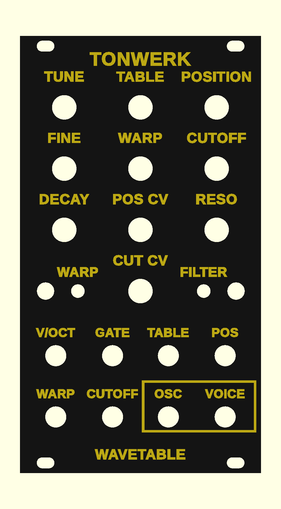
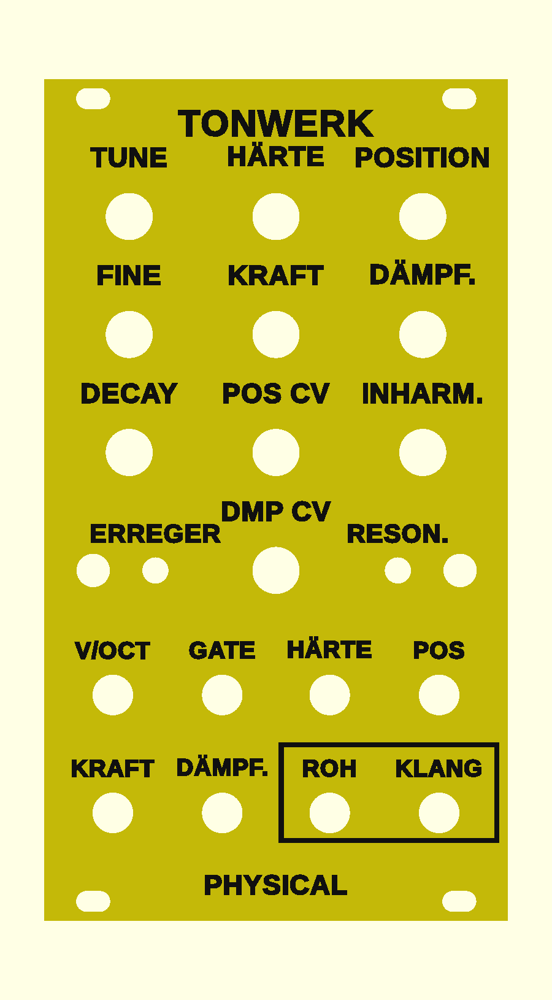

# Tonwerk Wavetable als Eurorack-Modul (ESP32-S3)

Konzept, Schaltplan-Skizze, Firmware-Grundgerüst, Stückliste und Frontplatte für ein 14-TE-Modul, das die Klangerzeugung von **Tonwerk Wavetable** (Plugin in diesem Repo, `wavetable/src/`) auf einem ESP32-S3 spielt.

Stand 2026-10-28. **Ein Modul ist gebaut und spielt** (bedrahtete Platinen v0.1, 27.10.2026); CV-Eingänge und V/Oct-Kalibrierung sind auf der Hardware noch nicht geprüft. Was geprüft ist, steht unter [Was getestet ist](#was-getestet-ist).



Mit einer zweiten Firmware spielt dasselbe Modul **Tonwerk Physical** (Physical Modeling, eigene Frontplatte): [Zweite Firmware](#zweite-firmware-tonwerk-physical).

Nachbauen: **[BAUANLEITUNG.md](BAUANLEITUNG.md)** führt Schritt für Schritt durch die bedrahtete Variante, vom Bestellen über Löten und erste Messungen bis zum Flashen und Kalibrieren. Auf der Website: [Bedienung](https://tonwerk.studio/modul/) und [Bauanleitung mit Bildern](https://tonwerk.studio/modul/bauanleitung.html).

## Die Idee in einem Absatz

Ein monophoner Wavetable-Oszillator mit eingebautem Filter und Hüllkurve. Er klingt wie eine Stimme des Plugins: dieselben zehn Tabellen (aus denselben Formeln berechnet), dieselben Warp-Modi, derselbe Filter (SVF 12/24 dB, Hochpass, Bandpass, Notch, Kamm, mit Drive), dieselbe Hüllkurve. Zwei Ausgänge: **OSC** ist der reine Oszillator (wie ein VCO, für externe Filter), **VOICE** ist dieselbe Stimme durch Filter und VCA. LFOs, Modulationsmatrix, Effekte und Polyphonie des Plugins fallen weg; das übernimmt im Modularsystem das Patchen.

## Bedienung

| Regler | Normal | WARP-Taste gehalten (Oszillator B) | FILTER-Taste gehalten |
|---|---|---|---|
| TUNE | ±2 Oktaven in Halbtönen | B: Transponierung ±24 Halbtöne | Attack 0,5 ms bis 2 s |
| FINE | ±50 Cent | B: Feinstimmung ±50 Cent | – |
| TABLE | Tabelle (10 Stück) | B: Tabelle, ganz links = B aus | – |
| POSITION | Position in der Tabelle | B: Position | Keytracking des Filters 0–100 % |
| WARP | Stärke des Warp | Unisono 1–4 Stimmen (A und B) | – |
| CUTOFF | 20 Hz bis 20 kHz | Unisono-Verstimmung 0–100 Cent | Hüllkurve → Cutoff, 0–6 Oktaven |
| RESO | Resonanz | Sub-Oszillator: Lautstärke, links = aus | Drive vor dem Filter |
| DECAY | Decay und Release, 5 ms bis 5 s | Sub: −1/−2 Oktaven, Sinus/Rechteck | Sustain (ab Werk 100 %) |
| POS CV | Abschwächer für POS-CV, Mitte = 0 | – | – |
| CUT CV | Abschwächer für CUTOFF-CV, rechts = 1 V/Okt | – | – |

- **WARP kurz drücken:** Warp-Modus weiter (aus, Sync, Bend, PWM, FM). LED 1 zeigt ihn: grau, cyan, gelb, magenta, rot. Nach dem Drehen an TABLE zeigt sie eine Sekunde lang die Tabelle (Farbkreis).
- **FILTER kurz drücken:** Filtermodus weiter (LP12, LP24, HP12, BP12, Notch, Kamm, aus). LED 2 zeigt ihn.
- **Taste halten und drehen** stellt die versteckte Ebene ein. Ein Regler übernimmt erst, wenn er den gespeicherten Wert erreicht („Pick-up“), damit nichts springt. Modi und versteckte Werte werden 3 s nach der letzten Änderung gespeichert.
- **Beide Tasten beim Einschalten halten:** V/Oct-Kalibrierung. 1,000 V an V/OCT (sonst nichts gesteckt), WARP drücken; 3,000 V anlegen, FILTER drücken. Grün = gespeichert, rot = unplausibel (alte Werte bleiben).

Buchsen: **V/OCT** (−1…+7 V, 0 V = C2), **GATE** (ab ca. 1,4 V; ohne Kabel ist das Gate dauerhaft an, das Modul läuft als Drone), **TABLE** (±5 V, 5 V = alle zehn Tabellen), **POS**, **WARP**, **CUTOFF** (±5 V), Ausgänge **OSC** und **VOICE** (±5 V).

## Zweite Firmware: Tonwerk Physical

Dieselben Platinen spielen mit einer anderen Firmware **Tonwerk Physical** (Plugin in diesem Repo, `physical/src/`): ein **Erreger** (Zupfen, Schlagen, Streichen, Blasen) bringt einen **Resonator** (Saite, Rohr geschlossen, Rohr offen, Stab, Glocke, Fell, Schale) zum Klingen, auf Wunsch durch Filter und Korpus. Bis zu vier Stimmen klingen übereinander aus, so wird aus einer Folge von Anschlägen ein Akkord oder eine Harfe. Eine eigene Frontplatte gehört dazu (unten), gedacht gelb mit schwarzer Schrift, damit man die Module im Rack auseinanderhält.



| Regler | Normal | ERREGER gehalten | RESON. gehalten |
|---|---|---|---|
| TUNE | ±2 Oktaven in Halbtönen | Attack von Bogen und Atem, 1 ms bis 2 s | Cutoff des Filters, 20 Hz bis 20 kHz |
| FINE | ±50 Cent | Decay von Bogen und Atem, 5 ms bis 5 s | Resonanz |
| HÄRTE (TABLE) | Härte des Anschlags: weich und dunkel bis hart und hell | Sustain von Bogen und Atem | Filter: aus, LP12, LP24, HP12, BP (ab Werk aus) |
| POSITION | Wo angeregt wird, vom Rand bis zur Mitte | Release von Bogen und Atem, 5 ms bis 5 s | Keytracking des Filters |
| KRAFT (WARP) | Bogendruck und Atem; bei Zupfen und Schlagen, wie stark angeschlagen wird | Rauschen (Kratzen, Luft) | Korpus: aus, Gitarre, Geige, Kiste, Resonanzboden |
| DÄMPF. (CUTOFF) | Dämpfung: wie viel schneller die hohen Obertöne verklingen | Dynamik: wie viel leiser ein schwacher Anschlag ist | Mix des Korpus |
| INHARM. (RESO) | Inharmonie: streckt die Obertöne (steife Saite, verstimmte Resonanzen) | – | – |
| DECAY | Abklingzeit des Resonators, 20 ms bis 20 s | Stimmen 1–4 (ab Werk 2) | Dämpfer nach dem Gate, 5 ms bis 60 s (ab Werk 60 s: der Ton klingt aus) |
| POS CV | Abschwächer für POS-CV, Mitte = 0 | – | – |
| DMP CV (CUT CV) | Abschwächer für die DÄMPF.-CV, Mitte = 0 | – | – |

- **ERREGER kurz drücken** (die WARP-Taste): Zupfen, Schlagen, Streichen, Blasen. LED 1: gelb, cyan, magenta, grün.
- **RESON. kurz drücken** (die FILTER-Taste): Saite, Rohr geschlossen, Rohr offen, Stab, Glocke, Fell, Schale. LED 2: gelb, orange, grün, cyan, blau, rot, magenta.
- Halten, Pick-up, Speichern und Kalibrieren wie oben. Beide LEDs leuchten mit dem neuesten Ton auf.
- **Anschlagen:** Eine steigende Flanke an GATE zupft oder schlägt eine neue Stimme an; fällt das Gate, senkt sich der Dämpfer auf die neueste (RESON.-Ebene, DECAY). Ist das Gate an (oder steckt kein Kabel), schlägt auch ein **Sprung an V/OCT** um mindestens einen halben Halbton an: ein Sequencer ohne Gate spielt so jede neue Note, ein Glide dagegen zieht nur die Tonhöhe. Die neueste Stimme folgt V/OCT, die älteren klingen in ihrer Tonhöhe weiter.
- **Streichen und Blasen** halten den Ton, solange das Gate an ist; ohne Gate-Kabel streicht der Bogen dauernd, das Modul ist eine Drone, KRAFT und DÄMPF. formen sie.

Buchsen: **V/OCT**, **GATE** wie oben; **HÄRTE**, **POS**, **KRAFT**, **DÄMPF.** (±5 V, je über den ganzen Weg ihres Reglers, POS und DÄMPF. über ihre Abschwächer); Ausgänge **ROH** (die Stimmen ohne Korpus, an der Stelle von OSC) und **KLANG** (mit Korpus, an der Stelle von VOICE). Ohne Korpus sind beide gleich.

## Hardware

Schaltplan-Skizze: [hardware/schaltplan.pdf](hardware/schaltplan.pdf) (auch als SVG und PNG). Die Stufen:

- **ESP32-S3-DevKitC-1 N16R8** (oder Klon): 240 MHz, zwei Kerne, FPU für float, 8 MB PSRAM für die Tabellen (5,7 MB), 16 MB Flash. Gesteckt auf die Hauptplatine; der USB-Anschluss bleibt zum Flashen erreichbar.
- **PCM5102A-Modul** am I2S: 48 kHz, 32 bit. Dahinter je Kanal ein **TL072** mit Verstärkung 1,68 an ±12 V: die 2,1 Veff des DAC werden zu ±5 V.
- **CV-Eingänge**: invertierende Stufen mit **MCP6004** an 3,3 V, Bias aus der 3,0-V-Referenz, in einen **MCP3208** (12 bit, extern statt der ungenauen ESP32-ADCs). V/OCT hat 0,1-%-Widerstände und eine Zwei-Punkt-Kalibrierung; 12 bit über 8 Oktaven sind 2,3 Cent pro Stufe, die Firmware mittelt vier Messungen.
- **Potis** an der Referenz **REF3030** in die ADC1-Eingänge des ESP32 (für Regler reicht dessen Genauigkeit).
- **Gate** über einen NPN-Transistor an GPIO18; die Audio-Task liest es bei jedem Block (alle 0,67 ms).
- **Strom**: +12 V über **Recom R-78E5.0** (Schaltregler, kühl) zu 5 V für DevKit und LEDs; −12 V nur für den TL072. Geschätzt +12 V ca. 110 mA, −12 V ca. 10 mA.
- **LEDs**: zwei WS2812D-F5 an GPIO40, über einen 74AHCT1G125 auf 5-V-Pegel.

Stückliste: [hardware/stueckliste.csv](hardware/stueckliste.csv) (Semikolon-getrennt, öffnet in Numbers/Excel), rund 65–70 € ohne Platine aus der Fabrik.

Aufbau: zwei Ebenen. Eine **Bedienplatine** (max. 66 × 110 mm) trägt Potis, Buchsen, Taster und LEDs und wird von deren Muttern an der Front gehalten; dahinter auf Abstandsbolzen die **Hauptplatine** mit DevKit, DAC, ADC, Op-Amps und Netzteil. Bautiefe ca. 40 mm, passt auch in flache Cases.

## Frontplatte / Gehäuse

Im Eurorack ist die Frontplatte das Gehäuse; das Modul hängt mit vier M3-Schrauben an den Schienen.

- Frontplatte 14 TE (70,8 × 128,5 mm), 2,5 mm dick, Maße nach Doepfer A-100, Langlöcher für die Schrauben, in drei Varianten der Beschriftung. Alle liegen schon richtig zum Drucken, PETG oder PLA, 0,2 mm Schichten:
  - [hardware/frontplatte.stl](hardware/frontplatte.stl): Schrift **0,4 mm erhaben**. Front nach oben drucken, bei **2,5 mm** Höhe (nach Schicht 13) Filament wechseln, dann ist die Schrift farbig.
  - [hardware/frontplatte-graviert.stl](hardware/frontplatte-graviert.stl): Schrift **0,4 mm vertieft**. Front nach oben drucken, mit Acrylfarbe oder Wachs füllen und die Front sauber wischen.
  - [hardware/frontplatte-einlage-platte.stl](hardware/frontplatte-einlage-platte.stl) + [hardware/frontplatte-einlage-schrift.stl](hardware/frontplatte-einlage-schrift.stl): Schrift **bündig** als eigenes Teil, für Drucker mit mehreren Farben oder Werkzeugwechsler. Front nach unten, am einfachsten [hardware/frontplatte-einlage.3mf](hardware/frontplatte-einlage.3mf) öffnen: ein Objekt mit den Teilen „Platte“ und „Schrift“, schon richtig zueinander, jedes Teil einem Werkzeug zuweisen. Die beiden STLs einzeln nicht im Slicer zentrieren, ihre Umrisse sind verschieden groß (neu bauen: `python3 hardware/tools/make-3mf.py platte.stl schrift.stl ziel.3mf`). Die Schrift ist genau so tief wie die erste Schicht (0,5 mm, danach 0,16 mm); so bekommen Front und Schrift dieselbe Oberfläche vom Druckbett, und die zweite Schicht der Platte deckt die Schrift von hinten ab. Andere Schichthöhen: `first_layer`, `layer` und `inlay_layers` in der .scad.
  - Der erste Druck (0,6 mm tief, Front nach unten, Schrift 2,3–2,5 mm) war schlecht lesbar: Nach unten gedruckte Gravuren überbrückt der Drucker, und die Striche waren zu dünn. Jetzt ist die Schrift 2,6–4 mm groß, fetter und weiter gesperrt.
- Drehknöpfe zum Drucken, schwarz mit gelbem Zeiger und Ring: [hardware/knopf.3mf](hardware/knopf.3mf) (zehn Stück, Teile „Körper“ und „Zeiger“, Deckel nach unten; der Zeiger ist die erste Schicht) oder einzeln [hardware/knopf-koerper.stl](hardware/knopf-koerper.stl) und [hardware/knopf-zeiger.stl](hardware/knopf-zeiger.stl). 13,4 mm Durchmesser; unten eine Aussparung über Mutter und Scheibe, damit der Knopf auch auf der kurzen Achse hinter der gedruckten Front fest sitzt. Die Bohrung ist 6,15 mm: beim ersten Aufbau waren 5,9 und 6,0 zu eng und 6,1 etwas zu stramm. Auf einem anderen Drucker erst [hardware/knopf-probe.stl](hardware/knopf-probe.stl) drucken (Bohrungen 6,05, 6,15 und 6,25 mm, 1–3 Striche) und die strammste passende als `shaft_d` in [hardware/knopf.scad](hardware/knopf.scad) eintragen; dort auch D-Achse, Achslänge und Mutter.
- **Physical-Front** (für die [zweite Firmware](#zweite-firmware-tonwerk-physical)): dieselben drei Varianten mit ihrer Beschriftung, [hardware/frontplatte-physical.stl](hardware/frontplatte-physical.stl), [hardware/frontplatte-physical-graviert.stl](hardware/frontplatte-physical-graviert.stl) und [hardware/frontplatte-physical-einlage.3mf](hardware/frontplatte-physical-einlage.3mf) (Teile einzeln: `frontplatte-physical-einlage-platte.stl`, `-schrift.stl`). Gedacht gelbe Platte, schwarze Schrift. Neu bauen mit `-D 'engine="physical"'` in OpenSCAD.
- [hardware/frontplatte.scad](hardware/frontplatte.scad): die Quelle (OpenSCAD), alle Positionen und Lochmaße oben als Variablen; `engine` wählt die Beschriftung (`"wavetable"` oder `"physical"`).
- [hardware/frontplatte-bohrplan.svg](hardware/frontplatte-bohrplan.svg): Umriss und Löcher 1:1, falls die Front lieber aus 2-mm-Alu gebohrt werden soll.

Lochmaße: Potis 7,2 mm (Alpha 9 mm, M7), Buchsen 6,2 mm (Thonkiconn), LEDs 5,1 mm, Taster 4,0 mm. Vor dem Bestellen der Platine einmal drucken und Potis und Buchsen durchstecken.

## Firmware

`firmware/` ist ein ESP-IDF-Projekt (v5.3), `platformio.ini` liegt für PlatformIO daneben.

```
firmware/
  main/dsp/Tables.*   die zehn Tabellen des Plugins, als int16 mit 9 Bandbegrenzungs-Stufen (256 Obertöne)
  main/dsp/Voice.h    die Stimme: 2 Oszillatoren mit Unisono (bis 4) und Warp, Sub, Filter, ADSR
  main/dsp/PhysicalVoice.h   Tonwerk Physical: Erreger, Resonatoren, Filter, Korpus, bis 4 Stimmen
  main/app/Panel.h    Bedienlogik beider Firmwares ohne Hardware: Ebenen, Pick-up, Tasten, Kalibrierung
  main/app/Module.h   Regler, Modi und LEDs der Wavetable-Firmware
  main/app/PhysicalModule.h  dasselbe für Tonwerk Physical
  main/hw/            Treiber: I2S, MCP3208 (SPI), ADC, WS2812 (RMT), NVS, Flash-Kopie der Tabellen
  main/main.cpp       Audio-Task auf Kern 1, Steuer-Task (2 ms) auf Kern 0
  host/               Test auf dem Rechner, gegen die Stimmen der Plugins
```

Wie es läuft: Die Audio-Task rechnet je 32 Samples und wartet dann auf den DMA des I2S; Modulation wird wie im Plugin alle 32 Samples berechnet und dazwischen gerampt. Die Steuer-Task liest alle 2 ms Regler und CVs und reicht die Parameter über einen Sequence-Lock weiter (die Audio-Task wartet nie). Der DSP rechnet in float mit 32-bit-Phasen statt double, weil die FPU des S3 nur einfache Genauigkeit kann.

Die Tabellen berechnet der ESP32 beim **ersten Start nach dem Flashen** selbst (geschätzt einige Sekunden, plus ca. 20 s zum Ablegen im Flash; LEDs rot/gelb) und liest sie danach in Bruchteilen einer Sekunde aus der Partition `tables`. Eine Änderung an den Formeln braucht `Bank::kVersion + 1`.

Bauen und flashen auf dem Mac (ESP-IDF braucht die Command Line Tools und `brew install cmake ninja dfu-util`, kein Xcode):

```sh
# einmalig: ESP-IDF v5.3 installieren (https://docs.espressif.com/projects/esp-idf/en/v5.3/esp32s3/get-started/)
. ~/esp/esp-idf/export.sh
cd firmware
idf.py set-target esp32s3
idf.py build flash monitor          # Port wird erkannt, sonst -p /dev/cu.usbmodem…
```

Fertig gebaut: [firmware/modul/tonwerk-modul.bin](firmware/modul/tonwerk-modul.bin), eine Datei für Adresse 0x0 (Web-Flasher wie beim Steckbrett-Test unten).

Tonwerk Physical statt Wavetable (keine Tabellen, der erste Start dauert nicht länger als jeder andere):

```sh
idf.py -B build-physical -DTONWERK_PHYSICAL=1 build flash monitor
```

Fertig gebaut: [firmware/modul-physical/tonwerk-physical.bin](firmware/modul-physical/tonwerk-physical.bin), ebenfalls für Adresse 0x0. Zurück zur anderen Firmware geht es genauso; jede hat ihre eigenen gespeicherten Einstellungen, die Kalibrierung ist nach dem Flashen ohnehin neu zu machen.

Die GitHub Action `Modul` (`.github/workflows/modul.yml`) baut bei jeder Änderung an der Firmware alle drei Images mit ESP-IDF 5.3.1, prüft sie auf Warnungen und lädt sie als Artefakt `modul-firmware` hoch. Steht in der neuesten Commit-Nachricht eines Pull Requests `[Images: physical]` (oder `modul`, `bench`), legt sie die genannten Images auch in dessen Zweig; so kommen die Dateien hier ins Repo.

Oder mit PlatformIO: `pio run -t upload -t monitor` im Ordner `firmware`. Der serielle Monitor zeigt alle 5 s die Last des Audio-Kerns.

### Steckbrett-Test (nur DevKit und PCM5102-Modul)

Eine Variante der Firmware, die ohne Potis, ADC und Gate spielt: ein Arpeggio mit 120 BPM, die Position fährt in 8 s hin und zurück, alle 4 s die nächste Tabelle, nach allen zehn der nächste Warp-Modus. Ausgabe der VOICE-Ausgang auf beiden Kanälen, 16 dB leiser als im Modul, damit ein Kopfhörer direkt an die Klinke des Moduls kann (das Modul hat keinen Lautstärkeregler).

Verdrahtung: DevKit **5V → VIN**, **G → GND**, **IO11 → BCK**, **IO12 → LCK**, **IO13 → DIN**, am Modul **SCK an GND** und die Lötbrücken 1 L, 2 L, 3 H, 4 L.

```sh
idf.py -B build-bench -DTONWERK_BENCH=1 build flash monitor
```

Fertig gebaut: `firmware/steckbrett-test/tonwerk-steckbrett-test.bin`, eine Datei für Adresse 0x0, zum Beispiel mit dem Web-Flasher von Espressif (https://espressif.github.io/esptool-js/) oder `esptool.py --chip esp32s3 write_flash 0x0 tonwerk-steckbrett-test.bin`. So klingt es auf dem Rechner: `make examples` (unten) schreibt `firmware/host/hoerproben/00_steckbrett_test.wav`.

Test auf dem Rechner (nimmt Tonwerk Wavetable aus diesem Repo):

```sh
cd firmware/host
make test        # Vergleich mit den Plugins, Stimmung, Bedienlogik, Rechenzeit
make examples    # schreibt auch Hörproben nach hoerproben/ und hoerproben-physical/
```

## Platinen (KiCad)

In [hardware/pcb/](hardware/pcb/) liegen zwei KiCad-7-Projekte, Schaltplan und Layout, je 66 × 107,5 mm, zweilagig, für JLCPCB:

- **tonwerk-bedien** (Bedienplatine, direkt hinter der Front): 10 Potis, 8 Buchsen, 2 Taster, 2 LEDs, alles bedrahtet auf der Vorderseite; hinten zwei 14-polige Stiftleisten zur Hauptplatine.
- **tonwerk-haupt** (Hauptplatine, dahinter): vorn nur die beiden Buchsenleisten, alles andere hinten: das **ESP32-S3-WROOM-1-N16R8** als Modul direkt auf der Platine (statt des DevKits), USB-C zum Flashen (nativer USB des S3, GPIO19/20), PCM5102A als Chip, TL072, 2 × MCP6004, MCP3208, REF3030, AMS1117 für 3,3 V, R-78E5.0, Eurorack-Stecker. Reset- und Boot-Taster hinten.

Die Pins sind dieselben wie in `firmware/main/hw/Pins.h`; die Firmware läuft auf der Platine ohne Änderung.

Je Projekt (`tonwerk-bedien/`, `tonwerk-haupt/`) in `fertigung/`: Gerber und Bohrdaten als Zip, Bestückungsliste (`-bom-jlcpcb.csv`) und Bestückungsplan (`-cpl-jlcpcb.csv`) für JLCPCBs SMD-Bestückung (Hauptplatine: Unterseite), eine Liste der Teile zum Selbstlöten. Vorschaubilder `*-vorn.png` und `*-hinten.png`; der DRC-Bericht als `*-drc.txt`.

Aufbau: Bedienplatine an den Muttern der Potis und Buchsen an der Front, Stiftleisten (hinten) stecken in den Buchsenleisten der Hauptplatine; zwei M3-Abstandsbolzen 11 mm zwischen den Platinen (Löcher H1/H2). Die Hauptplatine trägt die Bauteile hinten, die Bautiefe bleibt bei ca. 40 mm.

Erzeugt wird alles aus einer Liste: `hardware/pcb/tools/parts.py` (jedes Bauteil, jeder Pin). `build_sch.py` schreibt die Schaltpläne und vergleicht KiCads Netzliste mit der Liste, `build_pcb.py` setzt die Bauteile, lässt Freerouting verdrahten, gießt GND auf beiden Lagen und schreibt den DRC-Bericht, `export.py` die Fertigungsdaten.

**Was geprüft ist und was nicht:**

- Geprüft: Die Netzlisten beider Schaltpläne (von KiCad exportiert) stimmen Pin für Pin mit `parts.py` überein. Beide Layouts sind vollständig verdrahtet, der DRC (KiCad 7, 0,2 mm Abstand, 0,25-mm-Leiterbahnen, 0,3-mm-Bohrungen, 0,3 mm zum Rand, alles innerhalb von JLCPCBs Standard) meldet keine Fehler und keine offenen Verbindungen, nur Warnungen zum Bestückungsdruck und zu Wärmefallen mit einem statt zwei Stegen. Die Pins passen zu `Pins.h`.
- Nicht geprüft: kein ERC (die KiCad-7-Kommandozeile hat keinen; vor dem Bestellen einmal in KiCad laufen lassen). Nichts ist gefertigt oder aufgebaut. Das Layout ist automatisch platziert und von Freerouting verdrahtet: es funktioniert elektrisch, ist aber nicht von Hand optimiert (Masseführung um DAC und Ausgangsstufe, Länge der USB-Leitungen).
- Vor dem Bestellen ansehen: die Pinbelegung der WS2812D-F5 (angenommen 1 DIN, 2 VDD, 3 GND, 4 DOUT; Händler unterscheiden sich), die Drehungen im Bestückungsplan (JLCPCB zeigt sie vor der Bestellung an, bei SOT-223, SOT-23-5 und den SOICs auf der Unterseite oft um 90° oder 180° falsch), die leeren LCSC-Nummern (in JLCPCBs BOM-Werkzeug nach Wert suchen) und die Abstände der Stift- und Buchsenleisten zur Front mit der gedruckten Frontplatte.
- Das WiFi des ESP32 bleibt aus; deshalb ist nur die Antenne selbst von Kupfer frei, nicht der breite Bereich, den Espressif für Funkbetrieb empfiehlt.

### Bedrahtete Variante (ohne SMD, zum Selberlöten)

Zwei weitere Projekte daneben, gleiche Maße, gleiche Frontplatte, gleiche Steckverbinder zwischen den Platinen (jede Bedienplatine passt auf jede Hauptplatine). Unbestückt bei JLCPCB bestellen: nur die Gerber-Zips aus `fertigung/` hochladen, keine Bestückung.

- **tonwerk-bedien-tht**: wie die Bedienplatine, nur C1/C2 als Keramikkondensatoren mit Draht.
- **tonwerk-haupt-tht**: das fertige **ESP32-S3-DevKitC-1 N16R8** und ein **PCM5102A-Modul (GY-PCM5102)** auf Buchsenleisten, alles andere bedrahtet: MCP3208, 2 × MCP6004, TL072, 74HCT125 in DIP (mit Fassungen; ein 74HCT32 passt ohne Änderung in dieselben Löcher), BC547, MCP1700-3002E als 3,0-V-Referenz (TO-92; eine 3,0-V-Referenz gibt es im TO-92-Gehäuse kaum), R-78E5.0, 1N5817, Widerstände 0207 (RM 10,16), Kerkos RM 2,54, Elkos 5 mm. USB, Reset und Boot sind die des DevKits; 3,3 V kommen aus dessen Regler.

Aufbau, was anders ist:

- Das DevKit steckt hinten auf zwei Buchsenleisten 1 × 22 (8,5 mm hoch), USB zur Unterkante. Espressifs Zeichnung gibt 25,4 mm zwischen den Reihen; manche Boards haben 22,86 mm, dafür hat J3 eine zweite Lochreihe weiter innen (beschriftet „22,86“). Vorher am eigenen Board messen und die Buchsenleiste in die passende Reihe löten.
- Das PCM5102-Modul steckt auf einer Buchsenleiste 1 × 6, beschriftet VIN GND LCK DIN BCK SCK, und liegt über dem Rahmen auf der Platine. Die Stiftleiste am Modul so einlöten, dass die Beschriftung passt (die Seite des Moduls entscheidet die Reihenfolge). Den Ausgang des Moduls (Lötfahnen der Klinkenbuchse oder die Pads L/G/R) mit drei kurzen Drähten an J13 (L, Masse, R). Die vier Lötbrücken auf der Rückseite des Moduls setzen: 1 (FLT) L, 2 (DEMP) L, 3 (XSMT) H, 4 (FMT) L; manche Module kommen ohne. SCK geht auf der Platine an Masse.
- Unter DevKit und Modul liegen nur flache Teile (Widerstände, Kerkos, ICs in Fassungen, TO-92); die Elkos, der Regler und der Eurorack-Stecker stehen außerhalb. Erst alles darunter löten, dann die Buchsenleisten.
- Bautiefe ca. 45 mm (DevKit auf Fassung), etwa 5 mm mehr als die SMD-Variante.
- **Fehler in v0.1 (beide Bedienplatinen):** Der Bestückungsdruck der LEDs D1 und D2 zeigt die abgeflachte Seite am eckigen Pad (DIN). Bei der WS2812D-F5 liegt sie laut Datenblatt bei DOUT; eine LED nach dem Druck eingesetzt ist verpolt und brennt durch. Von vorn gesehen flache Seite nach rechts, kurze Beine (DIN, VDD) ans eckige Pad; siehe [BAUANLEITUNG.md](BAUANLEITUNG.md), Schritt 5.
- Zum Löten: `fertigung/*-bestueckliste.csv` (nach Wert, flache Teile zuerst) und `*-bestueckung-hinten.png` (Bestückungsdruck von hinten gesehen). Einkaufsliste mit geschätzten Preisen: [hardware/pcb/einkaufsliste-tht.csv](hardware/pcb/einkaufsliste-tht.csv).

**Geprüft:** Netzlisten Pin für Pin gegen `parts.py`; beide Layouts vollständig verdrahtet, DRC ohne Fehler und ohne offene Verbindungen (Warnungen nur zum Bestückungsdruck und zu Wärmefallen mit einem Steg). Die DevKit-Pinbelegung stammt aus Espressifs Tabelle (DevKitC-1 v1.1), die Firmware-Pins bleiben unverändert. **Nicht geprüft:** kein ERC, nichts gebaut; Reihenabstand des DevKits und Pinfolge des GY-PCM5102 sind nach Händler- und Forenangaben, nicht nachgemessen; Pinbelegung des MCP1700 im TO-92 (1 GND, 2 IN, 3 OUT) vor dem Löten im Datenblatt ansehen. Die Platzierung ist automatisch und eng; der Bestückungsdruck ist an einigen Stellen überlappend.

## Was getestet ist

- **Klang wie das Plugin:** Der Host-Test spielt dieselben Einstellungen durch die Stimme des Plugins (`tonwerkwave::Voice`) und durch die Portierung. Abweichung 65 bis 92 dB unter dem Signal, Pegel gleich auf 0,01 dB (Säge mit LP24, Rechteck ohne Filter, Vokal-Tabelle mit LP12, FM-Growl mit Sync-Warp und Bandpass, Rauh-Tabelle mit Bend-Warp und Kamm). Nur Töne unter ca. 94 Hz haben weniger Obertöne als im Plugin (256 statt 512, darüber ist es gleich).
- **Stimmung:** C1 bis C7 auf 0,001 Cent genau (die V/Oct-Hardware ist nicht getestet).
- **Bedienlogik:** Pick-up, Halten gegen kurzes Drücken, Modi, Kalibrierungs-Rechnung.
- **Firmware:** baut mit ESP-IDF 5.3.1 für den ESP32-S3 ohne Warnungen (348 KB). Im Emulator (QEMU) ließ sie sich nicht starten, weil der keinen PSRAM nachbildet.
- **Auf Hardware:** Die Steckbrett-Test-Firmware ließ sich am 17.10.2026 auf ein ESP32-S3-N16R8-DevKit flashen (Prüfsumme bestätigt); Ton kam noch keiner, das PCM5102-Modul hatte da noch keine Versorgung an VIN. Am 27.10.2026 lief der erste Aufbau der bedrahteten Platinen (v0.1): Versorgung gemessen (+11,8 V, −12,1 V, 4,87 V, Referenz 3,01 V), Modul-Firmware geflasht, es spielt am VOICE-Ausgang und die Regler wirken. Dabei fiel der falsche LED-Bestückungsdruck auf (siehe Bedrahtete Variante).
- **Physical-Firmware, auf dem Rechner:** Der Host-Test spielt alle 28 Paare aus Erreger und Resonator durch die Stimme des Plugins (`tonwerkphys::Voice`) und durch die Portierung: Abweichung höchstens −41 dB, Pegel je 50 ms auf 0,5 dB gleich. Stimmung 0–5 V auf 0,04 Cent wie das Plugin; Anschlag per Gate und per V/Oct-Sprung, kein Anschlag beim Glide, Stimmenzahl, Korpus nur an KLANG, alle Paare an den Extremen ohne Ausreißer, Spitzenpegel ab Werk unter Vollaussteuerung. Baut in der GitHub Action mit ESP-IDF 5.3.1 ohne Warnungen (Programm 323 KB). Vier Stimmen brauchen auf dem Rechner etwa 1 % Echtzeit; auf dem ESP32 schätze ich 10–30 % eines Kerns. **Auf dem ESP32 ist sie noch nie gelaufen**, auch die Frontplatte ist noch nicht gedruckt.
- **Nicht getestet:** alles andere auf echter Hardware: CV-Eingänge, V/Oct-Kalibrierung, Rechenlast, die übrigen Modi im Einzelnen. Die Last schätze ich auf 10–25 % eines Kerns für den schwersten Fall (2 × 4 Unisono, FM, Sub, LP24 mit Drive); auf dem Rechner braucht er 1 % Echtzeit.

Hörproben der Portierung (auf dem Rechner gerendert, `make examples` in `firmware/host/`): ein FM-Growl-Bass am VOICE-Ausgang, alle zehn Tabellen nacheinander durchgefahren am OSC-Ausgang, eine Vokal-Fläche mit Oszillator B. Von der Physical-Firmware acht Paare am KLANG-Ausgang (gezupfte Saite, auch steif wie ein Klavier, geschlagener Stab, Glocke und Fell, gestrichene Saite, geblasenes Rohr, gestrichene Schale).

## Nächste Schritte

1. Teile bestellen, die Frontplatte drucken und Potis/Buchsen anprobieren.
2. Auf dem Steckbrett: DevKit + PCM5102A mit der Steckbrett-Test-Firmware (oben). Flashen, Hörprobe am Kopfhörer, Last im Monitor ablesen.
3. MCP3208 mit einer CV-Stufe dazu, V/Oct kalibrieren und mit einem Stimmgerät über 5 Oktaven prüfen.
4. Dann die Platinen aus `hardware/pcb/` prüfen (siehe dort, was offen ist), erst wenige bestellen; die bedrahtete Variante (`*-tht`) unbestückt.

Ideen für später: USB-MIDI über die zweite USB-Buchse des S3 (GPIO19/20 sind frei gehalten), die Presets des Plugins als Startpunkte, ein interner LFO auf einem der drei freien MCP3208-Kanäle als Rate-CV.

Felucca-Code ist hier nicht enthalten (GPL); alles stammt aus Tonwerk Wavetable und Tonwerk Physical und ist neu geschrieben.
