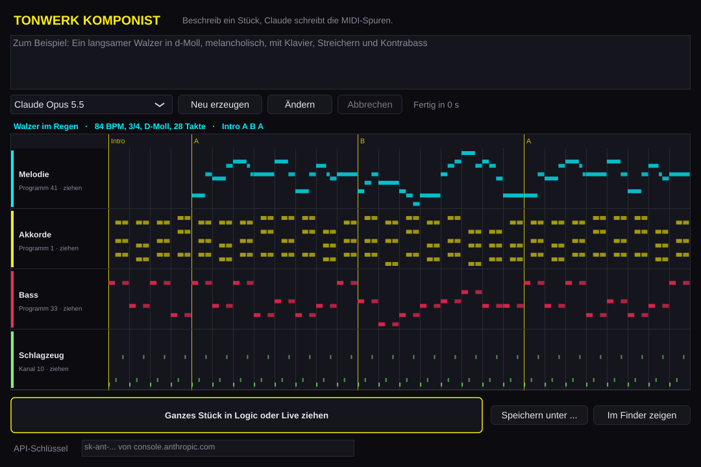

# Tonwerk Komponist

Ein Prototyp: Du beschreibst ein Stück in ein paar Worten, zum Beispiel „Ein langsamer Walzer in d-Moll, melancholisch, mit Klavier, Streichern und Kontrabass“, und Claude schreibt es als MIDI-Datei mit einer Spur je Instrument. Die ziehst du per Drag & Drop in Logic Pro oder Ableton Live und spielst sie mit deinen eigenen Instrumenten.



## So geht's

1. Unten den API-Schlüssel eintragen (von [console.anthropic.com](https://console.anthropic.com)). Die App nimmt sonst `ANTHROPIC_API_KEY` oder die Datei `~/.config/tonwerk/anthropic.key`, die auch Tonwerk-AI liest.
2. Oben beschreiben, was du hören willst: Stil, Tonart, Tempo, Taktart, Instrumente, Länge. Was du weglässt, wählt Claude passend (sonst etwa 24 bis 40 Takte mit Melodie, Akkorden, Bass und Schlagzeug).
3. **Neu erzeugen**. Nach meist ein bis drei Minuten erscheint das Stück als Pianoroll, mit Teilen (Intro, A, B …), Tempo, Taktart und Tonart.
4. Die gelbe Fläche **Ganzes Stück in Logic oder Live ziehen** auf eine Spur oder in den leeren Bereich ziehen. Logic und Live legen für jede MIDI-Spur eine eigene Spur an, mit Namen, Tempo und Taktart. Ein Spurname links in der Pianoroll lässt sich auch einzeln ziehen, etwa nur der Bass als Clip in Live.
5. **Ändern** schickt das aktuelle Stück mit deinem Text als Änderungswunsch, zum Beispiel „Melodie eine Oktave höher und den B-Teil lauter“ oder „ohne Schlagzeug“.

Jedes Stück wird in `Musik/Tonwerk Komponist` gespeichert (einzeln gezogene Spuren im Unterordner `Spuren`), so bleibt die Datei da, wo Logic oder Live sie gefunden hat. **Speichern unter …** legt eine Kopie woanders ab.

Die Datei ist General MIDI: Programmnummern für die Instrumente, das Schlagzeug auf Kanal 10 nach der GM-Drum-Map (Kick 36, Snare 38, Hi-Hat 42 …), passend etwa für Tonwerk Drums oder Logics Drum Kits.

## Modelle und Kosten

Zur Wahl stehen Claude Opus 5.5 (Standard), Claude Sonnet 5.5 (schneller und günstiger) und Claude Fable 5.1 (am stärksten, teurer). Die Anfrage läuft direkt von deinem Rechner an die Anthropic-API und wird über deinen Schlüssel abgerechnet; ein Stück kostet je nach Länge und Modell grob 10 Cent (Sonnet) bis 1 Euro (Fable), mit Opus meist um 30 bis 50 Cent. Lehnt ein Modell eine Anfrage ab, versucht die API es von sich aus mit einem anderen.

## Bauen

Ein eigenes CMake-Projekt neben den Plugins (noch nicht in ihren Releases):

```sh
cmake -S komponist -B build-komponist -DCMAKE_BUILD_TYPE=Release
cmake --build build-komponist --target TonwerkKomponist
open "build-komponist/TonwerkKomponist_artefacts/Release/Tonwerk Komponist.app"
```

Jeder Lauf von CI (`.github/workflows/komponist.yml`) legt die Mac-App als Artefakt `Tonwerk-Komponist-macOS` ab. Von Hand mit einer Version gestartet (Actions → Komponist → Run workflow), veröffentlicht der Lauf sie außerdem als Vorabversion `komponist-v<Version>` unter den Releases, getrennt von den Plugin-Releases. Von Hand gestartete Läufe signieren die App mit Developer ID und lassen sie von Apple notarisieren (dieselben Geheimnisse wie die Plugin-Releases), sie öffnet sich dann ohne Rückfrage. Das Artefakt gewöhnlicher Läufe bleibt ad hoc signiert; dafür nach dem Herunterladen einmal `xattr -dr com.apple.quarantine "Tonwerk Komponist.app"` oder Rechtsklick → Öffnen.

Tests: `cmake --build build-komponist --target TonwerkKomponistTests && ctest --test-dir build-komponist`. Mit `python3 komponist/tests/fake-api.py 8765 &` und `KOMPONIST_API_URL=http://127.0.0.1:8765/v1/messages` gehen sie auch den ganzen Weg über HTTP. `KOMPONIST_OPEN=komponist/examples/walzer.json` zeigt ein Stück im Format, das Claude schreibt, ohne Schlüssel (ein von Hand geschriebenes Beispiel).

## Stand

Gebaut und getestet unter Linux, mit einem nachgebauten API-Server. Noch nicht gegen die echte API gelaufen (in der Cloud-Umgebung gibt es keinen Schlüssel) und noch nicht auf dem Mac, in Logic oder in Live ausprobiert.
